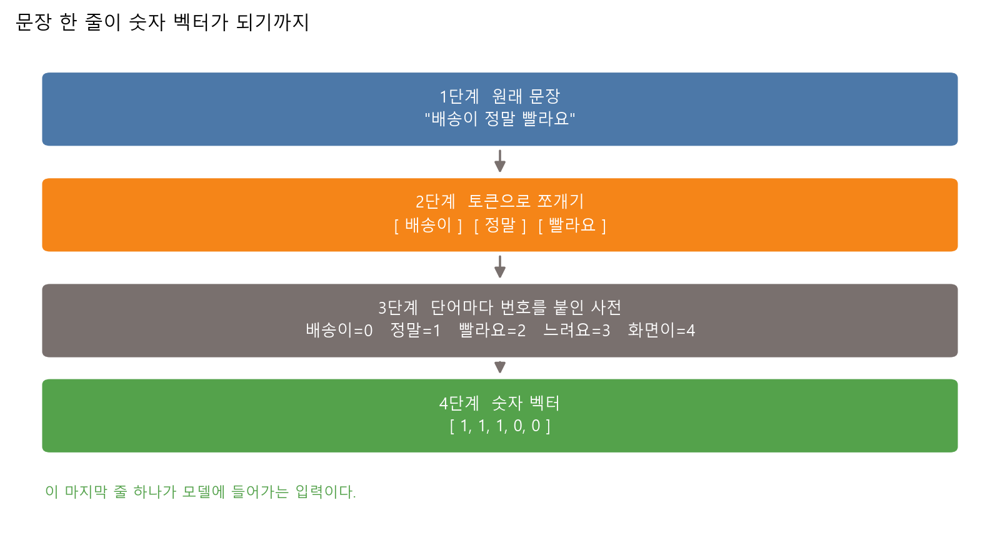
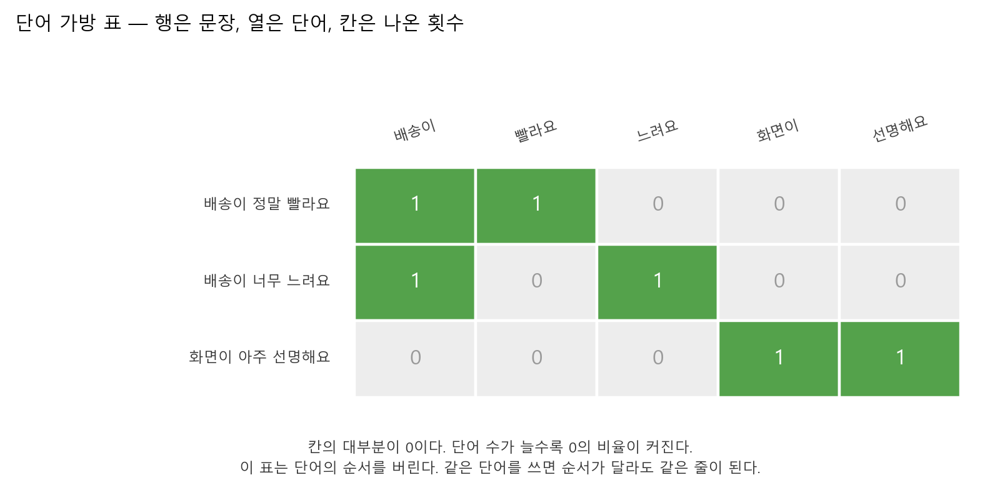

# 제10장 자연어 처리 — 컴퓨터가 글을 다루는 방식

---

### 학습 목표

- 자연어 처리가 무엇이고 어떤 일을 하는지 작업 종류로 말한다
- 자연어 처리가 규칙 기반 → 통계 기반 → 신경망 → 대규모 언어모델로 바뀐 과정을 설명한다
- 형태소 분석기 Kiwi를 설치하고, 한국어 문장을 형태소로 쪼갠다
- 단어 가방과 TF-IDF로 문장을 숫자로 바꾸고, 뉴스 제목의 주제를 분류한다
- 공백으로 자른 경우와 형태소로 쪼갠 경우의 분류 정확도 차이를 실험 결과로 설명한다

### 실행 환경

```bash
cd practice/chapter10
python -m pip install -r ../requirements.txt
python -m pip install kiwipiepy pyarrow
```

- `kiwipiepy`는 형태소 분석기 Kiwi, `pyarrow`는 실습 10.2의 데이터 파일(parquet)을 읽는 패키지다
- 실습 10.2는 처음 실행할 때 인터넷에서 데이터 약 5MB를 내려받는다. GPU는 필요 없다

---

### 1. 자연어 처리란

○ **자연어 처리**(natural language processing, NLP) — 사람이 쓰는 말과 글을 컴퓨터가 다루게 하는 분야
  - 자연어는 한국어·영어처럼 사람이 일상에서 쓰는 언어이고, 프로그래밍 언어와 구별하려고 붙인 이름이다

○ **컴퓨터는 글자의 뜻을 모른다**
  - 파일 안에서 '가'는 44032번, '나'는 45208번 같은 번호로 저장된다
  - '가'와 '나'의 번호 차이는 1176, '가'와 '개'의 차이는 28이지만, '가'가 '개'에 더 가까운 낱말인 것은 아니다. 글자 번호에는 뜻이 없다
  - 그래서 문장을 모델에 넣으려면 뜻이 비슷한 문장이 비슷한 숫자를 받도록 바꾸는 단계가 필요하다



**그림 10.1** 문장 → 토큰 → 사전 → 벡터. 마지막 줄 `[1, 1, 1, 0, 0]`이 모델에 들어간다. 그림은 개념을 보여 주려고 손으로 만든 도식이다

○ **자연어가 어려운 이유**
  - 같은 낱말이 여러 뜻을 가진다. "배"는 과일, 탈것, 몸의 한 부분일 수 있고, 앞뒤 문장을 봐야 뜻이 정해진다
  - 같은 뜻을 여러 낱말로 쓴다. "배송이 빨라요"와 "택배가 하루 만에 왔어요"는 겹치는 낱말이 없지만 같은 이야기다
  - 한국어는 낱말 뒤에 조사와 어미가 붙는다. "배송이", "배송은", "배송도"는 컴퓨터에게 서로 다른 글자 줄이다

---

### 2. 자연어 처리가 하는 일

같은 문장을 넣어도 무엇을 출력하게 하느냐에 따라 작업이 달라진다.

**표 10.1** 문장으로 하는 대표 작업

| 작업 | 컴퓨터가 내놓는 것 | 예 |
|---|---|---|
| 텍스트 분류(text classification) | 문장 하나에 이름표 하나 | 뉴스 제목의 주제 가리기(실습 10.2), 리뷰가 긍정인지 부정인지 |
| 토큰 분류(token classification) | 토큰마다 이름표 하나 | "서울에서 김철수가 주문했다"에서 "서울"은 장소, "김철수"는 사람이라고 표시하기 |
| 문장 유사도(sentence similarity) | 두 문장이 닮은 정도를 나타내는 숫자 | 비슷한 문의 글 찾기 |
| 특징 추출(feature extraction) | 문장이나 단어의 벡터 | 문장을 벡터로 바꿔 검색·추천에 쓰기 |
| 질의응답(question answering) | 질문에 대한 답 | 제품 설명서에서 "충전 시간은?"의 답 찾기 |
| 요약(summarization) | 짧게 줄인 글 | 긴 회의록을 몇 줄로 줄이기 |
| 번역(translation) | 다른 언어로 옮긴 글 | 한국어 기사를 영어로 옮기기 |
| 텍스트 생성(text generation) | 이어지는 글 | 다음 단어를 예측해 문장 이어 쓰기(11장) |

_참고: 작업 이름은 Hugging Face Tasks 페이지(https://huggingface.co/tasks, 2026년 11월 확인)의 Natural Language Processing 분류에서 골랐다. 각 작업의 예는 이 장의 내용에 맞춰 직접 든 것이다_

○ **텍스트 분류와 토큰 분류** — 텍스트 분류는 문장 전체에 이름표 하나를 붙이고, 토큰 분류는 토큰마다 이름표를 붙인다. 9장의 이미지 분류와 의미 분할(픽셀마다 이름표)의 관계와 같다

---

### 3. 자연어 처리의 발전 과정


**그림 10.2** 자연어 처리는 사람이 규칙을 적는 방식에서, 데이터에서 횟수를 세는 방식, 신경망이 배우는 방식으로 바뀌었다. 연도의 출처는 각 항목의 각주에 있다

#### 3-1. 규칙 기반 — 사람이 규칙을 적는다

○ **조지타운-IBM 실험**(1954)[^georgetown]
  - 러시아어 문장 60여 개를 영어로 자동 번역해 보였다
  - 번역 프로그램에 든 것은 문법 규칙 6개와 어휘 250개였다

○ **ELIZA**(1966)[^eliza]
  - MIT의 요제프 바이첸바움(Joseph Weizenbaum)이 만든 대화 프로그램이다
  - 사용자가 쓴 문장에서 미리 정한 핵심 낱말을 찾고, 그 낱말에 딸린 응답 틀에 사용자의 말 일부를 끼워 넣어 답했다

○ **한계** — 언어의 모든 경우를 사람이 규칙으로 적을 수 없다. 규칙에 없는 문장이 들어오면 프로그램이 답하지 못한다

#### 3-2. 통계 기반 — 많은 문장에서 횟수를 센다

○ **생각의 전환** — 규칙을 적는 대신, 문장을 많이 모아 어떤 낱말이 어떤 결과와 함께 자주 나오는지 센다
  - 예: "코스피"가 든 제목이 경제 기사에 자주 나오면, "코스피"를 경제 쪽 근거로 쓴다
  - 문장을 숫자로 바꾸는 대표 방법이 단어 가방과 TF-IDF다(5절). 실습 10.2가 이 방법을 쓴다

○ **한계** — 낱말이 겹치지 않으면 관계를 알지 못한다. "배송"과 "택배"가 같은 것을 가리킨다는 정보가 숫자 어디에도 없다

#### 3-3. 신경망과 임베딩 — 낱말을 실수 벡터로 바꾼다

○ **word2vec**(2013)[^word2vec] — 주변 낱말로 가운데 낱말을 맞히거나 가운데 낱말로 주변 낱말을 맞히도록 작은 신경망을 학습시켜, 낱말마다 실수 벡터(임베딩)를 얻었다
  - 비슷한 자리에 나오는 낱말은 벡터도 비슷해진다. "배송"과 "택배"처럼 같은 낱말 옆에 자주 나오는 두 낱말은 서로 겹치지 않아도 가까워진다

○ **seq2seq**(2014)[^seq2seq] — 순환 신경망(RNN, 단어를 하나씩 순서대로 읽으며 앞 내용을 기억하는 신경망)이 문장 하나를 읽고 다른 문장 하나를 써낸다
  - 번역처럼 문장을 받아 문장을 내는 일을 신경망 하나로 처리했다

○ **한계** — 순환 신경망은 단어를 하나씩 차례로 읽으므로, 긴 문장에서는 앞 내용을 잊기 쉽고 계산을 나눠서 동시에 하기 어렵다

#### 3-4. 트랜스포머와 대규모 언어모델 — 먼저 크게 배우고 일에 맞춘다

○ **트랜스포머**(2017)[^transformer] — 문장 안의 모든 단어가 서로를 얼마나 참고할지(어텐션)를 한꺼번에 계산한다
  - 단어를 차례로 읽지 않으므로 계산을 동시에 할 수 있고, 먼 단어 사이의 관계도 바로 본다

○ **BERT**(2018)[^bert] — 큰 말뭉치에서 가려 둔 단어를 맞히며 먼저 학습(사전학습)한 뒤, 분류 같은 개별 작업에 맞춰 조금 더 학습(미세조정)한다

○ **GPT-3**(2020)[^gpt3] — 다음 단어를 예측하도록 크게 키운 언어모델이다. 따로 다시 학습하지 않고 프롬프트에 예시 몇 개만 넣어도 여러 작업을 했다

○ **ChatGPT**(2022년 11월)[^chatgpt] — 대규모 언어모델을 대화 형식으로 쓰게 한 서비스다. 다음 단어를 예측하는 원리와 그 한계는 11장에서 다룬다

#### 3-5. 한국어 자연어 처리

○ **형태소 분석이 먼저다** — 한국어는 낱말에 조사와 어미가 붙으므로, 문장을 뜻을 가진 가장 작은 단위인 **형태소**로 쪼개는 일이 앞단에 온다(4절)

○ **KLUE**(2021)[^klue] — 한국어 이해 능력을 평가하려고 만든 공개 과제 모음이다. 주제 분류를 포함한 8개 과제로 이루어지고, 실습 10.2의 데이터 YNAT가 그중 주제 분류 과제다

**표 10.2** 시기별 정리

| 시기 | 컴퓨터가 배우는 방식 | 대표 사례 | 남은 한계 |
|---|---|---|---|
| 규칙 기반 | 사람이 적은 규칙을 따른다 | 조지타운-IBM, ELIZA | 규칙에 없는 문장을 못 다룬다 |
| 통계 기반 | 낱말 횟수를 세어 확률로 판단한다 | 단어 가방, TF-IDF | 낱말이 안 겹치면 관계를 모른다 |
| 신경망·임베딩 | 낱말을 실수 벡터로 바꿔 배운다 | word2vec, seq2seq | 긴 문장을 차례로 읽기 어렵다 |
| 트랜스포머·대규모 언어모델 | 큰 말뭉치로 먼저 배우고 일에 맞춘다 | BERT, GPT-3, ChatGPT | 그럴듯하지만 틀린 문장을 쓴다(11장) |

---

### 4. 한국어 형태소 분석

○ **형태소**(morpheme) — 뜻을 가진 가장 작은 말의 단위
  - "배송이"는 "배송"(일반명사) + "이"(조사)로, "빨라요"는 "빠르"(형용사) + "어요"(어미)로 나뉜다

○ **형태소 분석기** — 문장을 형태소로 쪼개고 각 형태소에 품사를 붙이는 프로그램
  - 공백으로만 자르면 "배송이", "배송은", "배송도"가 서로 다른 단어 세 개가 된다
  - 형태소 분석기로 쪼개면 셋 다 "배송"이 남아 한 단어로 모인다

○ **Kiwi**[^kiwi] — 파이썬에서 `pip install kiwipiepy` 한 줄로 설치하는 한국어 형태소 분석기다(Apache-2.0 라이선스)

---

### 실습 10.1: Kiwi 설치와 형태소 분석

#### 실습 목표

- Kiwi를 설치하고, 같은 문장을 공백으로 자른 결과와 형태소로 쪼갠 결과를 비교한다
- 조사만 다른 문장들에서 사전 크기가 얼마나 줄어드는지 센다

#### 실행 명령과 핵심 코드

```bash
python -m pip install kiwipiepy
cd practice/chapter10/code
python 10-1-kiwi-morphemes.py
```

- 파일 맨 위의 `MY_SENTENCES`에 자기 문장을 넣어 다시 실행한다
- 뜻을 담은 형태소(명사·동사·형용사 등)만 남기는 부분이 실습 10.2에서도 쓰인다. 불규칙 활용 표지("VA-I"의 "-I")는 떼고 비교한다

```python
from kiwipiepy import Kiwi
kiwi = Kiwi()
tokens = kiwi.tokenize("배송이 정말 빨라요")   # Token(form='배송', tag='NNG', ...) 목록
kept = [t.form for t in tokens if t.tag.split("-")[0] in KEEP_TAGS]
```

_전체 코드는 `practice/chapter10/code/10-1-kiwi-morphemes.py` 참고_

#### 실행 결과

```text
문장1  배송이 정말 빨라요
  공백으로 자르기 3개: 배송이 | 정말 | 빨라요
  Kiwi로 쪼개기   5개: 배송/NNG | 이/JKS | 정말/MAG | 빠르/VA | 어요/EF
  뜻을 담은 형태소만 남기기: 배송 | 빠르

문장2  삼성전자가 새 스마트폰을 공개했다
  공백으로 자르기 4개: 삼성전자가 | 새 | 스마트폰을 | 공개했다
  Kiwi로 쪼개기   9개: 삼성전자/NNP | 가/JKS | 새/MM | 스마트폰/NNG | 을/JKO | 공개/NNG | 하/XSV | 었/EP | 다/EF
  뜻을 담은 형태소만 남기기: 삼성전자 | 스마트폰 | 공개
```

_출처: `practice/chapter10/results/10-1-kiwi-morphemes.log`_

```text
공백으로 자른 사전: 14개 -> 느렸어요, 만에, 배송도, 배송은, 배송이, 빨라요, 선명해요, 어두워요, 왔어요, 커요, 하루, 화면도, 화면은, 화면이
Kiwi로 만든 사전:   9개 -> 느리, 배송, 빠르, 선명, 어둡, 오, 크, 하루, 화면
```

_출처: `practice/chapter10/results/10-1-kiwi-morphemes.log`_

#### 결과 읽기

○ **Kiwi는 조사와 어미를 떼어 낸다**
  - "배송이"가 "배송/NNG"(일반명사)와 "이/JKS"(주격조사)로 나뉘었다
  - "공개했다"는 "공개 + 하 + 었 + 다" 네 형태소가 되었다. 뜻을 담은 것은 "공개" 하나다

○ **사전이 14개에서 9개로 줄었다**
  - 문장 6개("배송이 빨라요", "배송은 느렸어요", "화면도 커요" 등)를 공백으로 자르면 "배송"이 "배송이·배송은·배송도" 세 단어로, "화면"이 세 단어로 갈린다
  - Kiwi로 쪼개면 각각 "배송", "화면" 한 단어로 모인다

#### 해 보기

1. `MY_SENTENCES`에 줄임말이나 신조어가 든 문장을 넣는다. Kiwi는 어떻게 쪼개는가
2. "나는 밥을 먹었다"와 "밥을 나는 먹었다"를 넣고, 남는 형태소가 같은지 본다

---

### 5. 문장을 숫자로 바꿔 분류하기

#### 5-1. 단어 가방과 TF-IDF

○ **단어 가방**(bag of words) — 사전의 단어마다 열을 하나씩 만들고, 문장에 그 단어가 몇 번 나왔는지 칸에 적는다
  - 행은 문장, 열은 단어다. 단어를 가방에 쏟아 담듯 순서는 버린다



**그림 10.3** 초록 칸이 1, 회색 칸이 0이다. 한 문장은 단어 몇 개만 쓰므로 칸 대부분이 0이다

○ **TF-IDF** — 단어 가방의 칸 값을 고친다
  - 여러 문장에 흔히 나오는 단어의 값은 낮추고, 적은 문장에만 나오는 단어의 값은 높인다
  - 주제를 가르는 데 쓸모 있는 단어에 무게가 실린다

#### 5-2. 주제별로 단어에 가중치를 붙인다

○ **로지스틱 회귀로 분류한다**(4장)
  - 학습이 끝나면 주제마다, 단어마다 가중치가 하나씩 붙는다. 주제가 7개면 단어 하나에 가중치가 7개다
  - 새 제목이 들어오면 제목에 든 단어의 가중치를 주제별로 더하고, 합이 가장 큰 주제를 고른다
  - 사전에 없는 단어는 가중치가 없으므로 덧셈에서 빠진다

○ **실습 전에 세우는 예측**
  - 공백으로 자르면 "코스피가", "코스피는"이 다른 단어가 되어 같은 근거가 여러 칸으로 흩어진다
  - Kiwi로 쪼개면 "코스피" 한 칸에 모이므로 정확도가 오를 것이다

---

### 실습 10.2: 뉴스 제목 주제 분류

#### 실습 목표

- 뉴스 제목을 IT과학·경제·사회·생활문화·세계·스포츠·정치 7개 주제로 분류한다
- 공백으로 자른 경우와 Kiwi 형태소로 쪼갠 경우의 정확도를 비교한다
- 주제마다 판단을 좌우하는 단어와 자주 헷갈리는 주제를 찾는다

#### 데이터

- KLUE의 **YNAT**: 연합뉴스 기사 제목에 주제 하나를 붙인 공개 데이터다[^klue]. 훈련 세트 45,678개, 검증 세트 9,107개이고, 기사 날짜는 2016~2019년이다. 라이선스는 CC BY-SA 4.0이다[^ynat]
- 수업 시간 안에 끝나도록 훈련 세트에서 10,000개, 검증 세트에서 2,000개를 무작위로 뽑아 쓴다(seed 42)

#### 실행 명령과 핵심 코드

```bash
cd practice/chapter10/code
python 10-2-topic-classification.py
```

- 파일 맨 위의 `MY_HEADLINES`에 자기가 쓴 제목을 넣으면 5단계에서 주제를 맞혀 본다
- `analyzer=lambda tokens: tokens`는 이미 쪼갠 단어 목록을 그대로 쓰라는 설정이고, `min_df=2`는 두 번 이상 나온 단어만 사전에 넣으라는 설정이다

```python
vectorizer = TfidfVectorizer(analyzer=lambda tokens: tokens, min_df=2)
x_train = vectorizer.fit_transform(train_tokens)        # 쪼갠 제목 -> TF-IDF 표
model = LogisticRegression(max_iter=1000, random_state=RANDOM_SEED)
model.fit(x_train, y_train)
```

_전체 코드는 `practice/chapter10/code/10-2-topic-classification.py` 참고_

#### 실행 결과

```text
주제별 제목 수
        훈련   시험
IT과학  1137  118
경제    1332  308
사회    1133  794
생활문화  1198  314
세계    1846  193
스포츠   1754  111
정치    1600  162

제목: 한미 연구진 스스로 광합성하는 인공세포 제작 성공
  공백으로 자르기: 한미 | 연구진 | 스스로 | 광합성하는 | 인공세포 | 제작 | 성공
  Kiwi(뜻을 담은 형태소): 한미 | 연구진 | 광합성 | 인공 | 세포 | 제작 | 성공

방법                             사전 크기      시험 정확도
기준선(가장 많은 주제로만 답하기)          -       0.097
공백으로 자르기                   8,832       0.605
Kiwi 형태소                     7,225       0.741
```

_출처: `practice/chapter10/results/10-2-topic-classification.log`_

```text
=== 4단계. 주제마다 판단을 좌우하는 단어 (Kiwi 모델) ===
  IT과학   AI, 출시, G, 네이버, 개발
  경제     투자, 코스피, 금융, 분기, 대출
  사회     KBS, MBC, 사장, 노조, 방통위
  생활문화   신간, 여행, 소설, 축제, 출간
  세계     美, 中, 트럼프, 이란, 日
  스포츠    감독, 류현진, 월드컵, 축구, 배구
  정치     北, 대통령, 朴, 한국당, 북한

가장 많이 헷갈린 짝: 정답 사회 -> 예측 생활문화 63건
```

_출처: `practice/chapter10/results/10-2-topic-classification.log`_


**그림 10.4** 행은 정답 주제, 열은 모델이 고른 주제다. 대각선 칸이 맞힌 제목 수다. 사회 행에 대각선 밖의 숫자가 가장 많다

```text
  올여름 바닷가 피서객 작년보다 늘어
    -> 경제 0.31, 다음 생활문화 0.25
```

_출처: `practice/chapter10/results/10-2-topic-classification.log`_

#### 결과 읽기

○ **예측이 맞았다: Kiwi로 쪼개면 정확도가 0.605에서 0.741로 올랐다**
  - 사전은 8,832개에서 7,225개로 줄었다. 조사만 다른 단어가 한 칸에 모였기 때문이다
  - "광합성하는"이 "광합성"으로, "인공세포"가 "인공"과 "세포"로 나뉘어, 다른 제목과 겹치는 단어가 늘었다

○ **기준선 0.097 — 제목을 읽지 않고 한 주제로만 찍었을 때의 정확도**
  - 기준선은 제목을 읽지 않고 모든 제목에 같은 주제 하나로 답하는 방법이다. 모델이 이보다 높아야 제목에서 무언가를 배웠다고 말할 수 있다
  - 찍을 주제는 훈련 데이터에서 가장 많은 주제로 정한다. 훈련 10,000개 중 세계가 1,846개로 가장 많으므로, 시험 제목 2,000개 전부에 "세계"라고 답한다

○ **주제를 가르는 단어는 사람이 봐도 납득된다**
  - 경제에는 "코스피", "금융", 스포츠에는 "류현진", "월드컵"이 올라왔다
  - "美", "中", "北", "朴"처럼 뉴스 제목에서 쓰는 한자 약칭이 세계·정치의 근거가 되었다. 2016~2019년 기사 제목에서 배운 단어이므로, 다른 시기의 제목에는 맞지 않을 수 있다

○ **사회 주제를 가장 많이 헷갈렸다**
  - 사회 794개 중 519개(0.654)만 맞혔고, 가장 많이 잘못 보낸 곳은 생활문화(63건)다
  - 사회 기사는 여러 주제의 낱말을 함께 쓴다. KLUE 논문도 제목만으로는 주제를 정확히 가리기 어려운 경우가 많아, 여러 사람이 합의한 제목만 남겼다고 적었다[^klue]

○ **내가 쓴 제목** — "올여름 바닷가 피서객 작년보다 늘어"는 경제 0.31, 생활문화 0.25로 두 주제 사이에서 갈렸다. 확률이 낮으면 모델이 확신하지 못한 것이다

#### 해 보기

1. `MY_HEADLINES`에 오늘 뉴스 제목 다섯 개를 넣는다. 몇 개를 맞히는가
2. `TRAIN_SIZE`를 3,000과 30,000으로 바꿔 Kiwi 방법의 정확도를 비교한다
3. 10-2 파일의 `KEEP_TAGS`에서 동사·형용사(`VV`, `VA`)를 빼고 명사만 남기면 정확도는 어떻게 되는가

---

### 과제 (LMS 제출)

- 수업 시간에 실습을 실행했는지만 확인한다. 따로 보고서를 쓰지 않는다
- 제출물: 실습 10.2를 실행하면 만들어지는 파일 두 개
  1. `practice/chapter10/results/topic_confusion.png`
  2. `practice/chapter10/results/my_headlines.csv` (`MY_HEADLINES`에 자기가 고른 뉴스 제목 다섯 개를 넣고 실행한 결과)
- 평가 기준: 두 파일을 올리면 완료로 인정한다. 정확도는 채점하지 않는다
- 마감: 실습 수업일 포함 7일 이내

---

### 핵심 정리

| 개념 | 한 줄 정리 |
|---|---|
| 자연어 처리 | 사람의 말과 글을 컴퓨터가 다루게 하는 분야. 분류·번역·요약·생성 등 출력에 따라 작업이 나뉜다 |
| 발전 과정 | 규칙 기반 → 통계 기반 → 신경망·임베딩 → 트랜스포머·대규모 언어모델 |
| 형태소 분석 | 문장을 뜻을 가진 가장 작은 단위로 쪼갠다. 한국어에서는 조사·어미를 떼어 같은 낱말을 한 칸에 모은다 |
| Kiwi | `pip install kiwipiepy`로 설치하는 한국어 형태소 분석기 |
| 단어 가방·TF-IDF | 단어마다 열을 두고 횟수를 적는다. TF-IDF는 흔한 단어의 값을 낮춘다 |
| 주제 분류 | 주제별 단어 가중치를 더해 합이 큰 주제를 고른다. 실습에서 Kiwi를 쓰면 0.605 → 0.741 |
| 기준선 | 가장 많은 주제로만 답한 정확도. 훈련과 시험의 주제 비율이 다르면 크게 낮아진다 |

○ **다음 장** — 다음 단어를 예측하는 방식으로 문장을 만들어 내는 언어모델을 다룬다

---

[^georgetown]: "Georgetown–IBM experiment", Wikipedia. https://en.wikipedia.org/wiki/Georgetown%E2%80%93IBM_experiment (2026년 11월 9일 확인)

[^eliza]: "ELIZA", Wikipedia. https://en.wikipedia.org/wiki/ELIZA (2026년 11월 9일 확인)

[^word2vec]: Mikolov, T. et al. (2013). Efficient Estimation of Word Representations in Vector Space. arXiv:1301.3781

[^seq2seq]: Sutskever, I. et al. (2014). Sequence to Sequence Learning with Neural Networks. arXiv:1409.3215

[^transformer]: Vaswani, A. et al. (2017). Attention Is All You Need. arXiv:1706.03762

[^bert]: Devlin, J. et al. (2018). BERT: Pre-training of Deep Bidirectional Transformers for Language Understanding. arXiv:1810.04805

[^gpt3]: Brown, T. B. et al. (2020). Language Models are Few-Shot Learners. arXiv:2005.14165

[^chatgpt]: OpenAI, "Introducing ChatGPT". https://openai.com/index/chatgpt/

[^klue]: Park, S. et al. (2021). KLUE: Korean Language Understanding Evaluation. arXiv:2105.09680

[^ynat]: KLUE 데이터 카드. https://huggingface.co/datasets/klue/klue (2026년 11월 9일 확인)

[^kiwi]: bab2min, kiwipiepy. https://github.com/bab2min/kiwipiepy (2026년 11월 9일 확인)
