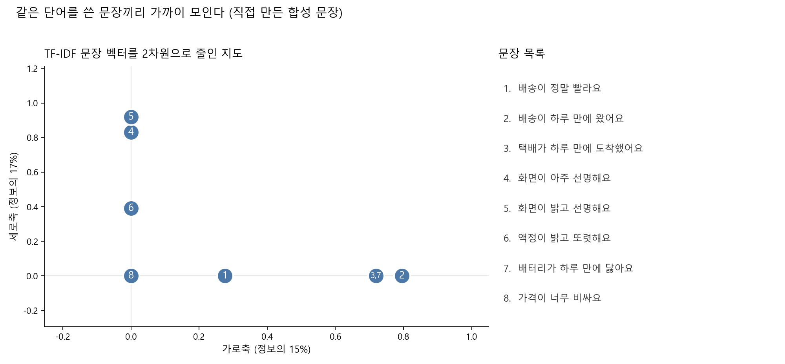
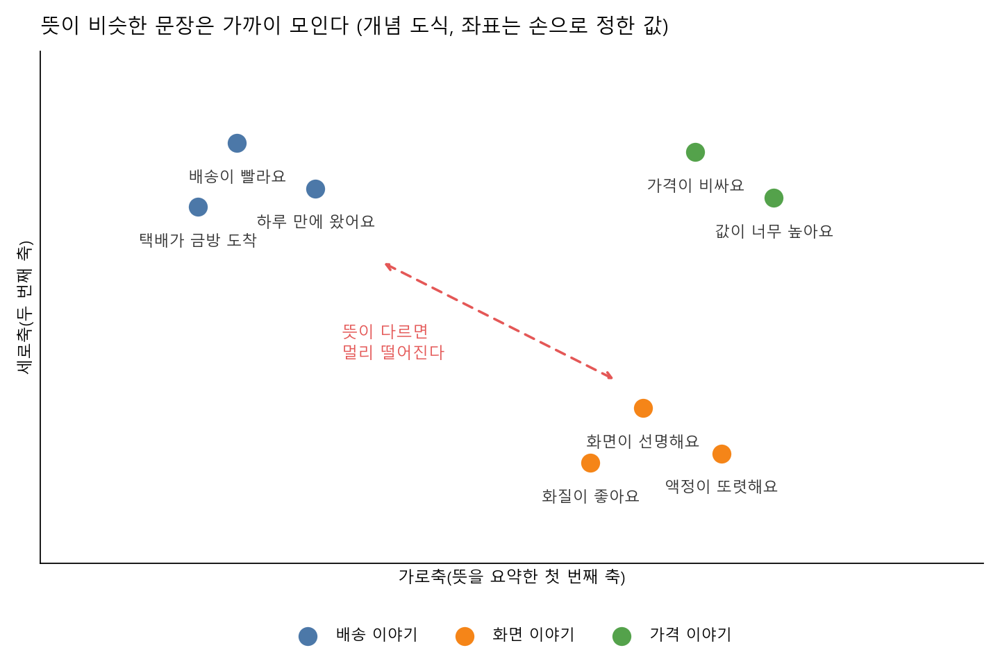
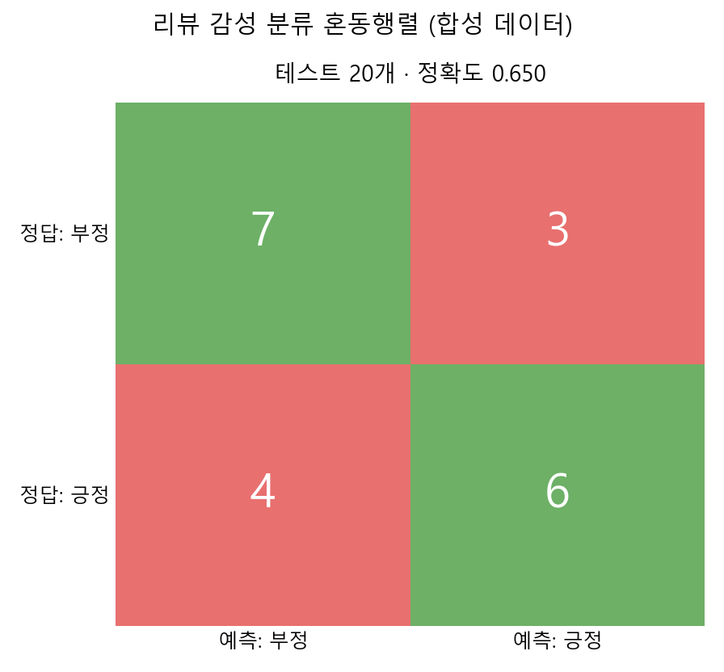
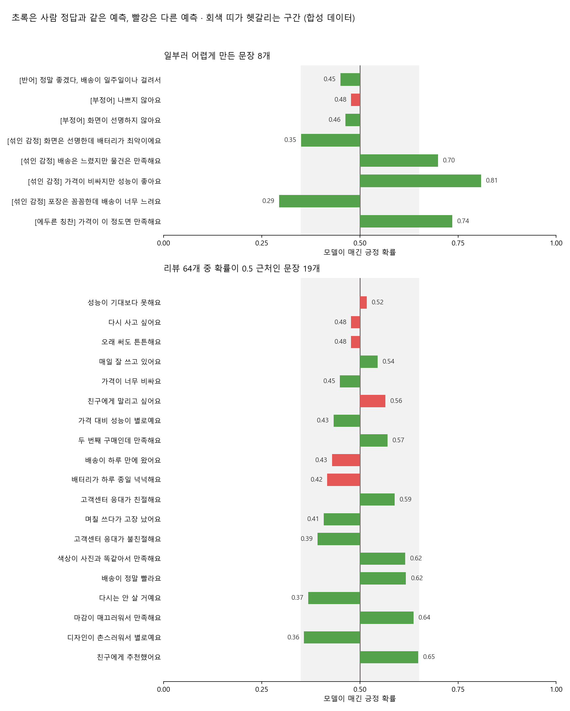
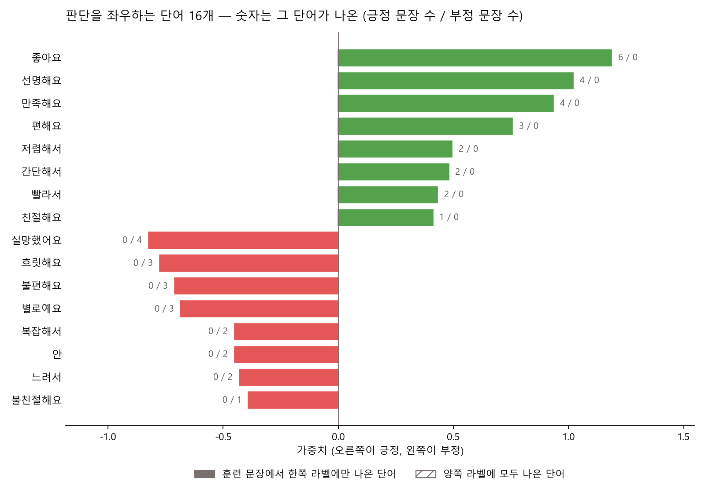

# 제10장 텍스트와 임베딩 — 문장을 숫자로 바꾸기

---

### 학습 목표

- 컴퓨터가 글자를 직접 다루지 못하는 이유를 설명한다
- 문장을 토큰으로 쪼개고, 한국어에서 이 작업이 왜 까다로운지 말한다
- 단어 가방 표의 행과 열을 읽고, 두 문장의 코사인 유사도를 손으로 계산한다
- 뜻이 같은 두 문장의 유사도가 0이 되는 경우를 실험 결과로 설명한다
- 이웃 단어를 세어 만든 단어 벡터가 무엇을 해결하고 무엇을 해결하지 못하는지 설명한다
- 단어 가중치를 더해 긍정 확률을 손으로 계산하고, 학습 문장이 치우치면 무엇이 달라지는지 확인한다
- 자연어 처리의 대표 작업을 말한다

○ **이 장의 질문**
  - 지난 장에서는 이미지 한 장을 숫자 64개로 펴서 모델에 넣었다. 이번 장에서는 같은 질문을 문장에 던진다
  - 모델은 덧셈과 곱셈만 하므로, "배송이 정말 빨라요"라는 글자 줄도 숫자 줄로 바뀌어야 한다
  - 숫자로 바꾼 뒤에는 뜻이 비슷한 문장이 비슷한 숫자를 받는지가 관건이다

○ **이 장의 순서** — 9장처럼 문제를 먼저 측정하고 해법을 뒤에 둔다
  - 1~3절: 문장을 단어 가방으로 바꾸고, 두 문장이 얼마나 닮았는지 계산하는 방법을 설명한다
  - 실습 10.1: 그 방법이 어디서 틀리는지 측정한다
  - 4절: 이웃 단어로 단어 벡터를 만드는 임베딩의 원리를 실습 10.1의 5단계 결과로 확인한다
  - 5절과 실습 10.2: 단어 가중치로 문장을 분류하는 원리를 설명하고, 리뷰 분류기를 만들어 흔든다
  - 6절: 학습 문장이 치우치면 생기는 일을 본다
  - 7절: 자연어 처리가 하는 일을 살펴본다

○ **유사도와 확률을 손으로 계산하는 이유**
  - scikit-learn은 유사도와 확률을 함수 하나로 계산해 주므로, 안에서 어떤 덧셈과 곱셈이 일어나는지 보이지 않는다
  - 이 장의 실습 로그는 코사인 유사도 한 개와 긍정 확률 한 개를 덧셈 단위까지 풀어 찍는다. 그래서 숫자 하나가 어느 단어에서 왔는지 따라갈 수 있다

### 실행 환경

```bash
cd practice/chapter10
python -m pip install -r ../requirements.txt
```

- 필요한 패키지는 numpy, pandas, matplotlib, scikit-learn이다
- GPU는 필요 없고, 두 실습 모두 노트북에서 몇 초 안에 끝난다
- 인터넷에서 데이터나 모델을 내려받지 않는다
- 두 실습의 문장은 모두 **수업용으로 직접 쓴 합성 문장**이다. 실제 쇼핑몰 리뷰를 모으지 않았으므로 개인정보가 들어 있지 않다

---

### 1. 컴퓨터는 글자를 모른다

○ **글자는 번호로 저장된다**
  - 파일 안에서 '가'는 44032번, '나'는 45208번 같은 번호로 저장된다
  - 다만 이 번호에는 뜻이 없다

○ **번호끼리 빼 보면 드러난다**
  - '가'와 '나'의 번호 차이는 1176이고, '가'와 '개'의 번호 차이는 28이다
  - 그렇다고 '가'가 '나'보다 '개'에 42배 더 가까운 낱말인 것은 아니다
  - 글자 번호는 글자마다 자리를 정해 주려고 붙인 번호이고, 뜻이 얼마나 가까운지 나타내려고 붙인 번호가 아니다

○ **모델에 넣을 숫자가 가져야 할 성질**
  - 뜻이 비슷한 두 문장은 숫자도 비슷하고, 뜻이 먼 두 문장은 숫자도 멀어야 한다
  - 이 장의 내용은 전부 이 성질을 어떻게 만드는지에 관한 것이다


**그림 10.1** 문장 → 토큰 → 사전 → 벡터. 마지막 줄 `[1, 1, 1, 0, 0]`이 모델에 들어간다. 그림은 개념을 보여 주려고 손으로 만든 도식이고, 실제 숫자는 실습 10.1 로그에서 확인한다

---

### 2. 토큰과 사전

○ **토큰**(token) — 문장을 자를 때 나오는 조각 하나
  - 어디서 자를지는 사람이 정하고, 자르는 규칙에 따라 토큰의 개수와 종류가 달라진다
  - 이 장에서 쓰는 규칙은 두 줄이다

1. 문장부호를 공백으로 바꾼다
2. 공백으로 자른다

- "배송이 정말 빨라요"를 이 규칙으로 자르면 `배송이 | 정말 | 빨라요` 세 조각이 나온다

○ **사전**(vocabulary) — 문장들에서 나온 서로 다른 토큰에 번호를 붙인 목록
  - 실습 10.1에서 문장 8개를 자르면 서로 다른 단어가 19개 나온다
  - 이 19가 문장 하나를 나타내는 숫자 줄의 길이가 된다

○ **한국어가 까다로운 이유**
  - 영어는 공백으로 자르면 대체로 낱말이 나온다. `delivery`가 두 문장에 나오면 같은 단어로 잡힌다
  - 한국어는 낱말 뒤에 조사와 어미가 붙는다. 공백으로만 자르면 "배송이", "배송은", "배송도"가 서로 다른 단어 세 개로 잡힌다
  - "배송이"를 "배송 + 이"로 쪼개 주는 프로그램이 **형태소 분석기**다. 이 장에서는 설치하지 않고, 조사가 붙은 채로 두면 무엇이 망가지는지를 실습 10.2에서 먼저 확인한다

---

### 3. 단어 가방과 코사인 유사도

#### 3-1. 단어 가방 표

○ **단어 가방**(bag of words) — 문장을 숫자 줄로 바꾸는 가장 단순한 방법
  - 사전의 단어마다 열을 하나씩 만들고, 문장에 그 단어가 몇 번 나왔는지 칸에 적는다
  - 행은 문장, 열은 단어, 칸은 나온 횟수다


**그림 10.2** 초록 칸이 1, 회색 칸이 0이다

○ **"가방"이라는 이름** — 단어를 가방에 쏟아 담으면 순서가 사라진다
  - "나는 밥을 먹었다"와 "밥을 나는 먹었다"는 토큰 세 개가 같으므로 표에서 같은 줄이 된다. 두 문장은 뜻도 같으니 잃은 정보가 없다
  - 영어 `dog bites man`과 `man bites dog`는 토큰 세 개가 같은데 뜻이 반대다. 단어 가방은 두 문장을 구분하지 못한다

#### 3-2. 두 문장이 얼마나 닮았는가 — 코사인 유사도

○ **코사인 유사도**(cosine similarity) — 두 화살표가 같은 쪽을 가리키는 정도
  - 표의 한 줄은 숫자 19개짜리 화살표(벡터)로 볼 수 있다
  - 두 줄이 같은 쪽을 가리키면 1, 직각이면 0이다


**그림 10.3** 사전에 단어가 "배송이", "하루" 두 개뿐이라고 가정한 그림이다. 겹치는 단어가 없는 두 문장은 서로 다른 축 위에 놓여 직각을 이루므로 유사도가 0이다. 화살표 좌표는 설명용으로 손으로 정한 값이다

계산 순서는 다음과 같다.

1. 두 줄에서 같은 칸끼리 곱해 모두 더한다
2. 각 줄의 길이를 구한다. 칸마다 제곱해 더한 뒤 제곱근을 씌운다
3. 1의 값을 두 길이의 곱으로 나눈다

○ **칸이 0과 1뿐일 때**
  - 1번 값은 **두 문장에 모두 나온 단어 수**가 된다
  - 줄의 길이는 √(그 문장의 단어 수)가 된다
  - 실습 10.1의 문장2와 문장3으로 계산하면 다음과 같다

```text
  문장2: 배송이 하루 만에 왔어요   -> 1이 찍힌 칸 4개
  문장3: 택배가 하루 만에 도착했어요   -> 1이 찍힌 칸 4개
  두 문장에 모두 1이 찍힌 칸(겹친 단어): 2개 (만에, 하루)
  코사인 유사도 = 같은 칸끼리 곱해 더한 값 / (각 줄의 길이를 곱한 값)
              = 2 / (√4 x √4) = 2 / 4.00 = 0.50
```

_출처: `practice/chapter10/results/10-1-text-to-numbers.log`_

○ **이 계산에서 나오는 성질**
  - **겹친 단어가 0개면 분자가 0이므로 유사도도 0이다**
  - 단어 가방은 글자가 같은 단어가 있는지만 보고, 뜻이 같은지는 보지 않는다

#### 3-3. TF-IDF — 흔한 단어의 무게를 낮춘다

○ **단어 가방의 빈틈** — "하루"처럼 여러 문장에 나오는 단어와 "왔어요"처럼 한 문장에만 나오는 단어가 똑같이 1이다

○ **TF-IDF** — 여러 문장에 나오는 단어의 칸 값을 낮추고, 적은 문장에만 나오는 단어의 칸 값을 높인다
  - 문장2의 칸 값은 다음과 같이 바뀐다

```text
문장2의 TF-IDF 칸 값(0이 아닌 칸만, 줄의 길이를 1로 맞춘 값)
  왔어요    0.60   (이 단어가 나온 문장 1개)
  배송이    0.51   (이 단어가 나온 문장 2개)
  만에     0.44   (이 단어가 나온 문장 3개)
  하루     0.44   (이 단어가 나온 문장 3개)
단어 가방으로 계산한 문장2-문장3 유사도는 0.50, TF-IDF로 계산하면 0.36로 바뀐다.
```

_출처: `practice/chapter10/results/10-1-text-to-numbers.log`_

○ **결과 읽기**
  - 문장2와 문장3이 공유한 "하루"와 "만에"는 문장 3개에 나오는 흔한 단어라서 칸 값이 0.44로 낮아졌다
  - 그래서 유사도가 0.50에서 0.36으로 내려갔다
  - TF-IDF도 겹친 단어의 칸끼리만 곱하므로, 겹치는 단어가 없으면 유사도는 여전히 0이다

#### 3-4. 실습 전에 세우는 예측

3-2의 계산 방식에서 세 가지 결과를 예상할 수 있다.

○ **예측 1: 뜻이 같아도 단어가 안 겹치면 유사도가 0이다**
  - "배송이 정말 빨라요"와 "택배가 하루 만에 도착했어요"는 사람이 보면 같은 이야기다
  - 두 문장에는 겹치는 단어가 하나도 없으므로 분자가 0이 된다

○ **예측 2: 뜻이 달라도 단어가 겹치면 유사도가 0보다 크다**
  - "택배가 하루 만에 도착했어요"와 "배터리가 하루 만에 닳아요"는 칭찬과 불만이다
  - 두 문장은 "하루", "만에"를 공유하므로 분자가 0이 아니다

○ **문제 3: 표가 거의 0으로 채워진다**
  - 한 문장은 단어 서너 개만 쓰는데 열은 사전의 단어 수만큼 있다
  - 문장을 더 모으면 사전이 커지고, 한 문장이 채우는 칸의 비율은 더 작아진다

---

### 실습 10.1: 문장을 숫자로 바꾸고 유사도의 한계를 측정한다

#### 실습 목표

- 토큰, 사전, 단어 가방 표를 출력으로 확인하고 0인 칸의 비율을 센다
- 코사인 유사도를 손으로 한 번 계산하고, TF-IDF 유사도 표에서 예측 1·2를 확인한다
- 2차원으로 줄인 문장 지도에서 무엇이 사라지는지 본다
- (5단계) 이웃 단어로 만든 단어 벡터로 유사도를 다시 계산한다. 5단계 결과는 4절에서 읽는다

#### 데이터

- 합성 한국어 문장 8개다. 두 종류의 짝을 일부러 섞어 뒀다
  - 같은 단어를 공유하는 짝 — 문장1 "배송이 정말 빨라요"와 문장2 "배송이 하루 만에 왔어요"
  - 뜻은 같은데 단어가 하나도 안 겹치는 짝 — 문장1과 문장3 "택배가 하루 만에 도착했어요"
- 5단계에서는 단어 벡터를 만들 합성 문장 22개(`CONTEXT_SENTENCES`)를 따로 쓴다

#### 실행 명령

```bash
cd practice/chapter10/code
python 10-1-text-to-numbers.py
```

#### 핵심 코드

- 파일 맨 위에 학생이 바꿀 목록이 있다

```python
MY_SENTENCES = [
    "배송이 정말 빨라요",
    "배송이 하루 만에 왔어요",
    "택배가 하루 만에 도착했어요",
    ...
]

# 사람이 보기에 뜻이 거의 같은 짝을 번호로 적는다.
MEANING_PAIRS = [(1, 3), (4, 6)]

# 3단계에서 코사인 유사도를 손으로 풀어 볼 문장 짝(번호)
HAND_PAIR = (2, 3)
```

- 문장을 자르는 규칙은 2절의 두 줄을 그대로 옮긴 코드다

```python
def tokenize(text: str) -> list[str]:
    cleaned = re.sub(r"[^\w\s]", " ", text)   # 문장부호를 공백으로
    return [token for token in cleaned.split() if token]   # 공백으로 자르기
```

_전체 코드는 `practice/chapter10/code/10-1-text-to-numbers.py` 참고_

#### 실행 결과

- 1단계에서 문장이 토큰으로 갈린다

```text
문장1  배송이 정말 빨라요
       -> 3개 토큰: 배송이 | 정말 | 빨라요
문장3  택배가 하루 만에 도착했어요
       -> 4개 토큰: 택배가 | 하루 | 만에 | 도착했어요
```

_출처: `practice/chapter10/results/10-1-text-to-numbers.log`_

- 2단계에서 단어 가방 표가 나온다

```text
문장 8개에서 서로 다른 단어 19개가 나왔다.
표의 크기: 8행 x 19열 = 칸 152개
그중 0인 칸: 125개 (82.2%)

두 문장 이상에 나온 단어는 6개다. 그 부분만 떼어 보면 이렇다.
     만에  밝고  배송이  선명해요  하루  화면이
문장1   0   0    1     0   0    0
문장2   1   0    1     0   1    0
문장3   1   0    0     0   1    0
문장4   0   0    0     1   0    1
문장5   0   1    0     1   0    1
문장6   0   1    0     0   0    0
문장7   1   0    0     0   1    0
문장8   0   0    0     0   0    0
```

_출처: `practice/chapter10/results/10-1-text-to-numbers.log`_

- 3단계에서 TF-IDF로 계산한 유사도가 나온다. 손계산 부분은 3-2와 3-3에 옮겨 두었다

```text
전체 28개 짝 가운데 유사도가 정확히 0인 짝이 22개다.

사람이 보기에 뜻이 같은 짝을 컴퓨터는 어떻게 보는가
  문장1: 배송이 정말 빨라요
  문장3: 택배가 하루 만에 도착했어요
  -> 컴퓨터가 계산한 유사도: 0.00

  문장4: 화면이 아주 선명해요
  문장6: 액정이 밝고 또렷해요
  -> 컴퓨터가 계산한 유사도: 0.00
```

_출처: `practice/chapter10/results/10-1-text-to-numbers.log`_

**표 10.1** 유사도가 높은 짝과 0인 짝 (TF-IDF 코사인 유사도)

| 문장 짝 | 겹치는 단어 | 유사도 |
|---|---|---:|
| 문장4 "화면이 아주 선명해요" – 문장5 "화면이 밝고 선명해요" | 화면이, 선명해요 | 0.62 |
| 문장2 "배송이 하루 만에 왔어요" – 문장3 "택배가 하루 만에 도착했어요" | 하루, 만에 | 0.36 |
| 문장2 "배송이 하루 만에 왔어요" – 문장7 "배터리가 하루 만에 닳아요" | 하루, 만에 | 0.36 |
| 문장3 "택배가 하루 만에 도착했어요" – 문장7 "배터리가 하루 만에 닳아요" | 하루, 만에 | 0.34 |
| 문장1 "배송이 정말 빨라요" – 문장3 "택배가 하루 만에 도착했어요" | 없음 | 0.00 |
| 문장4 "화면이 아주 선명해요" – 문장6 "액정이 밝고 또렷해요" | 없음 | 0.00 |

_출처: `practice/chapter10/results/10-1-text-to-numbers.log`_

- 4단계에서 19차원을 2차원으로 줄여 평면에 찍는다
  - `TruncatedSVD`는 숫자 19개짜리 줄을, 정보를 가장 많이 남기는 축 두 개 위의 숫자 2개로 줄이는 계산이다

```text
TF-IDF 벡터의 원래 차원: 19차원
두 축이 담아낸 정보의 비율: 가로축 14.8%, 세로축 17.3%, 합계 32.2%

2차원으로 줄인 뒤 완전히 같은 자리에 놓인 문장
  문장3, 문장7  ->  좌표 (0.719, 0.000)
```

_출처: `practice/chapter10/results/10-1-text-to-numbers.log`_



**그림 10.4** 같은 단어를 쓴 문장끼리 모인다. 점 안의 숫자가 문장 번호이고, "3,7"은 두 문장이 같은 자리에 겹쳤다는 뜻이다

#### 결과 읽기

○ **예측 1이 맞았다: 뜻이 같은 두 짝이 모두 0.00이다**
  - 문장1과 문장3은 둘 다 배송이 빨랐다는 이야기인데 유사도가 0.00이다
  - 문장4와 문장6은 둘 다 화면이 잘 보인다는 이야기인데 역시 0.00이다
  - 28개 짝 중 22개가 0이다
  - 사람이 읽으면 배송 이야기 셋(문장1~3)과 화면 이야기 셋(문장4~6)이 묶이지만, 컴퓨터는 "택배"와 "배송"이 같은 것을 가리킨다는 정보를 어디에서도 얻지 못한다

○ **예측 2도 맞았다: 뜻이 반대인 짝이 0보다 큰 값을 받았다**
  - 문장3 "택배가 하루 만에 도착했어요"와 문장7 "배터리가 하루 만에 닳아요"는 칭찬과 불만인데 유사도가 0.34다
  - 같은 이야기인 문장2–문장3(0.36)과 뜻이 다른 문장2–문장7(0.36)이 같은 값을 받았다
  - "하루 만에"를 공유한다는 이유 하나 때문이다

○ **문제 3: 표의 82.2%가 0이다**
  - 문장 8개, 단어 19개짜리 작은 표인데도 칸 152개 중 125개가 0이다
  - 문장을 늘리면 열은 계속 늘어나는데 한 문장이 채우는 칸은 그 문장의 단어 수 그대로다

○ **2차원 지도에서 문장3과 문장7이 한 점에 겹쳤다**
  - 두 문장의 좌표가 (0.719, 0.000)으로 같다
  - 공유한 "하루", "만에"만 두 축에 남았고, 뜻을 가르는 "도착했어요"와 "닳아요"는 남은 32.2% 밖으로 밀려났다
  - 14.8과 17.3을 더하면 32.1인데 합계가 32.2로 찍힌 것은, 각 축의 값을 반올림해 찍고 합계는 반올림 전 값을 더했기 때문이다
  - 평면에서 가까워 보여도 실제로 가까운 것은 아니다. 정확한 거리는 3단계의 유사도 표에서 읽는다

#### 해 보기

`MY_SENTENCES`를 자기 문장으로 바꿔 다시 실행한다.

1. 뜻이 같은데 단어가 하나도 안 겹치는 짝을 하나 만들어 넣고, `MEANING_PAIRS`에 그 번호를 적는다. 유사도가 0인지 확인한다
2. 두 문장 중 한쪽 단어 하나를 다른 쪽과 같게 고친다. 유사도가 0에서 얼마로 올라가는가
3. `HAND_PAIR`를 (1, 2)로 바꾸고, 로그의 손계산을 보기 전에 먼저 직접 계산해 본다
4. 문장을 12개로 늘리면 0인 칸의 비율이 82.2%에서 어느 쪽으로 움직이는가

○ 2번에서 확인할 것은 **단어 하나가 겹치는 순간 유사도가 0에서 튀어 오른다**는 점이다. 단어 가방의 유사도는 조금씩 닮아 가지 않고, 겹친 단어가 있는지 없는지에 따라 갈린다

---

### 4. 임베딩 — 뜻은 이웃 단어에서 온다

○ **실습 10.1에서 남은 문제**
  - "배송이"와 "택배가"는 표에서 서로 다른 열이었고, 두 열 사이에는 아무 연결이 없었다
  - 그래서 뜻이 같은 문장1과 문장3의 유사도가 0이었다

○ **임베딩**(embedding) — 단어나 문장을 짧은 실수 벡터로 바꾸되, 뜻이 가까운 단어끼리 벡터도 가깝게 놓는 방법

#### 4-1. 임베딩이 단어 가방과 다른 두 가지

Google 머신러닝 단기집중과정은 임베딩을 "희소 데이터의 저차원 표현"으로 정의한다.[^google-emb] 이 정의에 두 가지가 들어 있다.

○ **저차원** — 열의 개수를 줄인다
  - 단어 가방은 사전에 단어가 10만 개면 열도 10만 개다
  - 임베딩은 단어 하나를 수십~수백 개의 숫자로 나타낸다

○ **희소하지 않다** — 칸이 0으로 차 있지 않다
  - 단어 가방의 한 줄은 대부분 0이고 몇 칸만 1이다(실습 10.1에서 82.2%가 0)
  - 임베딩의 한 줄은 모든 칸에 0.31, -0.07 같은 실수가 들어 있다

○ **칸마다 실수가 들어 있으면 달라지는 점**
  - 겹치는 단어가 없는 두 문장도 가까울 수 있다
  - "택배가"와 "배송이"의 벡터를 가깝게 만들어 두면, 두 단어로 만든 문장 벡터도 가까워진다



**그림 10.5** 임베딩으로 만들려는 배치 — 배송 이야기끼리, 화면 이야기끼리 모인다. 좌표는 설명을 위해 손으로 정한 값이다

#### 4-2. 이웃이 같으면 뜻이 가깝다고 본다

○ **두 단어가 비슷하다는 근거 = 이웃 단어**
  - "배송이"와 "택배가"는 한 문장에 같이 나오지 않아도, 둘 다 "하루 만에", "도착했어요", "빨라요" 옆에 나온다
  - 이웃이 같은 두 단어를 뜻이 가까운 단어로 본다

실습 10.1의 5단계는 이 원리를 세 단계로 계산한다.

1. **이웃 표를 만든다** — 합성 문장 22개에서 서로 다른 단어 35개를 뽑아 35행 x 35열 표를 만든다. 칸에는 두 단어가 같은 문장에 함께 나온 문장 수를 적는다. 단어 하나는 이 표의 한 줄, 즉 숫자 35개짜리 벡터가 된다
2. **줄을 짧게 줄인다** — 4단계와 같은 `TruncatedSVD`로 35칸을 3칸으로 줄인다. 이 3칸짜리 벡터가 단어 벡터다
3. **문장 벡터를 만든다** — 문장에 든 단어 벡터의 평균을 문장 벡터로 쓰고, 문장끼리 코사인 유사도를 계산한다

```text
--- 이웃 표에서 두 단어의 줄을 비교한다 ---
  배송이 - 택배가
    같은 문장에 함께 나온 횟수: 0회
    배송이의 이웃 11개, 택배가의 이웃 9개, 공유한 이웃 7개 (늦게, 도착했어요, 만에, 빨라요, 왔어요, 정말, 하루)
    두 줄의 코사인 유사도: 0.70
  화면이 - 액정이
    같은 문장에 함께 나온 횟수: 0회
    화면이의 이웃 7개, 액정이의 이웃 6개, 공유한 이웃 5개 (또렷해요, 밝고, 선명해요, 어두워서, 크고)
    두 줄의 코사인 유사도: 0.77
  배송이 - 화면이
    같은 문장에 함께 나온 횟수: 0회
    배송이의 이웃 11개, 화면이의 이웃 7개, 공유한 이웃 0개 (없음)
    두 줄의 코사인 유사도: 0.00
```

_출처: `practice/chapter10/results/10-1-text-to-numbers.log`_

```text
--- 이웃 표의 한 줄(35칸)을 TruncatedSVD로 3칸으로 줄인다 ---
  배송이   -> [+2.06, +0.00, -1.00]
  택배가   -> [+2.40, -0.00, -1.26]
  화면이   -> [+0.00, +2.42, -0.00]
  배송이 - 택배가 단어 벡터 유사도: 1.00
  화면이 - 액정이 단어 벡터 유사도: 1.00
  배송이 - 화면이 단어 벡터 유사도: 0.00

--- 문장 벡터 = 문장에 든 단어 벡터의 평균 ---
짝         사람 판단       TF-IDF     단어 벡터
문장1-문장3   뜻이 같다         0.00      0.88
문장4-문장6   뜻이 같다         0.00      1.00
문장1-문장4   뜻이 다르다        0.00      0.00
문장3-문장7   뜻이 다르다        0.34      0.81
```

_출처: `practice/chapter10/results/10-1-text-to-numbers.log`_


**그림 10.6** 회색 막대는 TF-IDF, 파랑 막대는 이웃 단어 벡터로 계산한 코사인 유사도다

○ **겹치는 단어가 없던 짝이 가까워졌다**
  - "배송이"와 "택배가"는 같은 문장에 한 번도 같이 나오지 않았다
  - 대신 이웃 7개를 공유해서, 이웃 표의 두 줄이 이루는 유사도가 0.70이다
  - 3칸으로 줄이자 단어 벡터 유사도가 1.00이 되었다. 로그의 "배송이" [+2.06, +0.00, -1.00]과 "택배가" [+2.40, -0.00, -1.26]은 길이만 다르고 거의 같은 방향을 가리킨다
  - 이웃 표의 줄에 있던 차이(유사도 0.70)가 3칸으로 줄이는 과정에서 남지 않았다
  - 그 결과 TF-IDF로 0.00이던 문장1–문장3이 0.88, 문장4–문장6이 1.00이 되었다
  - 이웃을 하나도 공유하지 않은 배송 이야기와 화면 이야기(문장1–문장4)는 0.00 그대로다

○ **이웃만 같으면 뜻이 반대여도 가까워진다**
  - 문장3 "택배가 하루 만에 도착했어요"와 문장7 "배터리가 하루 만에 닳아요"는 TF-IDF로 0.34였는데 단어 벡터로는 0.81로 올라갔다
  - "배터리가"도 "하루 만에" 옆에 나오기 때문이다
  - 이웃을 세는 방법은 "함께 나오는가"만 보고, 칭찬인지 불만인지는 보지 않는다

○ **이 실험이 보여 주지 않는 것**
  - "배송이"와 "택배가"가 이웃을 공유하도록 문장 22개를 쓴 것은 사람이다
  - 이 결과는 계산 방식을 보여 줄 뿐, 컴퓨터가 스스로 뜻을 알아낸 증거가 아니다
  - 실제 임베딩은 사람이 고르지 않은 문장을 수억 개 모아 같은 종류의 계산을 한다. word2vec은 이웃 단어를 맞히는 신경망을 학습시켜 단어 벡터를 얻는다
  - 이 수업에서는 그런 모델을 학습시키지도, 내려받지도 않는다

#### 4-3. 실습 10.1의 4단계 지도와 무엇이 다른가

- 4단계와 5단계는 둘 다 `TruncatedSVD`로 차원을 줄인다
- 다른 것은 **무엇을 줄였는가**다

| 단계 | 줄인 표 | 결과 |
|---|---|---|
| 4단계 | 문장 x 단어 표(TF-IDF) | 표에 담긴 정보는 문장끼리 겹친 단어뿐이다. 겹친 단어가 없는 문장1과 문장3 사이의 관계는 처음부터 표에 없다 |
| 5단계 | 단어 x 이웃 단어 표 | 이웃을 공유한 "배송이"와 "택배가"가 같은 쪽을 가리킨다 |

○ **정리**
  - 차원을 줄이는 계산만으로 뜻이 생기지는 않는다
  - 어떤 단어들이 같은 자리에 자주 나타나는지를 많은 문장에서 세어야 뜻에 가까운 정보가 생긴다
  - 11장의 언어모델은 이 관찰을 훨씬 큰 규모로 한 결과 위에서 동작한다

○ **더 보기** — Google 머신러닝 단기집중과정(한국어)
  - 임베딩 페이지: 음식 5,000종 추천 예시로 원-핫 인코딩(단어 가방처럼 항목마다 칸 하나를 두는 방식)이 왜 무거운지 설명한다
  - https://developers.google.com/machine-learning/crash-course/embeddings?hl=ko
  - 「어휘와 원-핫 인코딩」 페이지: 카테고리 N개를 요소 N개짜리 벡터로 바꾸는 과정을 그림 세 장으로 보여 준다
  - https://developers.google.com/machine-learning/crash-course/categorical-data/one-hot-encoding?hl=ko

---

### 5. 텍스트 분류와 감성 분석

○ **텍스트 분류**(text classification) — 문장을 넣으면 이름표 하나를 돌려주는 문제
  - 4장에서 다룬 분류와 같은 틀이고, 입력이 표 대신 문장일 뿐이다
  - 메일이 스팸인지, 문의 글이 배송 문제인지 결제 문제인지, 리뷰가 칭찬인지 불만인지를 가리는 데 쓴다

○ **감성 분석**(sentiment analysis) — 의견이 긍정인지 부정인지 가리는 텍스트 분류
  - Google 텍스트 분류 가이드는 감성 분석을 "콘텐츠가 표현하는 의견의 유형을 파악"하는 일로 정의한다.[^google-text]

#### 5-1. 단어 가중치를 더해 확률을 만든다

○ **만드는 순서** — 4장과 같다
  - 문장마다 정답(긍정 1, 부정 0)을 붙인다
  - 문장을 단어 가방 벡터로 바꾸고, 로지스틱 회귀를 학습시킨다
  - 처음 보는 문장으로 정확도를 측정한다

○ **가중치**(weight) — 학습이 끝나면 사전의 단어마다 붙는 숫자 하나
  - 가중치가 양수인 단어는 긍정 쪽으로, 음수인 단어는 부정 쪽으로 판단을 민다
  - 문장 하나의 확률은 다음 두 줄로 계산한다

```
점수 z = 절편 + (문장에 든 단어의 가중치를 모두 더한 값)
긍정 확률 = 1 / (1 + e^(-z))
```

○ **두 줄 읽는 법**
  - 절편은 단어와 상관없이 늘 더하는 숫자다
  - 둘째 줄은 4장의 시그모이드 함수다. z가 0이면 0.5, z가 양수면 0.5보다 크고, 음수면 0.5보다 작다
  - 실습 10.2의 로그가 반어 문장 하나를 이 식으로 풀어 찍는다

```text
문장: 정말 좋겠다, 배송이 일주일이나 걸려서
  점수 z = 절편(-0.090) + 아는 단어 가중치의 합 (+0.382) + (-0.196) + (-0.295)
        = -0.199
  긍정 확률 = 1 / (1 + e^(-z)) = 1 / (1 + e^(+0.199)) = 0.450
  모델이 직접 낸 확률(predict_proba): 0.450
```

_출처: `practice/chapter10/results/10-2-sentiment.log`_

○ **결과 읽기**
  - 세 가중치는 각각 "정말"(+0.382), "배송이"(-0.196), "일주일이나"(-0.295)의 값이다
  - 손으로 계산한 0.450과 모델이 낸 0.450이 같다
  - 모델이 하는 일이 이 덧셈과 시그모이드 계산이라는 것을 확인할 수 있다

#### 5-2. 실습 전에 세우는 예측

5-1의 계산 방식에서 세 가지 약점을 예상할 수 있다.

○ **예측 1: 처음 보는 단어는 판단에 끼지 못한다**
  - 가중치는 훈련 문장에 나온 단어에만 붙는다. 처음 보는 단어는 z의 덧셈에서 빠진다
  - 2절의 조사 문제와 겹친다. 훈련 문장에 "화면이"가 있어도 "화면은"은 처음 보는 단어다

○ **예측 2: 부정어를 읽지 못한다**
  - z는 단어 가중치를 더할 뿐 순서를 보지 않는다
  - "나쁘지 않아요"에서 "않아요"가 "나쁘지"를 뒤집는다는 규칙을 덧셈으로 나타낼 수 없다

○ **예측 3: 한쪽 라벨에만 나온 단어가 큰 가중치를 받는다**
  - 어떤 단어가 긍정 문장에만 나오면, 그 단어를 부정 쪽으로 미는 근거가 훈련 문장에 하나도 없다
  - 그 단어가 원래 감정과 무관한 말이어도 긍정 단어가 된다

---

### 실습 10.2: 리뷰 분류기와 헷갈리는 문장

#### 실습 목표

- 리뷰 분류기를 만들고 기준선과 비교해 정확도와 혼동행렬을 읽는다
- 반어, 부정어, 섞인 감정이 든 문장을 넣고, 아는 단어와 모르는 단어로 결과를 설명한다
- 단어 가중치를 꺼내 예측 3을 확인한다

#### 데이터

- 합성 리뷰 64개다. 긍정 32개와 부정 32개로 수를 맞췄다
- 같은 물건 이야기를 양쪽에 넣어, 감정을 나타내는 단어에서만 두 무리가 갈리도록 썼다

```text
("배송이 정말 빨라요", 1)      ("배송이 너무 느려요", 0)
("화면이 아주 선명해요", 1)     ("화면이 어둡고 흐릿해요", 0)
("가격이 저렴해서 만족해요", 1)  ("가격이 너무 비싸요", 0)
```

#### 실행 명령

```bash
cd practice/chapter10/code
python 10-2-sentiment.py
```

#### 핵심 코드

- 파일 맨 위에 모델을 헷갈리게 만들 문장과 사람이 매긴 정답을 함께 적는다

```python
MY_TRICKY_SENTENCES = [
    ("정말 좋겠다, 배송이 일주일이나 걸려서", 0, "반어"),
    ("나쁘지 않아요", 1, "부정어"),
    ("화면은 선명한데 배터리가 최악이에요", 0, "섞인 감정"),
    ...
]
```

- 문장을 벡터로 바꿔 학습시키는 부분은 세 줄이다. `binary=True`는 단어가 두 번 나와도 칸에 1만 적으라는 설정이다

```python
vectorizer = CountVectorizer(
    tokenizer=tokenize, token_pattern=None, lowercase=False, binary=True,
)
x_train = vectorizer.fit_transform(train_text)
model = LogisticRegression(max_iter=1000, random_state=RANDOM_SEED).fit(x_train, y_train)
```

- 5-1의 z 계산은 다음 코드가 한다

```python
intercept = float(model.intercept_[0])                    # 절편
z = intercept + sum(weight_of[tok] for tok in first_seen)  # 아는 단어의 가중치만 더한다
p_hand = 1 / (1 + np.exp(-z))                             # 시그모이드
```

_전체 코드는 `practice/chapter10/code/10-2-sentiment.py` 참고_

#### 실행 결과

```text
훈련 44개, 테스트 20개(테스트 안의 긍정 10개)
훈련 문장 44개에서 서로 다른 단어 89개가 나왔다.

기준선(무조건 많은 쪽으로 찍기) 테스트 정확도: 0.500
훈련 데이터 정확도: 1.000
테스트 데이터 정확도: 0.650

--- 테스트 데이터 혼동행렬 ---
               예측:부정  예측:긍정
  정답:부정         7         3
  정답:긍정         4         6
```

_출처: `practice/chapter10/results/10-2-sentiment.log`_



**그림 10.7** 테스트 20개 중 13개를 맞혔다. 틀린 7개는 부정을 긍정으로 본 3개와 긍정을 부정으로 본 4개다

- 일부러 어렵게 만든 문장 8개의 결과는 다음과 같다

**표 10.2** 헷갈리게 만든 문장과 모델의 답

| 유형 | 문장 | 사람 정답 | 모델 예측 | 긍정 확률 |
|---|---|---|---|---:|
| 반어 | 정말 좋겠다, 배송이 일주일이나 걸려서 | 부정 | 부정 | 0.45 |
| 부정어 | 나쁘지 않아요 | 긍정 | 부정 | 0.48 |
| 부정어 | 화면이 선명하지 않아요 | 부정 | 부정 | 0.46 |
| 섞인 감정 | 화면은 선명한데 배터리가 최악이에요 | 부정 | 부정 | 0.35 |
| 섞인 감정 | 배송은 느렸지만 물건은 만족해요 | 긍정 | 긍정 | 0.70 |
| 섞인 감정 | 가격이 비싸지만 성능이 좋아요 | 긍정 | 긍정 | 0.81 |
| 섞인 감정 | 포장은 꼼꼼한데 배송이 너무 느려요 | 부정 | 부정 | 0.29 |
| 에두른 칭찬 | 가격이 이 정도면 만족해요 | 긍정 | 긍정 | 0.74 |

_출처: `practice/chapter10/results/confusing_sentences.csv`_

```text
[반어] 정말 좋겠다, 배송이 일주일이나 걸려서
    아는 단어 3개: 정말(+0.38), 일주일이나(-0.29), 배송이(-0.20)
    모르는 단어 2개: 좋겠다, 걸려서
    -> 긍정 확률 0.45  (사람 정답 부정)

[부정어] 나쁘지 않아요
    아는 단어 0개
    모르는 단어 2개: 나쁘지, 않아요
    -> 긍정 확률 0.48  (사람 정답 긍정)

[섞인 감정] 화면은 선명한데 배터리가 최악이에요
    아는 단어 2개: 최악이에요(-0.28), 배터리가(-0.25)
    모르는 단어 2개: 화면은, 선명한데
    -> 긍정 확률 0.35  (사람 정답 부정)
```

_출처: `practice/chapter10/results/10-2-sentiment.log`_



**그림 10.8** 막대가 짧을수록 모델이 0.5 근처에서 판단했다는 뜻이다. 회색 띠가 0.35~0.65 구간이다

```text
훈련 문장에 나온 단어 89개 중 한쪽 라벨에만 나온 단어: 72개 (80.9%)

--- 긍정 쪽으로 가장 세게 미는 단어 10개 ---
  단어   가중치  긍정문장수  부정문장수 한쪽에만
 좋아요 1.185      6      0    예
선명해요 1.018      4      0    예
만족해요 0.933      4      0    예
 편해요 0.754      3      0    예
  ...
  정말 0.382      1      0    예

--- 부정 쪽으로 가장 세게 미는 단어 10개 ---
   단어    가중치  긍정문장수  부정문장수 한쪽에만
실망했어요 -0.823      0      4    예
 흐릿해요 -0.775      0      3    예
 불편해요 -0.710      0      3    예
 별로예요 -0.684      0      3    예
  ...

가중치 상위 10개와 하위 10개, 모두 20개 중 한쪽 라벨에만 나온 단어: 20개
```

_출처: `practice/chapter10/results/10-2-sentiment.log`_



**그림 10.9** 막대 오른쪽 숫자는 그 단어가 나온 (긍정 문장 수 / 부정 문장 수)다

#### 결과 읽기

○ **훈련 1.000, 테스트 0.650**
  - 훈련 문장 44개는 하나도 틀리지 않았고, 처음 보는 문장 20개에서는 7개를 틀렸다
  - 단어 89개짜리 사전으로 문장 44개를 외운 것에 가깝다. 7장에서 다룬 과적합이 텍스트에서 나타난 모습이다
  - 기준선 0.500보다 0.15 높으므로, 데이터에서 배운 것이 있기는 하다

○ **예측 1이 맞았다: 조사가 바뀌자 아는 단어가 사라졌다**
  - "화면은 선명한데 배터리가 최악이에요"에서 모르는 단어는 "화면은", "선명한데"였다
  - 훈련 문장에는 "화면이"와 "선명해요"가 있다
  - 사람에게는 같은 말인데 모델에게는 처음 보는 단어이므로 z의 덧셈에서 빠졌다

○ **예측 2가 맞았다: "나쁘지 않아요"에서 아는 단어가 0개다**
  - "나쁘지"와 "않아요" 둘 다 훈련 문장에 없으므로 z에는 절편 -0.090만 남는다
  - 1 / (1 + e^(0.090))을 계산하면 0.48이고, 로그의 확률과 같다
  - 사람이 매긴 정답은 긍정인데 부정이라고 답했다. 단어를 하나도 보지 못한 채 절편만으로 정한 답이다

○ **어려운 문장을 맞혀도 이유는 맞지 않았다**
  - 반어 문장 "정말 좋겠다, 배송이 일주일이나 걸려서"를 부정이라고 답해 정답을 맞혔다
  - 그러나 반어의 핵심인 "좋겠다"와 "걸려서"는 모르는 단어라 계산에 들어가지 않았다
  - 아는 단어 세 개의 가중치를 더한 z가 -0.199로 0보다 조금 작았을 뿐이다(5-1)

○ **예측 3이 맞았다: 판단을 좌우하는 단어 20개가 전부 한쪽 라벨에만 나왔다**
  - 이 결과는 6절에서 자세히 읽는다

#### 해 보기

`MY_TRICKY_SENTENCES`에 자기 문장을 넣고 다시 실행한다.

1. 모델이 확실히 틀리는 문장을 세 개 만든다. 목표는 확률을 0.5 반대편으로 넘기는 것이다
2. 긍정 단어와 부정 단어를 한 문장에 같이 넣는다. 로그의 가중치로 z를 먼저 계산해 보고, 어느 쪽이 이길지 예상한 뒤 실행한다
3. 훈련 문장에 있는 단어의 조사만 바꿔("화면이" → "화면은") 넣고, 모르는 단어 수가 어떻게 변하는지 본다
4. `REVIEWS`에 "정말"이 들어간 부정 문장을 하나 추가하고 다시 실행한다. "정말"의 가중치가 어느 쪽으로 움직이는가

○ 4번이 6절의 편향을 직접 확인하는 방법이다

---

### 6. 학습 문장이 치우치면 생기는 일

○ **모델은 감정 단어를 훈련 문장에서만 배운다**
  - 실습 10.2의 훈련 문장 44개에는 서로 다른 단어 89개가 나온다
  - 그중 72개(80.9%)가 긍정 문장이나 부정 문장 **한쪽에만** 나온다
  - 가중치 상위 10개와 하위 10개, 모두 20개가 이 72개 안에 든다

○ **"정말"이 긍정 단어가 된 과정**
  - "정말"은 강조하는 말이므로 "정말 좋아요"에도 "정말 별로예요"에도 붙는다
  - 실습 10.2의 훈련 문장에서는 "배송이 정말 빨라요" 한 문장에만 나왔다. 긍정 1회, 부정 0회다
  - 모델은 "정말"에 +0.382를 줬다. 문장 하나에 나왔다는 이유로 긍정 단어가 되었다
  - "좋아요"는 긍정 문장 6개에만 나와 +1.185를 받았다. "좋아요"는 뜻이 긍정이라서 긍정 쪽에 몰렸고, "정말"은 우연히 긍정 문장에만 들어갔다

○ **데이터 편향** — 데이터가 세상의 일부만 담고 있는데 모델이 그 일부를 전부로 취급하는 현상
  - 데이터의 문장 하나하나가 틀린 것은 아니다

○ **알아채는 방법**
  - 단어마다 긍정 문장에 몇 번, 부정 문장에 몇 번 나왔는지 센다. 실습 10.2의 5단계 표가 이 일을 한다
  - 한쪽이 0인 단어가 가중치 상위에 몰려 있으면 의심한다
  - 그 단어를 사람이 읽어 본다. "실망했어요"가 부정 쪽에 몰린 것은 뜻 때문이고, "정말"이 긍정 쪽에 몰린 것은 우연이다

○ **생성형 AI에게 학습 문장을 만들게 할 때**
  - "긍정 리뷰 30개를 써 줘"라고 요청하면 비슷한 문장이 반복해서 나올 수 있다
  - 긍정 문장에는 "만족", 부정 문장에는 "실망"만 되풀이될 수 있다
  - 만들어진 문장을 바로 쓰지 말고, 위의 단어 횟수 세기를 먼저 해 본다

○ **더 보기** — scikit-learn 예제 「Classification of text documents using sparse features」
  - 뉴스 문서를 TF-IDF로 바꿔 분류하고, 혼동행렬 그림과 클래스별 상위 단어 가중치 그림을 나란히 보여 준다
  - "caltech"라는 단어가 상위 특성으로 올라오는데, 뜻과 무관하게 메일 주소 정보에서 들어온 단어다. 실제 데이터에서 편향이 나타나는 사례다
  - 그림은 BSD 라이선스이며, 발표 자료에 넣을 때는 출처를 적는다
  - https://scikit-learn.org/stable/auto_examples/text/plot_document_classification_20newsgroups.html

---

### 7. 자연어 처리가 하는 일

○ **자연어 처리**(natural language processing, NLP) — 컴퓨터가 사람의 말과 글을 다루게 하는 분야
  - 이 장에서 만든 리뷰 분류기도 자연어 처리 작업이다
  - 같은 문장을 넣어도 무엇을 출력하게 하느냐에 따라 작업이 달라진다

**표 10.3** 문장으로 하는 대표 작업

| 작업 | 컴퓨터가 내놓는 것 | 예 |
|---|---|---|
| 텍스트 분류(text classification) | 문장 하나에 이름표 하나 | 리뷰가 긍정인지 부정인지(실습 10.2), 메일이 스팸인지 |
| 토큰 분류(token classification) | 토큰마다 이름표 하나 | "서울에서 김철수가 주문했다"에서 "서울"은 장소, "김철수"는 사람이라고 표시하기 |
| 문장 유사도(sentence similarity) | 두 문장이 닮은 정도를 나타내는 숫자 | 비슷한 문의 글 찾기(실습 10.1의 코사인 유사도) |
| 특징 추출(feature extraction) | 문장이나 단어의 벡터 | 문장을 임베딩 벡터로 바꿔 검색·추천에 쓰기(4절) |
| 질의응답(question answering) | 질문에 대한 답 | 제품 설명서에서 "충전 시간은?"의 답 찾기 |
| 요약(summarization) | 짧게 줄인 글 | 긴 회의록을 몇 줄로 줄이기 |
| 번역(translation) | 다른 언어로 옮긴 글 | 한국어 리뷰를 영어로 옮기기 |
| 텍스트 생성(text generation) | 이어지는 글 | 다음 단어를 예측해 문장 이어 쓰기(11장) |

_참고: 작업 이름은 Hugging Face Tasks 페이지(https://huggingface.co/tasks, 2026년 11월 확인)의 Natural Language Processing 분류에서 골랐다. 각 작업의 예는 이 장의 내용에 맞춰 직접 든 것이다_

헷갈리기 쉬운 작업은 다음처럼 구분한다.

○ **텍스트 분류와 토큰 분류**
  - 텍스트 분류는 문장 전체에 이름표 하나를 붙이고, 토큰 분류는 토큰마다 이름표를 붙인다
  - 9장의 이미지 분류와 의미 분할(픽셀마다 이름표)의 관계와 같다

○ **문장 유사도와 특징 추출**
  - 특징 추출은 문장을 벡터로 바꾸는 단계이고, 문장 유사도는 그 벡터 두 개로 코사인 유사도 같은 값을 계산하는 단계다
  - 실습 10.1의 5단계에서 문장 벡터를 만든 것이 특징 추출, 그 벡터로 0.88을 계산한 것이 문장 유사도에 해당한다

○ **틀릴 수 있다**
  - 실습 10.2처럼 자연어 처리 모델도 반어와 부정어에서 틀리고, 처음 보는 표현을 판단에서 빼 버린다
  - 불만 접수나 상담 분류처럼 놓치면 손해가 큰 곳에서는 모델이 틀린 문장을 따로 모아 사람이 확인한다

○ **글에는 사람이 들어 있다**
  - 리뷰, 상담 기록, 메일에는 이름, 전화번호, 주소가 섞여 있다
  - 이런 글은 개인정보이므로 무엇을 모으고 얼마 동안 보관하는지 먼저 정해야 한다
  - 이 장의 실습이 합성 문장을 쓴 이유도 여기에 있다

○ **더 보기** — Google 텍스트 분류 가이드(한국어)
  - 스팸 필터링 그림으로 주제 분류를 소개하고, 데이터 수집부터 배포까지 7단계 작업 흐름을 그림으로 보여 준다
  - https://developers.google.com/machine-learning/guides/text-classification?hl=ko

---

### 과제 (LMS 제출)

- 수업 시간에 실습을 실행했는지만 확인한다
- 따로 보고서를 쓰지 않는다

#### 제출물

두 실습을 실행하면 만들어지는 그림 파일 두 장을 LMS에 올린다.

1. `practice/chapter10/results/sentence_map.png`
2. `practice/chapter10/results/confusing_sentences.png`

#### 평가 기준

- 두 파일을 올리면 완료로 인정한다. 정확도가 얼마인지는 채점하지 않는다
- `MY_SENTENCES`나 `MY_TRICKY_SENTENCES`를 바꿨다면 바뀐 그림이 올라온다. 기본값 그대로여도 인정한다

#### 마감

- 실습 수업일 포함 7일 이내

---

### 핵심 정리

| 개념 | 한 줄 정리 |
|---|---|
| 토큰 | 문장을 자른 조각. 어디서 자를지는 사람이 정한다 |
| 한국어 토큰 | 조사와 어미가 붙어 남는다. "화면이"와 "화면은"이 다른 단어가 된다 |
| 단어 가방 | 행은 문장, 열은 단어, 칸은 횟수. 순서를 버리고, 칸의 대부분이 0이다 |
| 코사인 유사도 | 두 줄의 같은 칸끼리 곱해 더한 값을 두 줄의 길이로 나눈 값. 겹친 단어가 없으면 0이다 |
| TF-IDF | 여러 문장에 나오는 흔한 단어의 칸 값을 낮춘다. 겹친 단어가 없으면 여전히 0이다 |
| 임베딩 | 희소 데이터의 저차원 표현. 이웃 단어가 같은 단어끼리 벡터를 가깝게 놓는다 |
| 이웃 단어의 한계 | 함께 나오는지만 보므로, 이웃이 같으면 뜻이 반대인 문장도 가깝게 놓는다 |
| 가중치와 확률 | 절편과 아는 단어의 가중치를 더한 z를 시그모이드에 넣으면 긍정 확률이 된다. 모르는 단어는 덧셈에서 빠진다 |
| 데이터 편향 | 한쪽 라벨에만 나온 단어가 판단을 좌우한다. 데이터가 세상의 일부만 담는다 |

○ **다음 장** — 다음 단어를 예측하는 방식으로 문장을 만들어 내는 모델을 다룬다. 그럴듯한 문장이 왜 틀린 내용을 담을 수 있는지가 드러난다

---

[^google-emb]: Google, "임베딩", 머신러닝 단기집중과정. https://developers.google.com/machine-learning/crash-course/embeddings?hl=ko (2026년 8월 24일 확인)

[^google-text]: Google, "텍스트 분류", 머신러닝 가이드. https://developers.google.com/machine-learning/guides/text-classification?hl=ko (2026년 8월 24일 확인)
