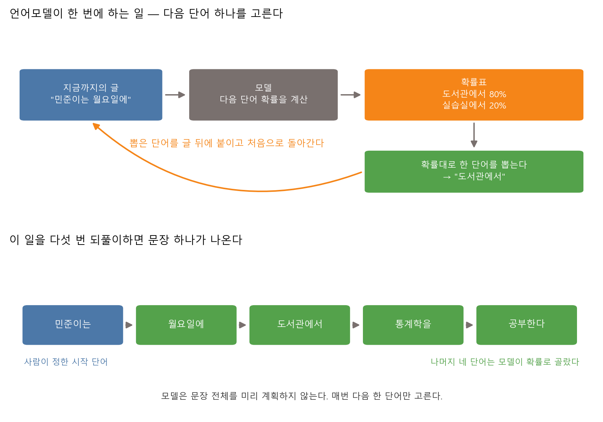
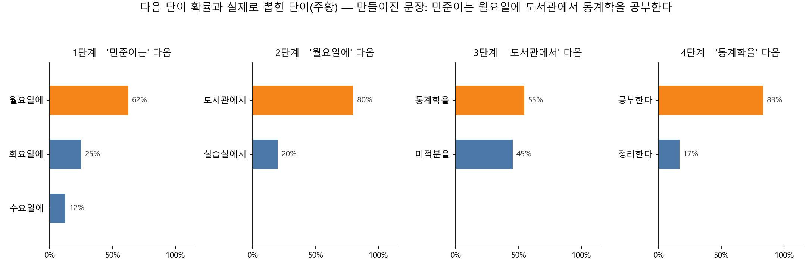
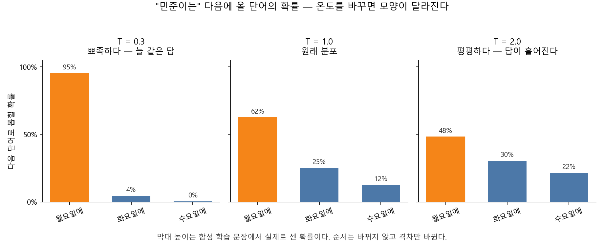
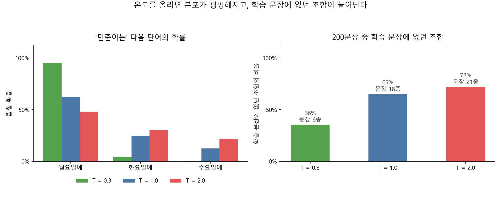
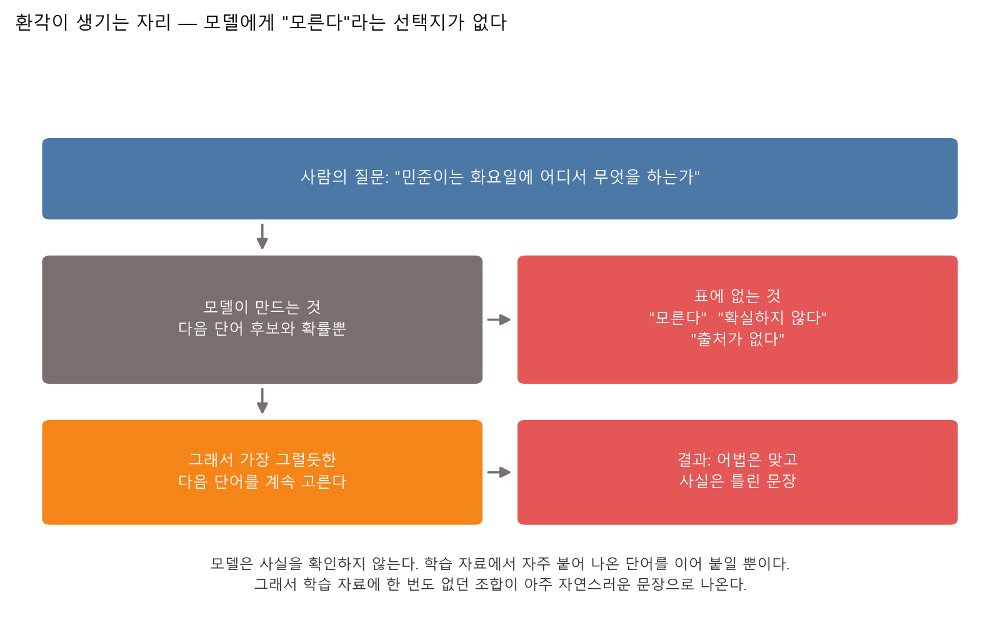

# 제11장 생성형 AI의 원리와 폐해 — 환각, 편향, 출처 검증

---

### 학습 목표

- 언어모델이 한 번에 하는 일이 "다음 단어 하나 고르기"임을 설명한다
- 단어 빈도표를 확률표로 바꾸고, 확률대로 단어를 이어 붙여 문장을 만든다
- 온도를 바꾸면 확률 분포 모양이 어떻게 달라지는지 그림으로 읽는다
- 환각이 왜 기계적으로 생기는지, 어느 자리에서 생기는지 짚어 설명한다
- AI 답변을 확인됨·불확실·틀림·판단 보류로 나누고 근거 주소를 적는다
- AI를 쓰는 시스템에 넣는 확인 장치 세 가지(자료 붙이기, 바깥 확인, 권한과 검사)를 설명한다
- 멜로디를 음표 토큰의 순서로 보고, 내가 고른 곡으로 LSTM을 학습시켜 새 곡을 만든다

10장에서는 이미 있는 문장을 분류했다. 이번 장에서는 문장을 만드는 쪽으로 넘어간다. 원리를 설명한 뒤 곧바로 실습 코드를 실행해 결과를 확인하는 순서로 진행한다. 문장을 만드는 절차를 직접 돌려 보면, AI가 그럴듯한 거짓말을 하는 일이 고장이 아니라 절차의 당연한 결과라는 것이 드러난다.

○ **이 장에서 하지 않는 것을 먼저 밝힌다**
  - 외부 AI 서비스를 코드로 부르지 않는다. API 키가 필요한 코드를 쓰지 않는다
  - 실제 GPT 계열 모델을 학습시키지 않는다. `torch`도 `tensorflow`도 쓰지 않는다
  - 실습 코드를 한 줄씩 읽는 것이 목표가 아니다. **실행하고 결과를 읽는 것**이 목표다

### 실행 환경

```bash
python -m pip install -r practice/requirements.txt
cd practice/chapter11/code
```

필요한 패키지는 numpy와 matplotlib뿐이다. GPU도, 인터넷 연결도, API 키도 필요 없다. 세 실습 모두 노트북에서 몇 초 안에 끝난다.

○ **실습에 쓰는 모델과 문장**
  - 학습 문장은 사람이 미리 적어 둔 합성 한국어 문장 12개다. 실제 사람도, 실제 기록도 아니다. 자주 나오는 문장은 여러 번 넣어 모두 27개로 늘렸다
  - 실습 모델은 이 27개 문장에서 "앞 단어 뒤에 어떤 단어가 몇 번 왔는가"를 세어 확률표를 만든다. 경사하강법으로 학습하는 모델이 아니라 원리를 보여 주는 교육용 모델이다. 다만 다음 단어에 확률을 매겨 하나를 뽑는 순서는 실제 언어모델과 같다
  - 이 작은 세계에서는 문장 12개만 참으로 정한다. 모델이 만든 문장이 12개 안에 없으면, 어법이 맞아도 환각으로 센다

---

### 1. 언어모델은 무엇을 하는가

언어모델(language model)은 글을 이해하는 프로그램이 아니다. 하는 일은 하나다.

```
지금까지의 글을 받아서, 다음에 올 단어의 확률을 매긴다
```

그게 전부다. 문장 전체나 결론을 미리 계획하지 않는다. 매번 다음 한 단어만 고른다.



**그림 11.1** 언어모델은 다음 단어 하나를 고르고, 그 단어를 글 뒤에 붙인 뒤 처음으로 돌아간다. 이 고리를 네 번 돌면 시작 단어와 합쳐 다섯 어절 문장이 나온다

이 그림에서 확인할 것은 고리의 방향이다. 모델이 뽑은 단어가 **다음 차례의 입력**이 된다. 그래서 세 번째 단어를 잘못 고르면, 네 번째와 다섯 번째는 그 잘못된 단어를 사실로 놓고 계산한다. 한 번 어긋나면 되돌아오지 않는다.

○ **자주 하는 오해**
  - "AI가 답을 알고 있다가 말로 풀어 준다" — 아니다. 답이라는 것이 미리 있는 자리가 없다
  - "AI가 인터넷을 찾아보고 확인한다" — 검색을 붙인 서비스도 찾은 글을 프롬프트 앞에 붙여 놓고 이어 쓸 뿐이다. 옮긴 내용이 맞는지는 확인하지 않는다
  - "AI가 자기 답이 맞는지 안다" — 확률이 높은 단어를 골랐을 뿐이다. 확률이 높다는 것과 사실이라는 것은 다른 말이다

---

### 2. 다음 토큰 예측 — 빈도를 세어 확률로 바꾼다

#### 2-1. 토큰은 글을 자르는 단위다

모델은 글자 하나하나를 다루지도, 문장 전체를 통째로 다루지도 않는다. 그 사이 크기로 자른 조각을 다룬다. 이 조각을 토큰(token)이라고 부른다.

실제 서비스에서 쓰는 토큰은 단어보다 작을 때가 많다. "공부한다"가 "공부" + "한다"로 잘리기도 한다. 이 장의 실습에서는 **어절 하나를 토큰 하나로** 쓴다. 자르는 규칙이 단순할수록 확률표를 눈으로 읽기 쉽다.

#### 2-2. 세고, 나누고, 뽑는다

작은 언어모델은 세 단계로 만든다.

1. **센다** — 학습 문장에서 "앞 단어 뒤에 어떤 단어가 몇 번 나왔는가"를 센다. 학습 문장 27개 중 `민준이는`으로 시작하는 문장이 8개이고, 그중 5개에서 `월요일에`가 뒤따랐다
2. **나눈다** — 횟수를 그 줄의 합으로 나누면 확률이 된다. 5 / 8 = 0.625이므로 `민준이는` 다음 `월요일에`의 확률은 62.5%다
3. **뽑는다** — 확률이 높은 단어일수록 자주 뽑히게 하면서 한 단어를 뽑는다. 62.5%짜리는 대략 열 번에 여섯 번 뽑히고, 12.5%짜리도 가끔 뽑힌다. 뽑은 단어를 글 뒤에 붙이고 다시 1번 표로 돌아간다

○ **이 표에 없는 것**
  - 단어의 뜻이 없다. "월요일"이 요일이라는 정보가 어디에도 없다
  - 사실 여부가 없다. 민준이가 실제로 월요일에 도서관에 가는지 확인할 자리가 없다

#### 2-3. 프롬프트는 시작 단어다

프롬프트(prompt)는 우리가 AI에게 써 넣는 글이다. 사람은 이것을 명령으로 여기지만, 모델에게 프롬프트는 "지금까지의 글"의 맨 앞부분이다. 그 뒤를 이어 쓰는 것이 모델이 하는 일이다. "표로 정리해 줘"라는 문장이 명령으로 실행되는 것이 아니라, 그 문장 뒤에 표가 오는 글을 학습 자료에서 자주 봤기 때문에 표가 나온다. 그래서 프롬프트를 바꾸면 명령이 아니라 **조건이 바뀌어서** 답이 바뀐다.

실습 11.1에서는 시작 단어 `START_WORD`가 프롬프트 역할을 한다. 시작 단어를 `지호는`으로 바꾸면 뒤따라 나오는 요일의 확률표가 통째로 달라진다.

---

### 실습 11.1: 다음 단어를 예측하는 작은 언어모델 실행하기

#### 실습 목표

- 빈도표와 확률표를 출력해 2-2절의 계산을 숫자로 확인한다
- 확률표를 보고 다음 단어를 스스로 예측한 뒤, 모델이 뽑은 단어와 맞춰 본다
- 모델이 만든 문장 가운데 학습 문장에 없던 조합이 섞여 나오는 것을 확인한다

#### 실행 명령

```bash
python 11-1-next-word.py
```

파일 맨 위의 두 값만 바꿔 다시 실행한다. `START_WORD`는 시작 단어(기본값 `민준이는`), `N_WORDS`는 만들 어절 수(기본값 5)다. 난수를 고정해 두어 누가 실행해도 결과가 같다.

#### 실행 결과

```text
[1] 빈도표 — 앞 단어 뒤에 어떤 단어가 몇 번 나왔는가
  '민준이는' 다음에 나온 단어 (모두 8번)
    월요일에       5번    62.5%
    화요일에       2번    25.0%
    수요일에       1번    12.5%

[3] 확률대로 단어를 이어 붙여 문장을 만든다
  1단계  '민준이는' 다음 -> '월요일에' 선택 (확률 62.5%)
  2단계  '월요일에' 다음 -> '도서관에서' 선택 (확률 80.0%)
  3단계  '도서관에서' 다음 -> '통계학을' 선택 (확률 54.5%)
  4단계  '통계학을' 다음 -> '공부한다' 선택 (확률 83.3%)
  만들어진 문장: 민준이는 월요일에 도서관에서 통계학을 공부한다
  학습 문장에 그대로 있는 문장인가: 있다

[4] 같은 방법으로 문장을 5개 더 만든다
  1. 민준이는 월요일에 실습실에서 영어를 복습한다   [학습 문장에 없던 새 조합]
  2. 민준이는 화요일에 실습실에서 파이썬을 연습한다   [학습 문장 그대로]
  3. 민준이는 월요일에 도서관에서 미적분을 복습한다   [학습 문장에 없던 새 조합]
  4. 민준이는 월요일에 도서관에서 통계학을 공부한다   [학습 문장 그대로]
  5. 민준이는 화요일에 도서관에서 통계학을 공부한다   [학습 문장에 없던 새 조합]
  5개 중 학습 문장 그대로인 것: 2개

[5] 이 모델은 뜻을 모르고 빈도만 안다
  P(파이썬을 | 실습실에서) = 85.7%
  P(파이썬을 | 도서관에서) = 0.0%
```

_출처: `practice/chapter11/results/11-1-next-word.log`_



**그림 11.2** 네 단계에서 각각 후보와 확률을 그렸다. 주황 막대가 실제로 뽑힌 단어다

#### 결과 읽기

○ **모델이 아는 것은 빈도뿐이다**
  - `민준이는` 뒤에 `월요일에`가 62.5%로 오는 이유는 학습 문장 8개 중 5개가 그랬기 때문이다
  - `P(파이썬을 | 실습실에서) = 85.7%`와 `P(파이썬을 | 도서관에서) = 0.0%`가 다른 이유는 실습실에 컴퓨터가 있어서가 아니다. 두 단어가 붙어 나온 횟수가 달라서다
  - 21개 단어를 뜻 없는 기호로 바꿔도 이 모델의 계산은 한 글자도 달라지지 않는다

○ **다섯 문장 중 세 개가 학습 문장에 없던 조합이다**
  - 세 문장 모두 어법이 맞고 읽기에 자연스럽다
  - 그런데 이 세계에서 참인 문장 12개에는 없다. 모델은 그 차이를 구분하지 못한다
  - 이 지점이 다음 실습의 출발선이다

#### 해 보기

1. `START_WORD`를 `서연이는`, `지호는`, `하윤이는`으로 바꾼다. 뒤따르는 요일의 확률표가 어떻게 달라지는가
2. `START_WORD`를 `월요일에`처럼 문장 중간의 단어로 바꾼다. 몇 어절짜리 문장이 나오는가
3. `N_WORDS`를 8로 늘린다. 다섯 어절보다 길어지는가, 아니면 다섯에서 멈추는가. 왜 그런가
4. `금요일에`처럼 학습 문장에 없는 단어를 `START_WORD`에 넣으면 무엇이 출력되는가

○ 3번의 답은 빈도표 안에 있다. 마지막 어절(`공부한다`, `복습한다` 등) 뒤에는 어떤 단어도 온 적이 없어서 그 줄이 통째로 비어 있다. 뽑을 후보가 없으면 문장이 끝난다

---

### 3. 온도 — 확률 분포의 모양을 바꾼다

실습 11.1은 확률을 그대로 써서 뽑았다. 실제 서비스는 뽑기 전에 확률의 **모양**을 조절하는데, 이때 쓰는 값이 온도(temperature)다. 원래 확률을 `p`라고 하면, 온도 `T`를 적용한 값은 `p^(1/T)`를 다시 합이 1이 되도록 나눈 것이다.

- `T`가 1보다 작으면 큰 값이 더 커진다. 분포가 뾰족해진다. 늘 같은 답이 나온다
- `T`가 1보다 크면 값들이 서로 가까워진다. 분포가 평평해진다. 답이 흩어진다



**그림 11.3** 같은 단어 뒤의 확률을 온도만 바꿔 그렸다. 막대 순서는 바뀌지 않고 격차만 바뀐다

**표 11.1** 온도를 바꿨을 때 `민준이는` 다음에 올 단어의 확률

| 다음 단어 | T = 0.3 | T = 1.0 | T = 2.0 |
|---|---:|---:|---:|
| 월요일에 | 95.1% | 62.5% | 48.1% |
| 화요일에 | 4.5% | 25.0% | 30.4% |
| 수요일에 | 0.4% | 12.5% | 21.5% |

_출처: `practice/chapter11/results/11-2-hallucination.log`_

온도를 아무리 낮춰도 **1등이 바뀌지 않는다.** 온도는 순위를 다시 매기는 장치가 아니라 격차를 벌리거나 좁히는 장치다. 1등이 틀린 답이면, 온도를 낮출수록 늘 틀린 답이 나온다. 확률이 0인 단어는 어떤 온도에서도 0으로 남는다.

---

### 실습 11.2: 환각은 어디서 생기는가

#### 실습 목표

- 온도를 바꿔 확률 분포를 뾰족하게·평평하게 만들고 결과를 비교한다
- 학습 문장에 없던 조합이 만들어지는 순간을 어절 단위로 짚는다
- 온도를 낮추면 환각이 사라지는지 숫자로 확인한다

#### 실행 명령

```bash
python 11-2-hallucination.py
```

실습 11.1과 **똑같은 모델, 똑같은 학습 문장**을 쓰고 온도만 바꾼다. 파일 맨 위의 `TEMPERATURES`(기본값 0.3, 1.0, 2.0)와 `START_WORD`를 바꿔 다시 실행할 수 있다. 코드는 온도마다 문장을 200개씩 만들고, 학습 문장과 앞에서부터 비교해 처음 어긋난 어절을 대괄호로 표시한다.

#### 실행 결과

```text
  --- T = 0.3 ---
   이 온도에서 처음 나온 새 조합: 민준이는 월요일에 도서관에서 [미적분을] 공부한다
      4번째 어절에서 갈라짐
   200문장 중 학습 문장에 없던 조합: 71개 (35.5%), 서로 다른 문장 6종

  --- T = 1.0 ---
   2. 민준이는 월요일에 도서관에서 통계학을 [정리한다]
      5번째 어절에서 갈라짐 -> 학습 문장에 없는 조합
   200문장 중 학습 문장에 없던 조합: 130개 (65.0%), 서로 다른 문장 18종

  --- T = 2.0 ---
   1. 민준이는 화요일에 [도서관에서] 미적분을 복습한다
      3번째 어절에서 갈라짐 -> 학습 문장에 없는 조합
   200문장 중 학습 문장에 없던 조합: 144개 (72.0%), 서로 다른 문장 21종

[4] 환각이 만들어지는 자리
    P(통계학을 | 도서관에서) = 54.5%
    P(미적분을 | 도서관에서) = 45.5%
```

_출처: `practice/chapter11/results/11-2-hallucination.log`_



**그림 11.4** 왼쪽은 온도별 다음 단어 확률, 오른쪽은 온도별로 학습 문장에 없던 조합이 나온 비율

#### 결과 읽기

○ **온도를 올리면 답이 흩어진다**
  - 같은 모델, 같은 학습 자료인데 문장 가짓수가 T = 0.3의 6종에서 T = 2.0의 21종으로 세 배 넘게 늘었다

○ **온도를 낮춰도 환각이 사라지지 않는다**
  - T = 0.3에서도 200문장 중 71개(35.5%)가 학습 문장에 없던 조합이었다
  - 처음 나온 새 조합은 네 번째 어절 `[미적분을]`에서 갈라졌다. 그 자리의 확률이 54.5% 대 45.5%로 반반이라, 온도를 낮춰도 격차가 크게 벌어지지 않는다

○ **갈라지는 자리가 앞쪽일수록 문장이 더 크게 달라진다**
  - T = 2.0의 예는 세 번째 어절에서 갈라져 뒤 두 어절이 통째로 바뀌었다. T = 1.0의 예는 다섯 번째 어절에서 갈라져 서술어 하나만 다르다
  - 어느 쪽이든 사람 눈에는 똑같이 자연스러운 문장으로 보인다. 어디서 갈라졌는지는 학습 문장과 대조해야 알 수 있다

#### 해 보기

1. `TEMPERATURES`를 `[0.1, 0.5, 3.0]`으로 바꾼다. T = 0.1에서 새 조합 비율이 0이 되는가
2. `START_WORD`를 `하윤이는`으로 바꾼다. 새 조합 비율이 올라가는가 내려가는가

---

### 4. 환각이 생기는 이유

환각(hallucination)은 모델이 그럴듯하지만 사실과 맞지 않는 내용을 내놓는 일이다. 이름 때문에 고장처럼 들리지만, 실습 11.2의 절차를 보면 고장이 아니다.



**그림 11.5** 모델이 만드는 것은 다음 단어 후보와 확률뿐이다. 그 표에 "모른다"라는 항목이 없다

`민준이는 월요일에 도서관에서` 뒤에 참인 조합은 `통계학을` 한쪽뿐이다. 그런데 실습 11.2의 로그에서 `미적분을`의 확률은 45.5%였다. 어느 쪽이 뽑혀도 어법은 맞고, `미적분을`이 뽑히는 순간 환각이 만들어진다. 모델은 두 선택의 차이를 모르고 확률만 본다.

○ **환각이 생기는 조건 세 가지**
  - **확률이 갈리는 자리** — 후보 둘의 확률이 비슷하면 어느 쪽이든 나올 수 있다. 어법은 둘 다 맞는다
  - **"모른다"가 후보에 없다** — 확률표에는 단어만 들어 있다. 침묵이나 유보가 후보로 올라오지 않는다. 실제 모델도 학습·평가가 "모른다"보다 추측에 점수를 준다[^kalai]
  - **한 번 어긋나면 되돌아오지 않는다** — 잘못 뽑은 단어가 다음 단계의 입력이 된다. 뒤 단어는 그 잘못을 전제로 계산한다

○ **그래서 이런 대응은 통하지 않는다**
  - "온도를 낮추면 된다" — 실습 11.2에서 T = 0.3으로 낮춰도 35.5%가 학습 문장에 없던 조합이었다
  - "AI에게 확실하냐고 다시 물으면 된다" — 그 질문에 대한 답도 같은 방식으로 만들어진다. 검사하는 것이 아니라 이어 쓰는 것이다
  - "출처를 붙이라고 하면 된다" — 출처처럼 생긴 글자열도 같은 방식으로 만들어진다. 주소가 열려도 그 페이지에 그 내용이 있는지는 사람이 읽어 봐야 안다

우리 모델은 후보가 2~3개뿐인데도 35% 넘게 새 조합을 만들었다. 실제 모델은 후보가 수만 개라 갈라질 수 있는 자리가 훨씬 많다. 그래서 "이 답이 맞는가"는 모델 안에서 답할 수 없는 질문이다.

---

### 5. 편향은 어디서 오는가

편향(bias)은 답이 한쪽으로 치우치는 일이다. 원인을 멀리서 찾을 것 없다. 확률표가 곧 원인이다.

학습 문장에는 민준이의 월요일 문장을 5번, 화요일 문장을 2번, 수요일 문장을 1번 넣었다. 그 횟수가 그대로 실습 11.1 로그의 확률 62.5%·25.0%·12.5%가 됐다. 자료를 모을 때 월요일 이야기를 다섯 배 더 넣었을 뿐인데, 모델은 "민준이는 주로 월요일에 뭔가 한다"는 답을 내놓는다. 자료의 치우침이 답의 치우침이 된다.

더 눈에 띄는 것은 0이 되는 자리다. 실습 11.1 로그의 `P(파이썬을 | 도서관에서) = 0.0%`처럼 자료에 한 번도 없던 조합은 확률이 0이고, 확률이 0이면 **후보에조차 오르지 않는다.** 3절에서 본 대로 온도를 올려도 0은 0으로 남는다. 자료에 빠진 것은 답에서도 빠진다.

○ **실제 서비스에서 이 구조가 어떻게 나타나는가**
  - 특정 직업에 특정 성별이 자주 붙어 나온 자료로 학습하면, 그 직업을 물었을 때 그 성별이 먼저 나온다
  - 영어 자료가 훨씬 많은 모델은 한국 지역·제도·법령을 물으면 확률이 얕은 자리에서 답을 만든다
  - 오래된 자료로 학습하면 과거의 관행을 현재의 기준으로 답한다. Google 머신러닝 단기집중과정은 1960년대 주택 가격 자료가 당시의 차별적 대출 관행을 그대로 담고 있는 예를 든다[^google-bias]

○ **편향은 지울 수 있는가**
  - 완전히 지울 수 없다. 자료가 세상의 완전한 표본인 경우가 없다
  - 할 수 있는 일은 **어느 쪽으로 치우쳤는지 알고 쓰는 것**이다. 10장의 텍스트 편향 메모가 같은 이야기였다

---

### 6. AI 답변을 검증하는 절차

앞의 다섯 절과 두 실습을 한 문장으로 줄이면 **모델은 사실을 확인하지 않는다**. 확인은 모델 밖에서 해야 한다.

#### 6-1. 사람이 확인하는 4단계

**표 11.2** AI 답변 검증 4단계

| 단계 | 하는 일 | 판단 기준 |
|---|---|---|
| 1. 나누기 | 답을 문장 단위로 쪼개고, 확인이 필요한 것에 표시한다 | 수치·인물·기관·연도·논문 제목·법령 조항·URL은 전부 표시 |
| 2. 다시 묻기 | 같은 질문을 표현을 바꿔 두세 번 묻는다 | 답이 매번 같은가. 다르면 최소 하나는 틀렸다 |
| 3. 원 자료까지 가기 | AI가 아닌 곳에서, 주장이 처음 나온 자료를 찾는다 | 통계표·논문 원문·법령 원문까지 간다. 요약에서 멈추지 않는다 |
| 4. 등급 적기 | 확인 결과를 네 등급으로 적는다 | 확인됨 / 불확실 / 틀림 / 판단 보류 |

3단계는 정보 검증 교육에서 쓰는 SIFT 방법의 마지막 단계 "주장을 원래 맥락까지 거슬러 찾기"와 같다[^sift]. 아이디어를 뽑거나 문장을 다듬어 달라는 요청처럼 사실을 묻지 않은 답은 3단계를 건너뛴다.

**표 11.3** 같은 질문을 세 가지 방식으로 묻는 수업 활동 — 각자 쓰는 AI 도구에 묻고 답을 나란히 적는다

| 묻는 방식 | 프롬프트 예 | 무엇을 보는가 |
|---|---|---|
| 그냥 묻기 | 우리나라 대학 등록금은 얼마인가 | 숫자가 나오는가, 출처가 붙는가 |
| 조건을 붙여 묻기 | 2025년 기준 4년제 사립대 평균 등록금을 알려주고, 출처 기관과 연도를 함께 적어라 | 앞의 답과 숫자가 같은가 |
| 모른다고 답할 길을 열어 묻기 | 확실하지 않으면 "확인 필요"라고만 답하라. 추측한 숫자를 쓰지 마라 | 답이 짧아지는가, 숫자가 사라지는가 |

○ **네 등급을 나누는 기준**
  - **확인됨** — 원 자료에서 같은 값을 찾았고, 적어 둔 근거 주소가 열린다. AI가 알려준 주소는 직접 열어 본 것만 적는다
  - **불확실** — 비슷한 내용을 찾았지만 숫자나 연도가 다르다. 또는 출처가 2차 자료뿐이다
  - **틀림** — 원 자료에서 다른 값을 찾았다. 또는 AI가 댄 논문·기관·주소가 존재하지 않는다
  - **판단 보류** — 확인할 자료를 찾지 못했다. 없다는 뜻이 아니라 **아직 모른다**는 뜻이다

#### 6-2. AI를 쓰는 시스템에 넣는 확인 장치

AI에게 여러 단계의 일을 맡기면 사람이 모든 문장을 6-1절처럼 확인할 수 없다. 그래서 확인 장치를 시스템 안에 넣는다. 연구와 공식 문서로 효과와 한계가 확인된 장치는 다음 세 가지다.

○ **자료를 찾아 붙여서 쓰게 한다 — 검색 증강 생성(RAG)**
  - 질문과 관련된 문서를 먼저 검색해 프롬프트 앞에 붙이고, 그 뒤를 모델이 이어 쓰게 한다. 이 방식을 처음 제안한 연구는 문서를 붙이지 않은 모델보다 더 구체적이고 사실에 맞는 문장이 나왔다고 보고했다[^rag]
  - 한계는 1절의 오해 항목과 같다. 붙인 자료를 잘못 옮겨도 모델은 확인하지 않는다. 답에 붙은 출처는 여전히 6-1절로 확인한다
  - 예: "아래 [자료]에 있는 내용으로만 답하라. 자료에 없으면 '자료에 없음'이라고 써라. 문장마다 근거로 쓴 자료 번호를 붙여라"처럼 자료와 지시를 함께 넣는다. 번호가 붙어 있으면 6-1절 3단계에서 어느 자료를 열지 바로 안다

○ **스스로 고치게 하지 말고 바깥에서 확인한다**
  - 모델에게 자기 답을 다시 검토해 고치게 하면, 바깥의 정보 없이는 답이 잘 나아지지 않고 오히려 나빠지는 경우도 있다는 연구가 있다[^selfcorrect]. 4절의 "확실하냐고 다시 묻기"가 통하지 않는 이유와 같다
  - 그래서 확인은 만든 쪽과 다른 주체에게 맡긴다. 코드라면 시험 코드 실행, 사실이라면 원 자료 검색, 최종 판단은 사람이 한다
  - 예: AI가 코드를 고칠 때마다 시험 코드를 자동으로 돌리고, 시험이 실패하면 고친 코드를 받아들이지 않는다. 합격 여부는 모델의 답이 아니라 시험 코드의 실행 결과로 정한다

○ **글로 적은 규칙보다 권한과 검사로 막는다**
  - 규칙 파일에 "파일을 지우지 마라"라고 적는 것은 프롬프트에 한 줄을 더하는 일이다. 2-3절대로 그 줄은 조건일 뿐이어서 지켜진다는 보장이 없다
  - 대신 에이전트가 할 수 있는 일을 설정으로 좁힌다. 예를 들어 작업 폴더 밖 파일은 읽기만 허용하고, 삭제·전송 명령은 실행 전에 사람의 승인을 받게 한다
  - 실행 전 검사 도구를 직접 만드는 실습은 12장 실습 12.2, 실수를 되돌리는 버전 관리는 12장 6-2절에서 다룬다

---

### 7. AI로 음악 만들기 — 음표도 토큰이다

언어모델이 하는 일은 "지금까지의 글을 보고 다음 단어를 고르기"였다. 음악도 같은 모양의 데이터다. 멜로디는 음표가 시간 순서대로 늘어선 것이므로, 음표 하나를 토큰 하나로 보면 "지금까지의 멜로디를 보고 다음 음표를 고르기"가 된다. 이렇게 순서가 있는 데이터를 시계열 데이터라고 부른다.

**표 11.4** 문장과 멜로디의 대응

| 문장 만들기 | 음악 만들기 |
|---|---|
| 토큰 = 어절 (`민준이는`) | 토큰 = 음높이와 박자 (`C4:1` = 가운데 도, 1박) |
| 학습 자료 = 문장 | 학습 자료 = 곡의 멜로디 |
| 프롬프트 = 시작 단어 | 프롬프트 = 시작 멜로디 몇 음 |
| 온도를 올리면 새 조합이 늘어난다 | 온도를 올리면 원곡에서 벗어난 멜로디가 늘어난다 |

실습 11.1의 빈도표 모델은 바로 앞 단어 하나만 보므로 멜로디의 앞부분을 기억하지 못한다. 이 한계를 줄이는 신경망이 LSTM(Long Short-Term Memory)이다. LSTM은 10장 3-3절에서 소개한 순환 신경망의 한 종류로, 음표를 하나씩 읽을 때마다 기억 칸의 내용을 고친다. 무엇을 잊고 무엇을 담을지는 경사하강법으로 학습해 정하므로, 몇 마디 앞의 흐름을 이어 갈 수 있다.

○ **창작에서 조절할 것은 "외우기"와 "새로움" 사이다**
  - 오래 학습하면 손실이 0에 가까워지고, 모델은 학습 곡을 그대로 다시 부른다. 학습 자료를 외운 것이다
  - 온도를 올리거나 학습을 덜 하면 새 조합이 늘어난다. 너무 올리면 음이 아무렇게나 흩어진다
  - 그래서 한 번에 한 곡을 만들지 않고, 설정을 바꿔 후보를 여러 개 만든 뒤 사람이 듣고 고른다. 고른 곡이 학습 곡을 얼마나 베꼈는지는 숫자로 확인한다

---

### 실습 11.3: 내 곡을 학습시켜 새 곡 만들기

#### 실습 목표

- 예시 곡으로 LSTM을 학습시키고, 후보 곡을 듣고 비교한다
- 내가 고른 곡을 넣어 학습시키고, 설정을 바꿔 새 곡을 만든다
- 만든 곡이 학습 곡을 얼마나 베꼈는지 확인하고, 작곡 프로그램에서 다듬는다

#### 1단계 — 예시 곡으로 한 번 돌려 본다

```bash
python 11-3-music-lstm.py
```

코드는 `practice/chapter11/data/my_music/` 폴더의 곡을 모두 읽어 학습한다. 처음에는 저작권 보호기간이 끝난 예시 곡 5곡(작은 별, 환희의 송가, 프레르 자크, 징글벨 후렴, 메리의 어린 양)이 들어 있다. 노트북 CPU에서 몇 초 안에 끝나고, `results/my_song/` 폴더에 후보 곡 6개가 저장된다. 후보마다 파일이 세 개다.

| 파일 | 쓰는 곳 |
|---|---|
| `candidate_01.wav` | 바로 듣는다. 아무 음악 재생기로 열린다 |
| `candidate_01.mid` | MuseScore, GarageBand 같은 작곡 프로그램에서 열어 고친다 |
| `candidate_01.txt` | 음표 목록. 마음에 드는 부분을 학습 곡이나 시작 멜로디로 다시 쓴다 |

#### 2단계 — 후보를 비교한다

```text
[1] 학습 곡 읽기 — 5곡, 음표 213개, 서로 다른 음표 24개

[2] LSTM 학습 — 곡마다 '다음 음표 맞히기'를 반복한다
  epoch    1  손실 3.093
  epoch   80  손실 0.058

[4] 후보 비교 — 학습 곡을 얼마나 그대로 따라갔는가
  후보            온도   4음 일치율   가장 긴 복사 구간   길이
  candidate_01    1.0     59.2%      26음            35.5초
  candidate_02    1.0     61.2%      26음            35.5초
  candidate_03    1.5     73.5%      19음            31.0초
  candidate_04    1.5     59.2%      11음            28.0초
  candidate_05    2.0     22.4%       6음            33.5초
  candidate_06    2.0     30.6%       9음            32.7초
```

_출처: `practice/chapter11/results/11-3-music-lstm.log`_


**그림 11.6** 맨 위는 학습 손실, 아래는 후보 곡이다. 가로는 박, 세로는 음높이이고, 회색은 시작 멜로디, 주황은 모델이 이어서 만든 음이다

○ **표 읽는 법**
  - **4음 일치율** — 후보에서 연속 4음을 잘라 봤을 때, 학습 곡에 그대로 있던 조각의 비율이다
  - **가장 긴 복사 구간** — 후보 안에서 학습 곡 한 곡과 음표가 그대로 이어지는 가장 긴 길이다. 메리의 어린 양은 26음짜리 곡이므로, T = 1.0의 두 후보는 그 곡을 처음부터 끝까지 그대로 부른 부분을 담고 있다
  - T = 2.0의 후보는 복사 구간이 6음, 9음으로 짧다. 대신 들어 보면 흐름이 덜 자연스럽다. 숫자로 베끼지 않았는지 확인하고, 귀로 음악다운지 판단한다

#### 3단계 — 내 학습 곡을 넣는다

`data/my_music/`의 예시 파일을 지우거나 다른 곳으로 옮기고, 내가 고른 곡을 넣는다. 방법은 두 가지다.

1. **음표 글자로 적기** — `.txt` 파일 한 줄에 한 곡을 `C4:1 E4:0.5 G4:0.5 R:1 ...`처럼 적는다. 음이름 뒤 숫자는 옥타브(4가 가운데), 콜론 뒤는 박자, `R`은 쉼표, `#`은 반음 올림이다. 예시 파일 `sample_songs.txt` 맨 위에 적는 법이 있다
2. **MIDI 파일 넣기** — 작곡 프로그램에서 멜로디를 입력하고 MIDI(`.mid`)로 내보내 폴더에 넣는다. 화음이 있으면 가장 높은 음을 멜로디로 읽고, 드럼은 뺀다

○ **곡을 고르는 기준**
  - 직접 만든 곡이나 저작권 보호기간이 끝난 곡만 넣는다. 남의 곡을 학습시켜 만든 결과는 원곡의 저작권 문제를 안을 수 있다
  - 3곡 이상, 분위기가 비슷한 곡을 모은다. 곡이 적을수록 모델은 외우기 쉽다
  - 가능하면 같은 조(예: 다장조)로 옮겨 적는다. 조가 섞이면 음표 종류가 늘어나 학습할 자료가 부족해진다

#### 4단계 — 설정을 바꿔 후보를 고른다

코드 맨 위의 값만 바꿔 다시 실행한다. 실행할 때마다 `results/my_song/`의 후보가 새로 바뀌므로, 마음에 드는 후보는 다른 폴더로 복사해 둔다.

| 값 | 바꾸면 무엇이 달라지는가 |
|---|---|
| `PROMPT` | 시작 멜로디. 내가 만든 첫 마디를 넣으면 그 뒤를 모델이 잇는다. 학습 곡에 나온 음표만 쓸 수 있다 |
| `TEMPERATURES` | 낮으면 학습 곡에 가깝고, 높으면 새롭지만 흩어진다 |
| `EPOCHS` | 늘리면 손실이 더 내려가고 학습 곡을 더 외운다. 줄이면 덜 외운다 |
| `SEED` | 같은 설정으로 다른 후보를 뽑는다 |
| `LENGTH` | 후보의 음표 수 |

#### 5단계 — 다듬고 편곡한다

고른 후보의 `.mid` 파일을 작곡 프로그램에서 연다. 어색한 음을 고치고, 반주·악기·빠르기를 더해 곡을 완성한다. 이때 모델이 만든 부분과 내가 고친 부분을 메모해 둔다. 과제에서 그 구분을 적는다.

---

### 과제 (LMS 제출) — AI와 함께 만든 창작곡

실습 11.3으로 내가 고른 곡을 학습시켜 새 곡을 만들고 제출한다.

#### 제출물

1. **완성곡** — WAV 또는 MP3 한 개. 작곡 프로그램에서 편곡했다면 편곡한 곡
2. **생성 원본** — 고른 후보의 `.mid`와 `.txt`, 그리고 `candidates.csv`
3. **학습 곡 목록** — 곡 이름과 출처. 직접 만든 곡인지, 저작권 보호기간이 끝난 곡이면 그 근거(작곡자 사망 연도 등)
4. **제작 기록** 다섯 줄 — 바꾼 설정값, 고른 후보와 고른 이유, 그 후보의 4음 일치율과 가장 긴 복사 구간, 내가 직접 고친 부분, 들어 보고 느낀 점

#### 평가 기준

- 네 가지를 모두 내면 완료로 인정한다. 곡의 완성도는 채점하지 않는다
- 학습 곡에 예시 곡 말고 내가 고른 곡이 1곡 이상 들어 있어야 한다
- 고른 후보의 가장 긴 복사 구간이 8음 이하여야 한다. 학습 곡을 길게 그대로 옮긴 것은 새 곡으로 보지 않는다
- 저작권이 남아 있는 곡을 학습 곡으로 쓰면 인정하지 않는다

#### 마감

- 실습 수업일 포함 7일 이내

---

### 핵심 정리

| 개념 | 한 줄 정리 |
|---|---|
| 언어모델 | 문장을 계획하지 않는다. 다음 단어 하나를 고르는 일을 되풀이한다 |
| 토큰 | 글을 자르는 단위. 이 장의 실습에서는 어절 하나가 토큰 하나다 |
| 다음 토큰 예측 | 빈도를 세어 확률로 바꾸고, 그 확률대로 단어를 뽑는다 |
| 온도 | 확률 분포의 격차를 조절한다. 순위는 바꾸지 않는다 |
| 프롬프트 | 명령이 아니라 앞에 붙는 글이다. 조건을 바꿔 답을 바꾼다 |
| 환각 | 확률이 갈리는 자리에서 생긴다. "모른다"가 후보에 없어서 사라지지 않는다 |
| 편향 | 학습 자료의 빈도 차이가 그대로 답의 치우침이 된다. 자료에 없으면 후보에도 없다 |
| 검증(사람) | 나누기 → 다시 묻기 → 원 자료까지 가기 → 네 등급 적기 |
| 검증(시스템) | 자료를 붙여 쓰게 하고, 바깥에서 확인하고, 확실히 막을 일은 글이 아니라 권한과 검사로 막는다 |
| 음악 생성 | 음표를 토큰으로 보고 다음 음표를 고른다. 오래 학습하면 외우고, 온도를 올리면 새로워진다. 후보를 여러 개 만들어 베낀 정도를 확인하고 사람이 고른다 |

다음 장에서는 AI에게 코드를 쓰게 한다. 이번 장에서 확인한 검증 절차를 그대로 코드에 적용한다.

---

[^kalai]: Kalai, A. T. 외 (2025). Why Language Models Hallucinate. arXiv:2509.04664. https://arxiv.org/abs/2509.04664 (2026년 11월 14일 확인)

[^google-bias]: Google, "편향의 유형", 머신러닝 단기집중과정. https://developers.google.com/machine-learning/crash-course/fairness/types-of-bias?hl=ko (2026년 11월 14일 확인)

[^sift]: Caulfield, M. (2019. 6. 19.). SIFT (The Four Moves). Hapgood. https://hapgood.us/2019/06/19/sift-the-four-moves/ (2026년 11월 14일 확인)

[^rag]: Lewis, P. 외 (2020). Retrieval-Augmented Generation for Knowledge-Intensive NLP Tasks. NeurIPS 2020. arXiv:2005.11401. https://arxiv.org/abs/2005.11401 (2026년 11월 14일 확인)

[^selfcorrect]: Huang, J. 외 (2024). Large Language Models Cannot Self-Correct Reasoning Yet. ICLR 2024. arXiv:2310.01798. https://arxiv.org/abs/2310.01798 (2026년 11월 14일 확인)

[^hooks]: Anthropic, "Hooks reference", Claude Code 문서. https://code.claude.com/docs/en/hooks (2026년 11월 14일 확인)
