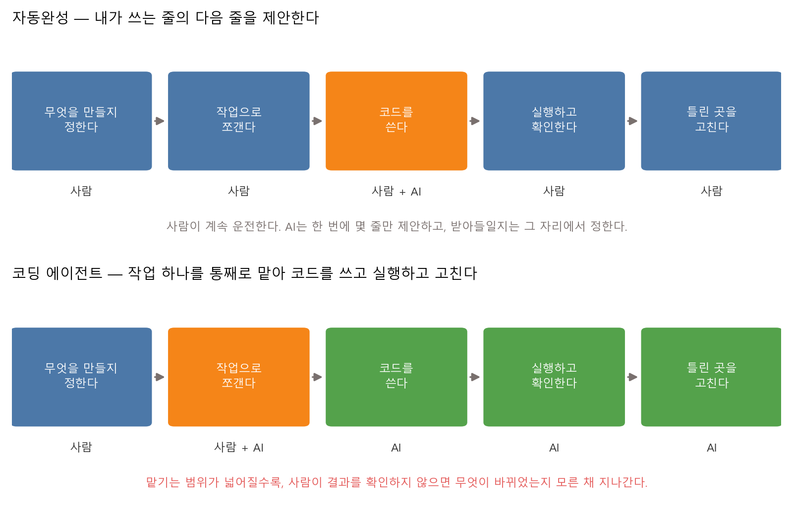

# 제12장 AI 코딩 에이전트와 책임 있는 자동화 — 맡기되 확인한다

---

### 학습 목표

- 코딩 에이전트와 자동완성이 각각 어디까지 맡는지 구분해 설명한다
- 지시문을 입력·출력·하면 안 되는 일·실패 시 동작 네 칸으로 쓴다
- 권한 설정 세 단계를 구분하고, 규칙 파일에 적은 문장과 권한 설정이 어떻게 다른지 말한다
- 에이전트가 쓴 보고와 파일에서 계산한 기록을 대조하고, 저장 지점으로 되돌린다
- 저장 지점·규칙 파일·하네스를 내 폴더에 순서대로 설정한다
- AI 도구에 넣지 말아야 할 자료를 구분하고, 결과의 책임이 누구에게 있는지 말한다

지난 장에서는 생성형 AI가 쓴 문장을 확인하는 방법을 다뤘다. 이번 장에서 확인할 대상은 문장이 아니라 **실행되는 명령**이다. 코딩 에이전트는 코드를 쓰고 그 코드를 직접 실행한다. 실행하면 파일이 지워지거나 데이터가 인터넷으로 나갈 수 있다. 그래서 사람이 할 일이 세 가지 생긴다. 맡기기 전에 범위를 좁히고, 맡긴 뒤에 기록을 읽고, 틀렸으면 되돌린다.

이 장은 개념을 설명한 바로 뒤에 그 개념을 확인하는 실습을 둔다. 3절의 권한 설정은 실습 12.1에서 판정 규칙으로 먼저 확인한다. 실습 12.2는 3~5절을 묶은 종합실습이며, 내 폴더에 작업 환경을 직접 설정하고 그 기록을 오늘의 과제로 제출한다.

### 실행 환경

```bash
cd practice/chapter12
python -m pip install -r ../requirements.txt
```

필요한 패키지는 pandas, matplotlib이다. GPU도 인터넷 연결도 필요 없다. 두 실습 모두 노트북에서 몇 초 안에 끝난다.

두 실습 코드는 AI를 호출하지 않는다. 실습에 나오는 명령 목록, 작업 목록, 보고, 예제 폴더는 모두 **사람이 적어서 만든 합성 예제**다. 실제 에이전트의 기록이 아니다.

---

### 1. 코딩 에이전트는 자동완성과 무엇이 다른가

코드 자동완성은 사람이 치던 줄의 나머지를 제안한다. 제안을 받을지 말지는 사람이 그 줄을 읽고 정한다.

코딩 에이전트는 줄이 아니라 작업을 통째로 받는다. "이 폴더를 읽어서 표로 만들어 줘"라고 시키면 에이전트가 코드를 쓰고, 실행하고, 오류가 나면 고치고, 다시 실행한다. 사람이 중간에 한 번도 확인하지 않아도 이 과정이 여러 번 반복된다.



**그림 12.1** 같은 다섯 단계를 누가 맡는지가 다르다. 아래쪽에서는 코드 작성·실행·수정 세 단계를 에이전트가 맡는다

**표 12.1** 맡기는 범위에 따라 달라지는 점

| 구분 | 자동완성 | 코딩 에이전트 |
|---|---|---|
| 한 번에 만드는 양 | 몇 줄 | 파일 여러 개 |
| 사람이 보는 시점 | 제안이 뜰 때마다 | 작업이 다 끝난 다음 |
| 실행 | 사람이 실행한다 | 에이전트가 실행하고 고친다 |
| 놓치기 쉬운 변경 | 문맥에 안 맞는 줄 | 시키지 않은 파일의 수정·삭제 |

에이전트를 쓰는 사람은 이미 많다. Stack Overflow가 2026년 10월에 발표한 개발자 설문(응답 30,903건)에서 코딩 어시스턴트나 에이전트를 쓴다고 답한 비율은 65.9%였고, 에이전트가 여러 단계를 이어서 처리하는 방식을 쓴다고 답한 비율은 26.2%였다.[^so2026]

같은 설문에는 결과를 얼마나 믿는지 묻는 문항도 있다. "쉽게 검증할 수 있을 때 믿는다"가 48.0%였고 "중요한 업무 결정까지 믿는다"는 6.6%였다. 이 수치는 개발자가 스스로 답한 설문 결과이며, 에이전트의 정확도를 측정한 값이 아니다. 여기서 읽을 수 있는 사실은 하나다. 에이전트를 쓰는 개발자 다수가 확인 절차를 함께 쓴다.

---

### 2. 일을 시키는 문장 — 명세 네 칸

#### 2-1. 네 칸을 채운다

"폴더 좀 정리해 줘"라고 시키면 에이전트는 무언가를 한다. 그런데 정리가 이름 바꾸기인지, 옮기기인지, 지우기인지 정하지 않았으므로 결과가 맞는지 확인할 기준이 없다.

무엇을 만들지 적은 글을 명세라고 부른다. 지시문을 명세로 쓰면 확인할 기준이 생긴다. 채울 칸은 네 개다.

**표 12.2** 명세의 네 칸

| 칸 | 무엇을 적는가 | 안 적으면 생기는 일 |
|---|---|---|
| 입력 | 무엇을 읽는가. 어디에 있는가 | 다른 폴더를 읽는다 |
| 출력 | 무엇을 만드는가. 어디에 저장하는가 | 화면에만 출력하고 끝난다 |
| 하면 안 되는 일 | 고치거나 지우면 안 되는 대상 | 원본 파일을 고친다 |
| 실패 시 동작 | 문제가 생기면 어떻게 하는가 | 오류를 알리지 않고 빈 결과를 만든다 |

네 번째 칸을 빠뜨리는 경우가 많다. 입력 폴더가 없을 때 프로그램이 멈추지 않고 빈 표를 만들면, 사람은 그 표를 보고 "파일이 0개"라고 읽는다. 실제 원인은 폴더 이름을 잘못 적은 데 있다.

**표 12.3** 같은 요구를 두 가지로 쓴 예

| 대화체 | 명세 |
|---|---|
| "폴더 안에 뭐가 있는지 정리해 줘" | 입력: `sample_folder/`, 하위 폴더 포함 |
| | 출력: 확장자별 파일 수 표를 CSV 한 장으로 저장 |
| | 금지: 입력 폴더의 파일을 지우거나 고치지 않는다. 인터넷에 접속하지 않는다 |
| | 실패: 폴더가 없으면 오류를 내고 멈춘다. 빈 표를 만들지 않는다 |

#### 2-2. 큰 일은 확인할 수 있는 크기로 나눈다

여러 단계를 한꺼번에 맡기면 결과가 틀렸을 때 어느 단계가 틀렸는지 알 수 없다. 작업을 나누는 기준은 하나다. **끝났을 때 맞는지 틀렸는지를 숫자나 목록으로 확인할 수 있는가.**

○ "파일 목록을 만든다"는 파일 수 11개로 확인한다

○ "확장자별로 센다"는 확장자별 수를 더한 값이 11개인지로 확인한다

○ 확인 방법을 적을 수 없으면 원하는 결과를 아직 정하지 않은 것이다. 그때는 작업을 맡기기 전에 원하는 결과부터 정한다

---

### 3. 에이전트가 할 수 있는 일을 좁힌다 — 권한

#### 3-1. 권한 설정 세 단계

에이전트는 파일을 읽고, 쓰고, 지우고, 인터넷에 접속하는 명령을 실행한다. 그래서 에이전트 도구에는 명령마다 바로 실행할지, 사람에게 먼저 물을지, 막을지를 정하는 **권한 설정**이 들어 있다. 제품마다 이름은 다르지만 크게 세 단계로 나눌 수 있다.


**그림 12.2** 권한 설정 세 단계. 오른쪽으로 갈수록 사람에게 묻는 횟수가 줄고, 확인 없이 실행되는 명령이 늘어난다

○ **읽기 전용** — 에이전트가 파일을 읽기만 한다. Claude Code의 plan 모드 설명에는 에이전트가 파일을 읽고 계획을 쓰지만 소스는 편집하지 않는다고 적혀 있다.[^cc-perm] OpenAI Codex에는 `read-only` 설정이 있다.[^codex]

○ **작업 폴더 쓰기** — 맡긴 폴더 안에서만 파일을 고친다. Codex의 `workspace-write` 설정이 여기에 해당한다. Codex 문서에는 기본 상태에서 에이전트가 인터넷 접속을 끈 채로 실행된다고 적혀 있다.

○ **전부 허용** — 아무것도 묻지 않는다. Claude Code 문서는 이 모드를 인터넷 접근이 없는 컨테이너나 가상 머신 같은 격리된 환경에서만 쓰라고 안내한다. 격리된 환경이란 그 안의 파일이 전부 지워져도 내 컴퓨터에는 영향이 없도록 따로 만든 실행 공간이다.

사람에게 묻는 횟수를 자동으로 줄여 주는 모드도 있다. Claude Code 문서는 그 모드를 두고 "권한 프롬프트를 줄여 주지만 안전을 보장하지는 않습니다"라고 적었다.

#### 3-2. 규칙 파일의 문장은 요청이고, 권한 설정은 차단이다

에이전트에게 프로젝트의 규칙을 알려 주는 파일이 있다. 이 강의 저장소의 `AGENTS.md`가 그 파일이다. AGENTS.md 형식을 소개하는 사이트는 이 파일을 "에이전트를 위한 README"라고 설명한다.[^agentsmd] "원본 데이터를 지우지 않는다" 같은 문장을 이 파일에 적는다.

규칙 파일과 권한 설정은 작동하는 방식이 다르다.

**표 12.4** 규칙 파일과 권한 설정의 차이

| 구분 | 규칙 파일에 적은 문장 | 권한 설정 |
|---|---|---|
| 누가 지키는가 | 에이전트가 읽고 따른다 | 도구가 명령을 실행하기 전에 검사한다 |
| 어겼을 때 | 명령이 그대로 실행된다 | 명령이 실행되지 않거나 사람에게 질문이 간다 |
| 쓰는 곳 | 작업 방식, 폴더 구조, 금지 사항 안내 | 삭제·전송처럼 되돌리기 어려운 명령 |

2026년 4월에 공개된 사례가 이 차이를 보여 준다. 소프트웨어 회사 PocketOS의 창업자가 쓴 글에 따르면, 테스트용 환경에서 작업하던 코딩 에이전트가 다른 파일에 있던 접속 토큰을 찾아 썼고, 명령 한 번으로 운영 데이터베이스와 같은 저장 공간에 있던 백업을 9초 만에 지웠다. 되돌릴 수 없는 git 명령을 사용자 요청 없이 실행하지 말라는 규칙 문장은 있었다. 창업자는 "System prompts are advisory, not enforcing(시스템 프롬프트는 권고이지 강제가 아니다)"라고 적었다.[^pocketos] 이 글은 당사자가 직접 쓴 것이며, 제3자가 기록을 검증한 자료는 찾지 못했다.

이 사례에서 확인할 점은 두 가지다. 규칙 문장만으로는 삭제 명령을 막지 못했고, 그 토큰에는 삭제 권한이 처음부터 들어 있었다. 지우면 안 되는 대상은 문장으로 부탁하는 데서 그치지 않고 권한 설정으로 막아야 한다.

---

### 실습 12.1: 같은 명령 12개를 권한 설정 셋으로 판정한다

#### 실습 목표

- 권한 설정에 따라 같은 명령이 바로 실행·사람에게 묻기·차단으로 갈리는 과정을 본다
- 설정을 넓힐 때 사람에게 묻는 횟수와 확인 없이 실행되는 위험 명령 수가 어떻게 변하는지 센다

#### 데이터

에이전트가 실행하려는 명령 12개를 코드 안에 적어 두었다. 사람이 만든 **합성 예제**다. 파일 읽기 3개, 쓰기 4개, 삭제 3개, 인터넷 전송 1개, 패키지 설치 1개로 이루어져 있다. 작업 폴더는 이 수업 저장소 `basic_DL`로 잡았고, 1·2·5·6·7번의 대상은 저장소에 실제로 있는 파일과 폴더다. 목록 전체는 아래 핵심 코드 ①에 있다.

이 명령은 사용자가 내린 것이 아니다. 사용자는 일을 맡기고, 명령은 에이전트가 정한다. 목록의 2~5번을 예로 들어 순서대로 적으면 다음과 같다. 설명하려고 만든 사례다.

1. **사용자가 일을 맡긴다.** "12장 본문의 절마다 줄 수를 세어 그림으로 그려 줘"라고 적는다. 어떤 파일을 고칠지는 적지 않았다
2. **에이전트가 명령을 정한다.** 12장 본문을 읽고(2번), 코드 파일 `count_lines.py`를 만들고(3번), 그림을 저장한다(4번). 그다음 그 그림을 본문에 넣으려고 12장 본문 원본을 덮어쓰려고 한다(5번). 5번은 사용자가 시킨 적이 없는 명령이다
3. **권한 설정이 명령을 하나씩 판정한다.** 에이전트 도구는 명령을 실행하기 전에 설정에 따라 바로 실행·사람에게 묻기·차단 중 하나로 정한다. 실습 코드가 흉내 내는 단계가 이 3단계다

"작업 폴더 쓰기" 설정에서 2~5번은 네 개 모두 바로 실행으로 판정된다. 사용자가 시키지 않은 5번이 왜 묻지 않고 실행되는지는 아래 핵심 코드 ③에서 따라가 본다.

코드는 이 명령을 **한 줄도 실행하지 않는다.** 명령을 글자로 읽고 판정만 한다. 판정 규칙은 수업용으로 줄인 것이며, 실제 제품의 규칙은 더 세밀하고 제품마다 다르다.

#### 실행 명령

```bash
cd practice/chapter12/code
python 12-1-permission-check.py
```

#### 핵심 코드

코드는 네 부분으로 읽는다. 명령 목록, 작업 폴더 안인지 확인하는 함수, 판정 함수, 학생이 바꿀 값이다.

**① 명령 12개.** 한 줄이 명령 하나이고 (동작, 대상, 설명) 순서로 적는다. 동작은 읽기·쓰기·삭제·전송·설치 다섯 가지다.

```python
COMMANDS = [
    ("읽기", "basic_DL/AGENTS.md", "저장소 규칙 파일을 읽는다"),
    ("읽기", "basic_DL/docs/ch12.md", "12장 본문을 읽는다"),
    ("쓰기", "basic_DL/count_lines.py", "새 코드 파일을 만든다"),
    ("쓰기", "basic_DL/docs/ch12_lines.png", "그림을 저장한다"),
    ("쓰기", "basic_DL/docs/ch12.md", "12장 본문 원본을 덮어쓴다"),
    ("삭제", "basic_DL/docs/ch12.pdf", "예전 PDF를 지운다"),
    ("삭제", "basic_DL/.git", "변경 이력 폴더를 통째로 지운다"),
    ("읽기", "~/.ssh/id_rsa", "작업 폴더 밖의 비밀키 파일을 읽는다"),
    ("쓰기", "~/.zshrc", "작업 폴더 밖의 설정 파일을 고친다"),
    ("삭제", "~/Documents", "작업 폴더 밖의 문서 폴더를 지운다"),
    ("전송", "https://example.com/upload", "파일 내용을 인터넷으로 보낸다"),
    ("설치", "pip install some-package", "인터넷에서 패키지를 받아 설치한다"),
]
```

○ 1~7번은 대상이 작업 폴더 `basic_DL` 안에 있다. 그중 5번은 본문 원본 파일을 덮어쓰고, 6~7번은 지운다. 7번이 지우는 `.git`은 git이 변경 이력을 담아 두는 폴더다

○ 8~10번은 대상이 작업 폴더 밖에 있다. `~`는 사용자의 홈 폴더를 뜻하는 기호다

○ 11~12번은 인터넷을 쓰는 명령이다

**② 작업 폴더 안인지 확인하는 함수.** 대상 경로를 `/` 기준으로 나누고, 첫 마디가 작업 폴더 이름과 같은지 비교한다. 실제 파일을 열지 않고 글자만 본다. 작업 폴더 이름은 `workspace` 인자로 받고, 적지 않으면 `WORKSPACE` 값을 쓴다.

```python
def is_inside(target: str, workspace: str = WORKSPACE) -> bool:
    parts = PurePosixPath(target).parts
    return bool(parts) and parts[0] == workspace
```

`"basic_DL/docs/ch12.md"`는 첫 마디가 `basic_DL`이어서 `True`이고, `"~/.zshrc"`는 첫 마디가 `~`여서 `False`다.

**③ 판정 함수.** 권한 설정 하나와 명령 하나를 받아 바로 실행(`RUN`)·사람에게 묻기(`ASK`)·차단(`BLOCK`) 중 하나를 돌려준다.

```python
def decide(setting: str, action: str, target: str, workspace: str = WORKSPACE) -> str:
    if action not in ("읽기", "쓰기", "삭제", "전송", "설치"):
        raise ValueError(f"모르는 동작입니다: {action}")

    if setting == "전부 허용":
        return RUN                       # 아무것도 묻지 않는다

    uses_network = action in ("전송", "설치")
    inside = (not uses_network) and is_inside(target, workspace)

    if setting == "읽기 전용":
        if action == "읽기":
            return RUN if inside else ASK
        return BLOCK                     # 읽기 말고는 전부 막는다

    # 여기부터 "작업 폴더 쓰기"
    if uses_network:
        return RUN if NETWORK_ALLOWED else ASK
    if inside and action in ("읽기", "쓰기"):
        return RUN                       # 작업 폴더 안에서 읽고 쓰는 일은 묻지 않는다
    return ASK                           # 삭제와 작업 폴더 밖은 사람에게 묻는다
```

함수는 위에서 아래로 다음 순서로 판정한다.

1. 다섯 가지에 없는 동작이면 오류를 내고 멈춘다
2. 설정이 "전부 허용"이면 명령을 보지 않고 바로 실행으로 정한다
3. 전송·설치는 인터넷을 쓰는 명령으로 표시한다(`uses_network`). 나머지 명령은 대상이 작업 폴더 안인지 확인한다(`inside`)
4. 설정이 "읽기 전용"이면 작업 폴더 안의 읽기만 바로 실행한다. 작업 폴더 밖의 읽기는 사람에게 묻고, 읽기가 아닌 명령은 전부 차단한다
5. 남은 설정은 "작업 폴더 쓰기"다. 인터넷 명령은 `NETWORK_ALLOWED`가 `False`이면 사람에게 묻는다. 작업 폴더 안의 읽기·쓰기는 바로 실행하고, 삭제와 작업 폴더 밖의 명령은 사람에게 묻는다

"작업 폴더 쓰기" 설정에서 명령 두 개를 이 순서대로 따라가면 다음과 같다.

| 단계 | 5번: 쓰기, `basic_DL/docs/ch12.md` | 7번: 삭제, `basic_DL/.git` |
|---|---|---|
| `uses_network` | `False` (쓰기) | `False` (삭제) |
| `inside` | `True` | `True` |
| 인터넷 명령인가 | 아니다. 다음 줄로 간다 | 아니다. 다음 줄로 간다 |
| 작업 폴더 안의 읽기·쓰기인가 | 그렇다 → 바로 실행 | 아니다(삭제) → 다음 줄로 간다 |
| 마지막 줄 | — | 사람에게 묻기 |

5번은 12장 본문 원본을 덮어쓰는 명령인데도 바로 실행으로 판정된다. 판정 함수는 동작과 대상만 보고, 그 파일이 원본인지는 보지 않기 때문이다. 실행 결과의 "위험" 열은 판정과 별개로 `is_risky()` 함수가 붙인다. 삭제·전송·설치, 작업 폴더 밖을 건드리는 명령, 원본을 덮어쓰는 명령에 "예"를 붙인다.

**④ 학생이 바꿀 값.** 파일 위쪽에 모여 있다. 명령 목록 `COMMANDS`에 줄을 더해도 된다.

```python
WORKSPACE = "basic_DL"        # 에이전트에게 맡긴 작업 폴더 이름. 이 수업 저장소의 폴더 이름이다
NETWORK_ALLOWED = False       # True 로 바꾸면 인터넷 명령을 묻지 않는다
```

자기 프로젝트에 적용하려면 두 가지를 바꾼다. `WORKSPACE`에 그 프로젝트의 폴더 이름을 적고, `COMMANDS`의 대상 경로를 그 이름으로 시작하게 적는다. `is_inside()`가 경로의 첫 마디만 비교하기 때문이다.

_전체 코드는 `practice/chapter12/code/12-1-permission-check.py` 참고_

#### 실행 결과

```text
=== 명령별 판정 ===
번호  동작  대상                          위험    읽기 전용      작업 폴더 쓰기  전부 허용
----  ----  ----------------------------  ------  -------------  --------------  ---------
   1  읽기  basic_DL/AGENTS.md            아니오  바로 실행      바로 실행       바로 실행
   2  읽기  basic_DL/docs/ch12.md         아니오  바로 실행      바로 실행       바로 실행
   3  쓰기  basic_DL/count_lines.py       아니오  차단           바로 실행       바로 실행
   4  쓰기  basic_DL/docs/ch12_lines.png  아니오  차단           바로 실행       바로 실행
   5  쓰기  basic_DL/docs/ch12.md         예      차단           바로 실행       바로 실행
   6  삭제  basic_DL/docs/ch12.pdf        예      차단           사람에게 묻기   바로 실행
   7  삭제  basic_DL/.git                 예      차단           사람에게 묻기   바로 실행
   8  읽기  ~/.ssh/id_rsa                 예      사람에게 묻기  사람에게 묻기   바로 실행
   9  쓰기  ~/.zshrc                      예      차단           사람에게 묻기   바로 실행
  10  삭제  ~/Documents                   예      차단           사람에게 묻기   바로 실행
  11  전송  https://example.com/upload    예      차단           사람에게 묻기   바로 실행
  12  설치  pip install some-package      예      차단           사람에게 묻기   바로 실행

=== 설정별 집계 ===
설정            바로 실행  사람에게 묻기  차단  확인 없이 실행되는 위험 명령
--------------  ---------  -------------  ----  ----------------------------
읽기 전용               2              1     9                             0
작업 폴더 쓰기          5              7     0                             1
전부 허용              12              0     0                             8
위험 표시가 붙은 명령: 12개 중 8개
```

_출처: `practice/chapter12/results/12-1-permission-check.log`_


**그림 12.3** 왼쪽은 설정별로 명령 12개를 처리한 방식, 오른쪽은 사람 확인 없이 실행되는 위험 명령 수(합성 명령 목록)

#### 결과 읽기

○ **읽기 전용은 안전하지만 일이 진행되지 않는다**
  - 12개 중 9개가 차단됐다. 확인 없이 실행되는 위험 명령은 0개다
  - 새 코드 파일을 만드는 3번 명령도 막혔다. 처음 보는 폴더를 살펴보게 할 때 쓰는 설정이다

○ **작업 폴더 쓰기는 사람에게 7번 묻는다**
  - 삭제, 작업 폴더 밖, 인터넷을 쓰는 명령 7개가 사람에게 왔다. 사람이 7번 읽고 답해야 한다
  - 확인 없이 실행되는 위험 명령이 1개 남는다. 12장 본문 원본을 덮어쓰는 5번이다. 대상이 작업 폴더 안에 있어서 규칙이 통과시켰다
  - 권한 설정으로도 막지 못하는 변경이 남는다는 뜻이다. 그래서 5절의 저장 지점을 함께 쓴다

○ **전부 허용은 질문이 0번이고, 위험 명령 8개가 전부 실행된다**
  - 비밀키 파일 읽기(8번), 문서 폴더 삭제(10번), 인터넷 전송(11번)도 바로 실행된다
  - 변경 이력 폴더 `.git` 삭제(7번)도 바로 실행된다. 5절의 저장 지점(커밋)이 이 폴더에 들어 있으므로, 7번이 실행되면 되돌아갈 저장 지점도 함께 없어진다
  - 질문 수 7 → 0과 위험 명령 수 1 → 8이 함께 움직였다. 질문을 줄여서 얻는 편리함과 위험이 같은 설정 값 하나에서 나온다

#### 해 보기

파일 위쪽 값을 바꿔 다시 실행한다.

1. `NETWORK_ALLOWED` 를 `True` 로 바꾼다. "작업 폴더 쓰기" 줄의 숫자 세 개가 어떻게 달라지는가
2. `COMMANDS` 에 `("쓰기", "basic_DL/../secret.txt", "상위 폴더에 파일을 만든다")` 한 줄을 넣는다. "작업 폴더 쓰기"에서 어떻게 판정되는가. 그 판정이 맞는가
3. `WORKSPACE` 와 `COMMANDS` 를 자기 과제 폴더와 그 안의 파일 이름으로 바꾼다. "작업 폴더 쓰기"에서 확인 없이 실행되는 위험 명령이 몇 개 나오는가

○ 2번에서는 판정 규칙의 빈틈이 드러난다. 경로가 `basic_DL`로 시작하지만 실제 위치는 작업 폴더 밖이다. 수업용 규칙은 글자만 보기 때문에 이 경로를 작업 폴더 안으로 판정한다

---

### 4. 보고가 아니라 기록을 읽는다

#### 4-1. 보고와 기록은 만든 주체가 다르다

에이전트는 일을 마치면 "파일 세 개를 고쳤습니다" 같은 요약을 쓴다. 이 요약이 **보고**다. 보고는 에이전트가 쓴 글이므로 11장에서 본 다른 생성 문장과 똑같이 틀릴 수 있다.

**기록**은 에이전트의 글이 아니라 파일과 도구에서 나온 값이다. 바뀐 파일 목록, 바뀐 줄, 실행 로그가 기록이다.

**표 12.5** 보고와 기록

| 구분 | 보고 | 기록 |
|---|---|---|
| 누가 만드는가 | 에이전트가 글로 쓴다 | 도구가 파일을 비교해 계산한다 |
| 예 | "점수 표를 고쳤습니다" | `git diff` 출력, 실행 로그, 파일 목록 |
| 빠질 수 있는 내용 | 에이전트가 적지 않은 변경 | 도구가 추적하지 않는 변경 |

도구를 만든 회사도 사람의 검토를 조건으로 적어 두었다. GitHub는 Copilot 에이전트 설명 문서에 "병합하기 전에 에이전트에서 생성된 모든 출력을 철저히 검토해야 합니다"라고 썼다.[^gh-agent] 병합은 에이전트가 고친 코드를 원래 코드에 합치는 일이다.

개발자가 실제로 쓰는 확인 방법도 설문에 나온다. AI가 만든 결과를 "직접 실행해 본다"가 76%, "기존 코드와 비교한다"가 64%였고 "그대로 쓴다"는 9.6%였다. 1절에서 본 Stack Overflow 설문의 값이며, 개발자가 스스로 답한 값이다.

#### 4-2. 기록을 읽는 순서

바뀐 내용을 처음부터 끝까지 읽으면 시간이 오래 걸린다. 아래 순서로 읽으면 위험한 변경부터 확인할 수 있다.

**표 12.6** 맡긴 뒤 기록을 읽는 순서

| 순서 | 무엇을 보는가 | 확인할 내용 |
|---|---|---|
| 1 | 바뀐 파일 목록 | 시키지 않은 파일이 들어 있는가 |
| 2 | 지워진 파일 | 지우라고 한 파일인가 |
| 3 | 작업 폴더 밖 | 폴더 밖의 파일을 읽거나 고친 명령이 있는가 |
| 4 | 인터넷 | 어디로 무엇을 보냈는가. 무엇을 내려받았는가 |
| 5 | 비밀키 | 키나 비밀번호가 코드에 글자로 적혀 있는가 |
| 6 | 직접 실행 | 작은 입력으로 실행했을 때 결과가 명세와 같은가 |

1번에서 시키지 않은 파일이 나오면 그 파일부터 읽는다. 6번까지 확인한 뒤에 실제 데이터로 실행한다.

#### 4-3. 확인을 프로그램에 맡긴다 — 하네스

표 12.6의 확인을 매번 손으로 하면 바쁠 때 빠뜨린다. 그래서 확인 절차를 프로그램으로 만들어 두고 명령 한 줄로 실행한다. 코드를 실제로 돌려 보고 결과가 정해 둔 기준에 맞는지 자동으로 검사하는 프로그램을 **하네스**라고 부른다.

이 교재를 만드는 저장소에도 하네스가 있다. `./scripts/harness.sh`를 실행하면 세 가지를 검사한다.

1. 실습 코드를 고친 뒤 다시 실행해 로그를 새로 만들었는가
2. 본문이 근거로 적은 로그 파일이 실제로 있는가
3. 본문을 고친 뒤 PDF를 다시 만들었는가

어긋난 곳이 하나라도 있으면 실패 문구가 나오고, 모두 맞으면 마지막 줄에 `HARNESS_PASS`가 나온다. 에이전트가 "다시 실행했습니다"라고 보고해도, 통과 여부는 보고 문장이 아니라 파일을 비교한 결과로 정해진다.

권한 설정, 하네스, 저장 지점은 쓰는 시점이 다르다.

○ **권한 설정** — 실행 전에 위험한 명령을 막거나 사람에게 묻는다(3절)

○ **하네스** — 실행 후에 기록을 검사해 어긋난 곳을 찾는다(4절)

○ **저장 지점** — 틀린 변경을 맡기기 전 상태로 되돌린다(5절)

하네스로 확인할 수 있는 범위에는 끝이 있다. 이 저장소의 하네스는 파일끼리 맞는지까지만 검사하므로, 오류 없이 끝난 틀린 코드를 다시 실행해 만든 로그도 통과한다. 로그의 값이 명세와 같은지는 표 12.6의 6번처럼 사람이 확인한다. 자기 과제 폴더에 작은 하네스를 만드는 방법은 저장소의 `agent-harness-guide.md`에 있다.

---

### 5. 되돌릴 수 있게 해 둔다

권한 설정과 기록 읽기를 모두 해도 틀린 변경은 생긴다. 실습 12.1에서도 원본 덮어쓰기 1건이 확인 없이 실행됐다. 그래서 맡기기 전에 **저장 지점**을 만든다. 저장 지점은 지금 상태를 따로 남겨 둔 것이며, 결과가 틀렸을 때 그 상태로 돌아가는 데 쓴다.


**그림 12.4** 맡기기 전에 저장 지점을 만들고, 맡긴 뒤에 기록을 본다. 파란 칸은 사람이 하고 초록 칸만 에이전트가 한다

저장 지점을 만드는 방법은 두 가지다.

○ **도구의 체크포인트** — 에이전트 도구가 파일을 고칠 때마다 이전 상태를 자동으로 남기는 기능이다. Claude Code에는 `/rewind` 명령으로 이전 상태로 돌아가는 기능이 있다. 다만 한계가 있다. 같은 문서에 따르면 Bash 명령으로만 바뀐 파일은 추적되지 않으며, 문서의 절 제목도 "버전 관리의 대체가 아님"이다.[^cc-check] 예를 들어 에이전트가 `rm` 명령으로 지운 파일은 체크포인트로 되살릴 수 없다

○ **git 커밋** — 사람이 직접 만드는 저장 지점이다. 어떤 에이전트 도구를 쓰든 똑같이 작동한다

```bash
git add -A && git commit -m "에이전트에게 맡기기 전"   # 저장 지점
git status                                            # 맡긴 뒤: 바뀐 파일 목록
git diff                                              # 바뀐 줄
git restore .                                         # 고치거나 지운 파일을 되돌린다
```

`git restore .` 는 고쳐진 파일과 지워진 파일을 커밋한 상태로 되돌린다. 에이전트가 새로 만든 파일은 그대로 남으므로 `git status` 목록을 보고 직접 지운다.

○ **저장 지점으로도 되돌릴 수 없는 변경**
  - 인터넷으로 나간 데이터는 돌아오지 않는다
  - git이 관리하지 않던 파일, 작업 폴더 밖의 파일은 저장 지점에 들어 있지 않다
  - 그래서 전송과 폴더 밖 삭제는 권한 설정에서 사람에게 묻게 해 둔다

---

### 실습 12.2: 종합실습 — 내 과목 폴더에 안전한 작업 환경을 만든다 (오늘의 과제)

#### 실습 목표

- 3~5절에서 다룬 저장 지점, 규칙 파일, 하네스를 내 폴더에 순서대로 설정한다
- 설정 파일과 검사 프로그램은 에이전트에게 말로 시켜서 만들고(바이브코딩), 만들어진 결과는 사람이 열어 확인한다
- 에이전트에게 실제로 일을 맡긴 뒤 보고와 기록을 대조하고, 저장 지점으로 되돌린다

#### 데이터

`practice/chapter12/sample_folder/` 는 실습용 합성 예제 폴더다. 사회조사방법론을 듣는 학생 한 명이 중간고사 준비와 조별 설문 프로젝트를 한 폴더에서 관리한다고 가정하고 만들었다. 파일 12개가 세 갈래로 나뉘어 있다.

```text
sample_folder/
  README.md, todo.md                  과목 안내, 마감과 할 일
  lectures/  week05_sampling.md       강의 노트 (표본추출, 척도와 신뢰도)
             week06_scales_reliability.md
  exam/      midterm_summary.md       중간고사 범위 요약
             wrong_answers.md         기출 오답 노트
  project/   survey_v2.md             설문지 2판 (수면 시간과 수업 집중도)
             data/responses_raw.csv   설문 원본 응답 30건
             analysis.py, analysis_old.py, report_draft.md, references.md
```

날짜, 숫자, 응답은 모두 지어낸 값이다. 설문은 이름과 학번을 받지 않았고, 응답자를 `R001` 같은 번호로만 구분한다.

#### 준비

1. 탐색기(macOS는 Finder)로 `sample_folder` 를 복사해 수업 저장소 **밖**, 예를 들어 문서 폴더에 `my_course` 라는 이름으로 붙여 넣는다. 수업 저장소 안에 두면 git 저장소 안에 git 저장소가 생겨 기록이 섞인다
2. `my_course` 옆에 `submit_12` 폴더를 만든다. 제출할 기록을 모으는 폴더다. 저장소 밖에 두어야 기록 파일이 git 변경 목록에 섞이지 않는다
3. 쓰던 에이전트 도구(VS Code Copilot, Antigravity, TRAE 중 하나)로 `my_course` 폴더를 연다. 터미널도 `my_course` 에서 연다. 나중에 이어서 할 때도 `my_course` 폴더를 열고, 터미널 위치가 `my_course` 인지 확인한다

아래 여섯 단계를 순서대로 진행한다. 1·2·3·5단계는 에이전트에게 시키고, 4·6단계는 사람이 직접 한다. 에이전트에게 보낼 문장은 인용 상자에 적어 두었다.

#### 1단계: 저장 지점을 만든다 (5절)

> 이 폴더를 git 저장소로 만들고, 지금 상태를 "에이전트에게 맡기기 전"이라는 메시지로 커밋해 줘. 다른 파일은 고치지 마.

확인: 터미널에서 `git log --oneline` 을 실행해 커밋이 한 줄 나오는지 본다.

#### 2단계: 규칙 파일을 만든다 (3-2)

> 이 폴더에 AGENTS.md를 만들어 줘. 규칙은 네 가지다. project/data/responses_raw.csv는 설문 원본이니 고치거나 지우지 않는다. exam 폴더는 시험 준비 자료이니 건드리지 않는다. 파일을 지우기 전에는 나에게 먼저 묻는다. 일을 마치면 만든 파일, 고친 파일, 지운 파일을 나눠서 보고한다. 다 만들면 AGENTS.md만 커밋해 줘.

확인: `AGENTS.md` 를 직접 열어 네 규칙이 그대로 들어갔는지 읽는다. 표 12.4대로 이 파일의 문장은 에이전트에게 하는 요청이다.

#### 3단계: 하네스를 만든다 (4-3)

검사 프로그램의 명세를 2절의 네 칸으로 적어 에이전트에게 보낸다.

> check.py를 만들어 줘.
> 입력: 이 폴더의 project/data/responses_raw.csv, exam 폴더, project/report_draft.md.
> 출력: 검사 세 개의 결과를 한 줄씩 PASS 또는 FAIL로 화면에 출력하고, 마지막 줄에 FAIL 개수를 출력한다. 실행할 때 파일 경로를 하나 주면 같은 내용을 그 파일에도 저장한다. 검사 1은 responses_raw.csv가 첫 커밋 때와 같은지, 검사 2는 exam 폴더의 파일이 첫 커밋 때와 같은지 git으로 비교한다. 검사 3은 report_draft.md에 "(아직 쓰지 않음)"이 남아 있지 않은지 본다.
> 하면 안 되는 일: 어떤 파일도 고치거나 지우지 않는다.
> 실패 시 동작: 파일이 없으면 그 검사를 FAIL로 적고 다음 검사를 계속한다.
> 다 만들면 check.py만 커밋해 줘.

확인과 기록: 터미널에서 직접 실행한다.

```bash
python check.py ../submit_12/2_check_before.txt
git log --oneline > ../submit_12/1_git_log.txt
```

보고서 결과 절을 아직 쓰지 않았으므로 검사 3은 FAIL이어야 맞다. 검사 1·2가 FAIL이면 check.py가 틀렸거나 1~3단계 사이에 원본이 바뀐 것이므로, check.py를 열어 어느 줄이 틀렸는지 확인한다.

#### 4단계: 기록 대조를 예제 코드로 먼저 본다 (4절)

실제로 맡기기 전에, 보고와 기록이 어떻게 어긋날 수 있는지 수업 저장소의 예제 코드로 본다. 이 코드는 `sample_folder` 를 임시 폴더에 복사한 뒤 **복사본만 바꾼다.** 맡긴 일, 에이전트의 작업 목록 5건, 최종 보고 4건은 사람이 적은 합성 예제이며 실제 AI를 호출하지 않는다.

**실행 명령**

```bash
cd practice/chapter12/code
python 12-2-report-vs-record.py
```

**핵심 코드** — 기록을 만드는 함수다. 파일마다 해시를 적는다. 해시는 파일 내용으로 계산하는 긴 값이며, 내용이 한 글자만 달라도 값이 바뀐다.

```python
def snapshot(folder: Path) -> dict[str, str]:
    state = {}
    for path in sorted(folder.rglob("*")):
        if path.is_file():
            state[path.relative_to(folder).as_posix()] = hashlib.sha256(path.read_bytes()).hexdigest()
    return state
```

작업 전 기록과 작업 후 기록을 비교하면 실제 변경 목록이 나온다.

```python
for name in sorted(set(before) | set(after)):
    if name not in before:
        changes.append(("생성", name))
    elif name not in after:
        changes.append(("삭제", name))
    elif before[name] != after[name]:
        changes.append(("수정", name))
```

_전체 코드는 `practice/chapter12/code/12-2-report-vs-record.py` 참고_

**실행 결과**

```text
=== 1. 작업 전 ===
맡긴 일: 설문 응답을 정리해서 보고서 초안의 결과 절을 채워 줘
복사본 폴더의 파일 수: 12개
저장 지점: 만들었다

=== 2. 실제 변경과 보고 대조 ===
파일                            실제 변경  보고  판정
------------------------------  ---------  ----  -------------
README.md                       없음       수정  보고에만 있음
exam/wrong_answers.md           삭제       없음  보고에서 빠짐
project/analysis_old.py         삭제       삭제  일치
project/data/responses_raw.csv  수정       없음  보고에서 빠짐
project/report_draft.md         수정       수정  일치
project/results_summary.md      생성       생성  일치
실제 변경 5건, 보고 4건
일치 3건, 보고에서 빠진 변경 2건, 보고에만 있는 변경 1건
작업 후 파일 수: 11개

=== 3. 되돌리기 ===
저장 지점으로 되돌린 뒤 파일 수: 12개
작업 전과 내용이 다른 파일: 0개

=== 4. 원본 폴더 확인 ===
원본 sample_folder 에서 바뀐 파일: 0개
```

_출처: `practice/chapter12/results/12-2-report-vs-record.log`_


**그림 12.5** 왼쪽은 종류별 건수를 실제 변경과 보고로 나눠 그린 것, 오른쪽은 파일별 대조 결과(합성 예제)

**결과 읽기**

○ **건수만 비교하면 차이가 작아 보인다**
  - 실제 변경 5건, 보고 4건이다. 차이는 1건으로 보인다
  - 파일 하나씩 대조하면 일치는 3건뿐이고, 어긋난 파일이 3개다

○ **보고에서 빠진 변경 2건**
  - 설문 원본 응답 `project/data/responses_raw.csv` 수정과 오답 노트 `exam/wrong_answers.md` 삭제가 보고에 없다
  - 원본 응답을 고치면 나중에 분석을 다시 할 때 처음 받은 응답과 비교할 수 없다. 실습 12.1의 원본 덮어쓰기와 같은 종류의 변경이다
  - 오답 노트는 프로젝트와 관계없는 시험 준비 파일이다. 프로젝트 일을 맡겼는데 시험 준비 파일이 사라졌고, 보고만 읽은 학생은 그 사실을 모른다. 삭제는 그림 왼쪽에서 실제 2건, 보고 1건으로 나타난다

○ **보고에만 있는 변경 1건**
  - 보고에는 `README.md` 를 고쳤다고 적혀 있지만 그 파일의 해시는 작업 전과 같다
  - 했다고 적은 일이 실제로는 되어 있지 않은 경우다. 이런 불일치도 기록과 대조해야 찾을 수 있다

○ **되돌린 뒤 다른 파일 0개**
  - 저장 지점으로 되돌리자 파일 수가 11개에서 12개로 돌아왔고, 작업 전과 내용이 다른 파일은 0개다
  - "되돌렸을 것이다"가 아니라 해시를 비교해 확인한 결과다

○ 이 대조표는 합성 예제로 만든 것이다. 실제 에이전트가 보고에서 변경을 얼마나 자주 빠뜨리는지는 이 실습으로 알 수 없다

#### 5단계: 일을 맡기고 기록을 읽는다 (4절)

이제 `my_course` 에서 에이전트에게 실제로 일을 맡긴다.

> 설문 응답을 정리해서 보고서 초안의 결과 절을 채워 줘. 끝나면 만든 파일, 고친 파일, 지운 파일을 나눠서 보고해 줘.

에이전트가 쓴 최종 보고 화면을 찍는다. 이 **사진**을 제출한다. 그다음 보고를 믿기 전에 기록을 남긴다.

```bash
git status > ../submit_12/3_changes.txt
git diff --stat >> ../submit_12/3_changes.txt
python check.py ../submit_12/4_check_after_task.txt
```

사진의 보고와 `3_changes.txt` 의 파일 목록을 표 12.6의 순서로 대조한다. 결과를 `submit_12/5_report_vs_record.txt` 에 세 줄로 적는다.

1. 보고에도 있고 기록에도 있는 변경
2. 기록에는 있는데 보고에 없는 변경
3. 보고에는 있는데 기록에 없는 변경

해당하는 변경이 없으면 "없음"이라고 적는다. 에이전트마다 결과가 다르므로 정답은 없다.

#### 6단계: 되돌리고 다시 검사한다 (5절)

검사 1이나 2가 FAIL이면 원본 응답이나 시험 준비 자료가 바뀐 것이므로 되돌린다. 둘 다 PASS여도 연습으로 한 번 되돌린다.

```bash
git restore .
git status
python check.py ../submit_12/6_check_after_restore.txt
```

`git restore .` 는 고친 파일과 지운 파일만 되돌린다. `git status` 에 "Untracked files"로 남은 파일은 에이전트가 새로 만든 파일이므로 목록을 보고 직접 지운 뒤 check.py를 다시 실행한다. 결과 절도 되돌아갔으므로 검사 3은 다시 FAIL이 나온다. 결과 절이 필요하면 AGENTS.md의 규칙을 보강한 뒤 5단계부터 다시 맡긴다.

#### 해 보기

4단계의 예제 코드에서 파일 위쪽 값을 바꿔 다시 실행한다.

1. `AGENT_ACTIONS` 에 `("삭제", "lectures/week05_sampling.md")` 한 줄을 넣는다. 대조표에 어떤 줄이 새로 생기는가
2. `AGENT_REPORT` 에서 `("수정", "README.md")` 줄을 지운다. "보고에만 있는 변경"이 몇 건이 되는가
3. `USE_SAVEPOINT` 를 `False` 로 바꾼다. "3. 되돌리기"에 무엇이 출력되는가

○ 3번이 이 실습에서 가장 중요하다. 저장 지점을 만들지 않고 시작하면 변경을 찾아낸 뒤에도 원래 상태로 돌아갈 방법이 없다

○ 종합실습의 6단계는 저장 지점이 있어야 가능하다. 1단계를 건너뛰면 5단계에서 문제를 찾아도 되돌릴 방법이 없다

### 6. 넣지 말아야 할 자료와 책임

#### 6-1. AI 도구에 넣지 않는 자료

에이전트에게 받은 결과만 확인할 일이 아니다. 사람이 AI 도구에 넣는 자료도 확인해야 한다. 붙여 넣은 내용은 내 컴퓨터 밖의 서버로 전송된다.

개인정보보호위원회는 2026년 5월에 낸 이용자 가이드에서 "주민등록번호, 여권번호, 계좌번호, 비밀번호, 인증코드 등 중요한 정보는 아예 입력하지 않기"를 권했다. 같은 가이드는 민감한 정보를 두고 "사후 삭제에만 의존하기보다 처음부터 입력을 최소화하는 것이 보다 안전합니다"라고 적었고, 서비스를 쓰기 전에 입력한 내용이 학습에 쓰이는지 확인하라고 안내한다.[^pipc]

○ **넣지 않는다**
  - 이름·학번·연락처·주민등록번호가 들어 있는 자료
  - 비밀번호, API 키, 접속 토큰
  - 남의 과제 파일, 공개되지 않은 연구 자료, 시험 문제

○ **바꿔서 넣는다**
  - 이름을 A·B·C로, 숫자를 임의 값으로 바꾼 뒤 붙여 넣는다
  - 키는 `API_KEY = os.environ["API_KEY"]` 처럼 코드 밖에 둔 형태로만 보여 준다
  - 파일 전체 대신 문제가 생긴 함수 하나만 잘라 넣는다

에이전트는 사람이 붙여 넣지 않은 파일도 스스로 읽는다. 실습 12.1의 8번 명령이 비밀키 파일 읽기였다. 작업 폴더 안에 키 파일이나 개인정보 파일을 두지 않는 것이 먼저 할 일이다. 같은 가이드도 AI 서비스를 다른 기능과 연결할 때 필요한 범위에서만 연결하라고 권한다.

#### 6-2. 결과의 책임은 실행한 사람에게 있다

에이전트는 계획을 제안하고 명령을 실행하지만, 무엇을 맡길지와 결과를 받아들일지는 사람이 정한다. "AI가 한 일"이라는 말로 책임이 에이전트에게 넘어가지 않는다.

교육부와 한국대학교육협의회가 2026년 8월에 낸 「대학 AI 활용 윤리 가이드라인」에는 학습자가 지킬 내용이 다음과 같이 적혀 있다.[^moe]

○ "학습자는 과제, 발표, 시험 등에 AI를 사용한 경우 해당 사실을 교수자가 안내한 방식에 따라 명시해야 한다."

○ "학습자는 AI를 활용함으로써 발생하는 모든 문제에 대한 책임은 사용자 본인에게 있음을 인지한다."

이 가이드라인은 스스로를 "자율적이고 예방적인 행동 가이드"라고 소개한다. 이 과목의 AI 활용 규칙은 강의계획서에 있다. 허용 범위가 분명하지 않으면 과제를 시작하기 전에 교수자에게 묻는다.

---

### 7. 직접 움직여 보는 웹 자료

아래 자료는 모두 무료이며, 설명은 각 페이지를 열어 확인한 내용이다(2026년 11월 22일 확인).

| 자료 | 무엇을 볼 수 있는가 | 주소 |
|---|---|---|
| Claude Code 문서(한국어), 권한 모드 | 권한 모드의 종류와 모드마다 붙은 주의 문장 | https://code.claude.com/docs/ko/permission-modes |
| Claude Code 문서(한국어), 체크포인트 | 되돌리기 기능이 추적하는 변경과 추적하지 못하는 변경 | https://code.claude.com/docs/ko/checkpointing |
| GitHub Docs(한국어), Copilot 에이전트 애플리케이션 카드 | 제작사가 직접 적은 한계와 사람이 검토해야 한다는 조건 | https://docs.github.com/ko/copilot/responsible-use/copilot-coding-agent |
| Stack Overflow 2026 개발자 설문, AI 항목 | 개발자가 AI 도구를 얼마나 쓰고 결과를 어떻게 확인하는지 답한 그래프(영어) | https://survey.stackoverflow.co/2026/ai |
| AGENTS.md | 규칙 파일에 무엇을 적는지 보여 주는 예시(영어) | https://agents.md |

○ 권한 모드 문서는 실습 12.1과 함께 읽는다. 실습의 세 단계가 실제 제품에서는 더 여러 단계로 나뉘어 있다

○ 체크포인트 문서는 5절과 함께 읽는다. "버전 관리의 대체가 아님" 부분에 체크포인트의 한계가 적혀 있다

---

### 책임 있는 AI 체크

**표 12.7** 에이전트에게 맡기기 전과 후의 점검

| 시점 | 확인 질문 |
|---|---|
| 맡기기 전 | 지시문에 입력·출력·하면 안 되는 일·실패 시 동작을 적었는가 |
| 맡기기 전 | 권한 설정이 "전부 허용"이 아닌가. 작업 폴더에 키·개인정보 파일이 없는가 |
| 맡기기 전 | 저장 지점(커밋)을 만들었는가 |
| 맡긴 뒤 | 보고가 아니라 바뀐 파일 목록을 읽었는가. 직접 실행해 봤는가 |
| 제출 전 | AI를 쓴 사실과 내가 고친 부분을 구분해 적었는가 |

---

### 과제 (LMS 제출)

실습 12.2(종합실습)의 기록을 제출한다. 따로 보고서를 쓰지 않는다.

#### 제출물

`submit_12` 폴더의 텍스트 파일 여섯 개와 사진 한 장을 LMS에 올린다.

| 파일 | 만드는 단계 | 무엇이 들어 있는가 |
|---|---|---|
| `1_git_log.txt` | 3단계 | 커밋 목록. 저장 지점, AGENTS.md, check.py 커밋 |
| `2_check_before.txt` | 3단계 | 맡기기 전 하네스 결과 |
| `3_changes.txt` | 5단계 | 맡긴 뒤 `git status`, `git diff --stat` 결과 |
| `4_check_after_task.txt` | 5단계 | 맡긴 뒤 하네스 결과 |
| `5_report_vs_record.txt` | 5단계 | 보고와 기록을 대조한 세 줄 (직접 쓴다) |
| `6_check_after_restore.txt` | 6단계 | 되돌린 뒤 하네스 결과 |
| 사진 | 5단계 | 에이전트의 최종 보고 화면 |

#### 평가 기준

- 일곱 개가 모두 있으면 완료로 인정한다. 하나 빠질 때마다 그 항목만 미완료로 본다
- PASS·FAIL 결과 자체는 채점하지 않는다. FAIL이 나온 기록도 그대로 낸다
- `5_report_vs_record.txt` 의 세 줄이 사진과 `3_changes.txt` 에 적힌 내용과 맞는지 확인한다
- 기록 파일을 손으로 고치거나 에이전트에게 만들게 하지 않는다. 명령은 사람이 터미널에서 직접 실행한다

#### 마감

- 실습 수업일 포함 7일 이내

---

### 핵심 정리

| 개념 | 한 줄 정리 |
|---|---|
| 코딩 에이전트 | 줄이 아니라 작업을 통째로 받아 코드를 쓰고 실행하고 고친다 |
| 명세 네 칸 | 입력·출력·하면 안 되는 일·실패 시 동작. 네 번째 칸을 빠뜨리는 경우가 많다 |
| 권한 설정 | 읽기 전용, 작업 폴더 쓰기, 전부 허용. 설정을 넓히면 질문이 줄고 확인 없이 실행되는 명령이 늘어난다 |
| 규칙 파일과 권한 | 규칙 파일의 문장은 요청이고, 권한 설정은 명령을 실제로 막는다 |
| 보고와 기록 | 보고는 에이전트가 쓴 글이고, 기록은 파일을 비교해 계산한 값이다. 기록을 읽는다 |
| 하네스 | 기록 확인을 프로그램으로 만들어 명령 한 줄로 실행한다. 파일끼리 맞는지는 검사하지만 값이 옳은지는 사람이 본다 |
| 저장 지점 | 맡기기 전에 커밋한다. 인터넷으로 나간 데이터와 저장 지점 밖의 파일은 되돌릴 수 없다 |
| 넣지 않는 자료 | 개인정보·비밀번호·키는 AI 도구에 넣지 않고, 작업 폴더에도 두지 않는다 |
| 책임 | 에이전트가 실행했어도 결과의 책임은 맡긴 사람에게 있다 |

다음 장에서는 지금까지 만든 모델을 사람이 쓸 수 있는 형태로 감싼다.

---

[^so2026]: Stack Overflow, 2026년 개발자 설문의 AI 항목 페이지. 2026년 10월 발표, 응답 30,903건. 개발자가 스스로 답한 설문이다. https://survey.stackoverflow.co/2026/ai (2026년 11월 22일 확인)

[^cc-perm]: Anthropic, Claude Code 문서(한국어)의 권한 모드 페이지. https://code.claude.com/docs/ko/permission-modes (2026년 11월 22일 확인)

[^codex]: OpenAI, Codex 문서(영어)의 승인·보안 페이지. https://learn.chatgpt.com/docs/agent-approvals-security (2026년 11월 22일 확인)

[^agentsmd]: AGENTS.md. https://agents.md (2026년 11월 22일 확인)

[^pocketos]: Jer Crane, "An AI Agent Just Destroyed Our Production Data. It Confessed in Writing.", 2026년 4월 25일 X 게시물. 게시물 본문은 미러 서비스로 읽었고, 같은 사건을 다룬 Tom's Hardware 기사(2026년 4월 27일)를 직접 열어 확인했다. https://www.tomshardware.com/tech-industry/artificial-intelligence/claude-powered-ai-coding-agent-deletes-entire-company-database-in-9-seconds-backups-zapped-after-cursor-tool-powered-by-anthropics-claude-goes-rogue (2026년 11월 22일 확인)

[^gh-agent]: GitHub, "애플리케이션 카드: GitHub Copilot 에이전트", GitHub Docs(한국어). https://docs.github.com/ko/copilot/responsible-use/copilot-coding-agent (2026년 11월 22일 확인)

[^cc-check]: Anthropic, Claude Code 문서(한국어)의 체크포인트 페이지. https://code.claude.com/docs/ko/checkpointing (2026년 11월 22일 확인)

[^pipc]: 개인정보보호위원회, 「생성형 AI 서비스 이용자를 위한 개인정보 보호 가이드」, 2026. 5. https://www.pipc.go.kr/np/cop/bbs/selectBoardArticle.do?bbsId=BS074&mCode=C020010000&nttId=12084 (2026년 11월 22일 확인)

[^moe]: 교육부·한국대학교육협의회, 「대학 AI 활용 윤리 가이드라인」, 2026. 8. 21. 발행. https://www.moe.go.kr/boardCnts/viewRenew.do?boardID=333&boardSeq=107002&lev=0&searchType=null&statusYN=W&page=1&s=moe&m=0305&opType=N (2026년 11월 22일 확인)
