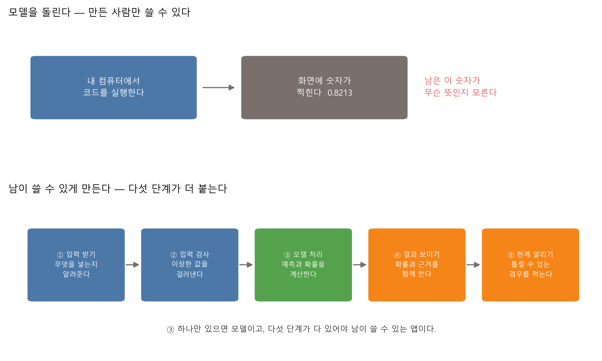
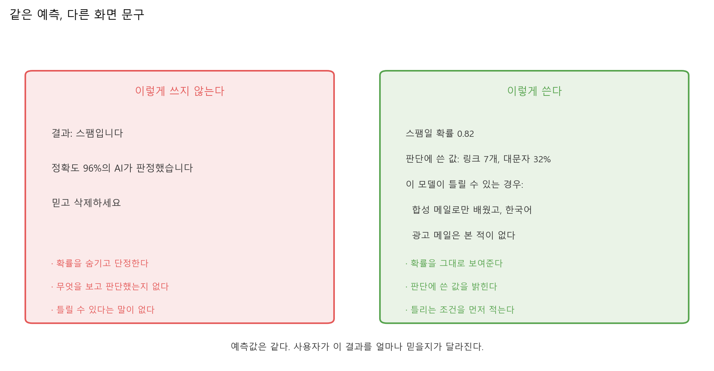
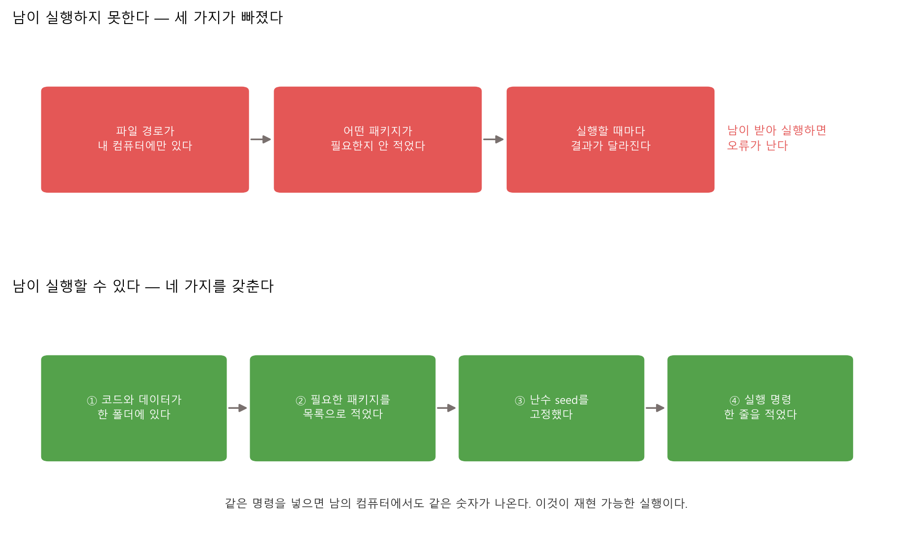

# 제13장 나만의 AI 앱 만들기 — 데모와 사용자 경험

---

### 학습 목표

- 모델과 앱의 차이를 설명하고, 앱이 하는 일 다섯 가지를 말한다
- 입력 검사, 확률, 판단 근거, 한계 안내를 화면에 넣은 앱 파일을 만든다
- 앱이 화면에 표시한 확률을 실제로 맞은 비율과 대조한다
- 모델이 배운 범위 밖의 입력에 경고를 붙여야 하는 이유를 실행 결과로 설명한다
- 앱을 남에게 건네는 방법 세 가지를 비교하고, 받지 않아야 할 입력을 구분한다

지난 장에서는 코딩 에이전트에게 일을 맡길 때 사람이 확인할 것을 다뤘다. 이번 장에서는 방향이 바뀐다. **내가 만든 모델을 다른 사람이 쓴다.** 그 사람은 코드를 읽지 않고 화면만 본다. 그래서 화면에 무엇을 적는지가 모델의 정확도만큼 중요해진다.

이 장은 개념을 설명한 바로 뒤에 그 개념을 확인하는 실습을 둔다. 1절과 2절의 앱 구성은 실습 13.1에서, 3절과 4절의 확률 점검은 실습 13.2에서 실행한다.

### 실행 환경

```bash
cd practice/chapter13
python -m pip install -r ../requirements.txt
```

필요한 패키지는 numpy, pandas, matplotlib, scikit-learn이다. GPU도 인터넷 연결도 필요 없다. 두 실습 모두 노트북에서 몇 초 안에 끝난다. 앱을 여는 데에는 웹 브라우저만 쓴다.

두 실습의 데이터는 **컴퓨터로 만든 합성 날씨 데이터**다. 하루의 기온·강수량·풍속 숫자 세 개를 보고 그날 공공자전거 대여가 많은 날인지 맞히는 문제를 흉내 냈다. 실제 대여 기록이 아니며, 숫자를 만든 규칙은 `practice/chapter13/code/_bikedata.py`에 적혀 있다.

---

### 1. 모델과 앱은 무엇이 다른가

지금까지 실습 코드는 정확도 한 줄을 출력하고 끝났다. 그 숫자는 코드를 실행한 사람만 볼 수 있고, 그 사람만 뜻을 안다. **모델**은 입력을 받아 예측을 계산하는 부분이다. **앱**은 모델 앞뒤에 사람이 쓸 수 있게 하는 단계를 붙인 것이다.



**그림 13.1** 위쪽은 만든 사람만 쓰는 상태, 아래쪽은 다섯 단계를 갖춘 앱이다

**표 13.1** 앱이 하는 일 다섯 가지

| 단계 | 하는 일 | 빠지면 생기는 일 |
|---|---|---|
| ① 입력 받기 | 무엇을 어떤 단위로 넣는지 화면에 적는다 | 사용자가 섭씨 대신 화씨를 넣는다 |
| ② 입력 검사 | 있을 수 없는 값이면 계산하지 않고 이유를 말한다 | 강수량 -5mm에도 확률이 나온다 |
| ③ 계산 | 모델로 확률을 계산한다 | (이 단계만 있으면 모델이다) |
| ④ 결과 보이기 | 판정, 확률, 판단에 쓴 값을 함께 적는다 | 사용자가 답을 얼마나 믿을지 정할 수 없다 |
| ⑤ 한계 알리기 | 모델이 틀릴 수 있는 경우를 적는다 | 모델이 배운 적 없는 입력에도 답을 그대로 믿는다 |

#### 1-1. 앱을 만드는 도구

파이썬 모델에 화면을 붙이는 도구는 여러 가지다. 수업에서는 설치가 필요 없는 세 번째 방법을 쓴다.

**표 13.2** 화면을 붙이는 방법 세 가지

| 방법 | 만드는 방식 | 쓰는 사람에게 필요한 것 |
|---|---|---|
| Gradio | 파이썬 함수 하나에 입력 칸과 출력 칸을 붙인다 | 만든 사람의 컴퓨터가 켜져 있거나, 웹에 올려야 한다 |
| Streamlit | 파이썬 파일을 위에서 아래로 실행하며 화면을 그린다 | 위와 같다 |
| 파일 한 개(HTML) | 모델의 숫자를 꺼내 웹 문서 한 개에 담는다 | 웹 브라우저 |

○ Gradio는 `pip install --upgrade gradio`로 설치하며, 문서에 적힌 조건은 파이썬 3.10 이상이다. 파일을 실행하면 내 컴퓨터의 `http://localhost:7860` 주소에서 화면이 열린다[^gradio]

○ Streamlit은 `pip install streamlit`으로 설치하고 `streamlit hello`로 예제 화면을 연다[^streamlit]

○ 세 번째 방법은 모델이 단순할 때만 쓸 수 있다. 이 장의 모델은 숫자 10개로 계산이 끝나서 파일 하나에 담긴다. 신경망처럼 숫자가 수백만 개인 모델은 Gradio나 Streamlit처럼 파이썬이 계속 실행되는 방식을 쓴다

---

### 2. 화면에 무엇을 적는가

같은 예측이어도 화면에 적는 문구에 따라 사용자가 하는 행동이 달라진다.



**그림 13.2** 예측값은 같고 문구만 다르다. 그림 안의 숫자는 문구를 보이려고 적은 예시이며 실행 결과가 아니다

왼쪽 화면은 세 가지를 빠뜨렸다. 확률이 없어서 사용자는 이 답이 겨우 넘긴 답인지 알 수 없고, 판단에 쓴 값이 없어서 입력을 잘못 넣었는지 확인할 수 없다. 틀릴 수 있는 경우가 없어서 "자전거를 더 배치하세요"라는 문장을 지시로 받아들인다.

**표 13.3** 화면에 적는 것과 적지 않는 것

| 적는다 | 적지 않는다 |
|---|---|
| 확률 숫자 ("대여가 많은 날일 확률 0.82") | 단정 ("대여가 많은 날입니다") |
| 판단에 쓴 입력값 | 모델이 보지 않은 것을 본 것처럼 쓴 설명 |
| 모델이 배운 데이터와 범위 | "정확도 높은 AI" 같은 수식어 |
| AI가 계산한 예측이라는 사실 | 사용자가 할 행동을 정해 주는 문장 |

마이크로소프트의 사람-AI 상호작용 지침은 첫 두 항목으로 "시스템이 무엇을 할 수 있는지 분명히 한다"와 "시스템이 그 일을 얼마나 잘하는지 분명히 한다"를 든다. 두 번째 항목의 설명은 "AI 시스템이 얼마나 자주 실수하는지 사용자가 이해하도록 돕는다"이다[^hax]. 제품 설계자를 위한 지침이며, 이 장에서는 화면 문구를 고르는 기준으로 빌려 쓴다.

---

### 실습 13.1: 모델을 파일 한 개짜리 앱으로 내보낸다

#### 실습 목표

- 학습한 모델에서 숫자를 꺼내 브라우저로 여는 앱 파일을 만든다
- 꺼낸 숫자로 계산한 확률이 원래 모델과 같은지 확인한다
- 시험 입력 6건이 답함·범위 밖 경고·입력 거절 중 어느 쪽으로 처리되는지 본다

#### 데이터

합성 날씨 데이터 1,500일치다. 기온은 3~26도 사이에서만 만들었다. 봄·가을 날씨만 보고 배운 모델이라는 뜻이다. 정답을 만든 규칙은 "기온이 24도에 가까울수록, 비와 바람이 적을수록 대여가 많다"이다.

모델은 6장에서 다룬 로지스틱 회귀다. 입력마다 무게를 곱해 더한 뒤 0과 1 사이의 확률로 바꾼다.

#### 실행 명령

```bash
cd practice/chapter13/code
python 13-1-build-app.py
```

실행이 끝나면 `practice/chapter13/results/my_app.html`을 두 번 눌러 브라우저로 연다.

#### 핵심 코드

앱이 입력 한 건을 처리하는 순서다. 앱 파일 안에도 같은 계산이 들어 있다.

```python
# 2. 입력 검사 - 있을 수 없는 값이면 계산하지 않는다
for item, value in zip(spec["inputs"], values):
    if not item["min"] <= value <= item["max"]:
        return {"status": REJECT, "reason": reason}

# 3. 계산 - 표준화한 값에 무게를 곱해 더하고, 확률로 바꾼다
pushes = [item["weight"] * (value - item["mean"]) / item["scale"]
          for item, value in zip(spec["inputs"], values)]
prob = 1.0 / (1.0 + math.exp(-(spec["bias"] + sum(pushes))))
```

학생이 바꿀 값은 파일 위쪽에 모여 있다.

```python
APP_TITLE = "오늘은 공공자전거 대여가 많은 날일까"
MODEL_LIMITS = [...]     # 앱 화면 아래에 항상 적을 한계 안내문
MY_INPUTS = [...]        # 앱에 넣어 볼 시험 입력 (설명, 기온, 강수량, 풍속)
```

_전체 코드는 `practice/chapter13/code/13-1-build-app.py` 참고_

#### 실행 결과

```text
=== 1. 모델 ===
데이터: 컴퓨터로 만든 합성 날씨 데이터(실제 대여 기록 아님)
난수 seed: 42
훈련 1050일, 테스트 450일
훈련 데이터 중 대여가 많은 날: 431일
테스트 정확도: 0.884

=== 2. 앱 파일에 담는 숫자 ===
입력    단위  앱이 받는 범위  모델이 배운 범위    평균  표준편차    무게
------  ----  --------------  ----------------  ------  --------  ------
기온    도    -20~45          3~26              14.555     6.725  +3.047
강수량  mm    0~100           0~32.5             2.312     4.686  -2.166
풍속    m/s   0~30            0.1~10.4           3.062     1.677  -0.734
절편: -1.117
담은 숫자: 입력 3개 x 3 + 절편 1 = 10개

=== 3. 내보낸 숫자 확인 ===
테스트 450일에서 원래 모델과 앱 계산의 확률 차이 최댓값: 0.000000
판정이 달라진 날: 0일

=== 4. 시험 입력 처리 ===
번호  설명                    기온  강수량  풍속  처리          판정             확률
----  ----------------------  ----  ------  ----  ------------  --------------  -----
   1  맑은 봄날                 21       0     2  답함          대여가 많은 날  0.966
   2  비 오는 가을날            15      12     4  답함          대여가 적은 날  0.003
   3  쌀쌀하고 바람 부는 날      8       0     7  답함          대여가 적은 날  0.009
   4  흐리고 비가 조금 온 날    18       4     3  답함          대여가 적은 날  0.423
   5  한여름 폭염               36       0     2  범위 밖 경고  대여가 많은 날  1.000
   6  잘못 입력한 예            20      -5     2  입력 거절     -                   -

5번 범위 밖 경고: 기온 36도(배운 범위 3~26)
6번 입력 거절: 강수량은(는) 0~100 mm 사이여야 한다

=== 5. 근거 예시: 2번 비 오는 가을날 ===
기온 15도: +0.20
강수량 12mm: -4.48
풍속 4m/s: -0.41
절편: -1.12
합계 -5.81 -> 확률 0.003
(양수는 '대여가 많은 날' 쪽, 음수는 '대여가 적은 날' 쪽으로 민 크기다)

=== 6. 집계 ===
시험 입력 6건: 답함 4건, 범위 밖 경고 1건, 입력 거절 1건
```

_출처: `practice/chapter13/results/13-1-build-app.log`_


**그림 13.3** 왼쪽은 시험 입력 6건을 앱이 처리한 결과, 오른쪽은 테스트 450일에서 원래 모델의 확률과 앱 파일의 숫자로 계산한 확률을 비교한 것이다(합성 데이터)


**그림 13.4** `my_app.html`에 5번 입력(기온 36도, 강수량 0mm, 풍속 2m/s)을 넣은 화면이다. 실습 코드가 만든 그림이 아니라 앱 파일을 브라우저로 열어 저장한 화면이다

#### 결과 읽기

○ **앱 파일에는 숫자 10개만 들어간다**
  - 입력 세 개마다 평균·표준편차·무게가 있고 절편이 하나 있다. 훈련 데이터 1,050일은 앱 파일에 들어가지 않는다
  - 테스트 450일에서 원래 모델과 앱 계산의 확률 차이 최댓값은 0.000000이고 판정이 달라진 날은 0일이다. 숫자를 옮기다 틀리면 앱이 원래 모델과 다른 답을 내므로, 코드는 이 차이가 0.001을 넘으면 앱 파일을 만들지 않고 멈춘다

○ **앱이 받는 범위와 모델이 배운 범위는 다르다**
  - 기온은 -20~45도까지 받지만 모델이 배운 범위는 3~26도다. 앞의 범위는 세상에 있을 수 있는 값이고, 뒤의 범위는 훈련 데이터에 있던 값이다
  - 6번은 강수량이 -5mm여서 받는 범위 밖이다. 앱은 계산하지 않고 이유를 적었다
  - 5번은 기온 36도여서 받는 범위 안이고 배운 범위 밖이다. 앱은 답을 내고 경고를 붙였다

○ **5번의 확률 1.000은 믿을 근거가 없다**
  - 모델은 26도보다 더운 날을 한 번도 보지 못했다. 배운 것은 "3~26도 사이에서는 더울수록 대여가 많다"뿐이고, 무게 +3.047을 36도까지 그대로 적용했다
  - 데이터를 만든 규칙에서는 24도를 넘으면 대여가 줄어든다. 이 확률이 실제로 얼마나 틀리는지는 실습 13.2에서 센다

○ **판단 근거는 값마다 민 크기로 적는다**
  - 2번에서 강수량 12mm가 -4.48로 가장 크게 밀었다. 사용자는 이 줄을 보고 "비 때문에 적은 날로 나왔다"는 것을 안다
  - 4번은 확률이 0.423이다. 판정은 "적은 날"이지만 기준인 0.5에 가깝다. 판정만 적으면 2번(0.003)과 4번이 같은 답으로 보인다

#### 해 보기

파일 위쪽 값을 바꿔 다시 실행하고, `my_app.html`을 새로 고친다.

1. `MODEL_LIMITS`의 세 문장을 자기 말로 고쳐 쓴다. 이 앱을 처음 보는 친구가 읽고 뜻을 아는지 물어본다
2. `MY_INPUTS`에 `("태풍이 온 날", 24.0, 80.0, 20.0)` 한 줄을 넣는다. 경고에 입력 이름이 몇 개 나오는가
3. 브라우저에서 기온 칸을 비운다. 화면에 무엇이 나오는가

---

### 3. 화면의 확률을 믿어도 되는가

앱이 "확률 0.9"라고 표시하면 사용자는 열 번 중 아홉 번은 맞는다고 읽는다. 그렇게 읽어도 되는지는 따로 확인해야 한다. scikit-learn 문서는 이 조건을 이렇게 적는다. 잘 맞춰진 분류기라면 0.8에 가까운 확률을 준 표본 가운데 약 80%가 실제로 그 분류에 속해야 한다[^calib].

확인 절차는 다음과 같다.

1. 앱이 낸 답을 표시한 확률에 따라 구간으로 묶는다(0.5~0.6, 0.6~0.7, …)
2. 구간마다 실제로 맞은 답의 비율을 센다
3. 표시한 확률과 맞은 비율을 나란히 놓는다

두 값이 비슷하면 화면의 확률은 사용자가 읽는 뜻과 같다. 맞은 비율이 더 낮으면 화면의 숫자가 실제보다 크다.

#### 3-1. 배운 범위 안과 밖

테스트 데이터로 확인한 결과에는 조건이 붙는다. 테스트 데이터는 훈련 데이터와 같은 범위에서 나왔다. 사용자가 그 범위 밖의 값을 넣으면 테스트 결과가 그대로 유지된다는 보장이 없다.

딥러닝 분류기 여러 종류를 비교한 2019년 연구는 입력의 분포가 훈련 때와 달라질수록 정확도와 함께 확률의 품질도 나빠진다고 보고했다[^ovadia]. 이 연구는 딥러닝 분류기를 다뤘고 이 장의 모델은 로지스틱 회귀이므로, 같은 현상이 이 장의 모델에서도 나타나는지는 실습 13.2에서 직접 센다.

---

### 4. 자신 없을 때와 범위 밖일 때 말하는 법

확률이 0.5에 가까운 답과 배운 범위 밖의 답은 서로 다른 경우다.

**표 13.4** 두 가지 "믿기 어려운 답"

| 경우 | 화면의 확률 | 앱이 할 일 |
|---|---|---|
| 확률이 0.5에 가깝다 | 0.4~0.6 근처 | 확률을 그대로 보이거나, 답을 내지 않고 "판단하기 어렵다"고 적는다 |
| 입력이 배운 범위 밖이다 | 0.99처럼 높게 나올 수 있다 | 확률 옆에 경고를 붙인다. 확률만으로는 이 경우를 알 수 없다 |

○ 첫 번째 경우에 답을 내지 않는 것을 **판단 보류**라고 한다. 보류하면 틀린 답은 줄고, 사람이 직접 확인할 건수는 늘어난다

○ 두 번째 경우는 확률 숫자에 드러나지 않는다. 그래서 앱이 입력값을 배운 범위와 비교하는 단계를 따로 둔다. 실습 13.1의 앱이 이 방식을 쓴다

확신을 화면에 어떻게 표시할지도 정해야 한다. 구글의 People + AI Guidebook은 방식 네 가지를 든다. 높음·중간·낮음 같은 등급, 후보 여러 개, 숫자, 그림이다. 같은 문서는 확신 표시가 사용자의 주의를 흩뜨리거나 잘못 읽힐 위험이 항상 있으므로, 표시가 사용자에게 도움이 되는지 시험할 시간을 넉넉히 두라고 권한다[^pair].

사람을 대상으로 한 실험도 같은 방향이다. 대규모 언어 모델의 조언에 의존을 조절하는 장치를 붙인 2025년 실험에서 장치는 지나친 의존을 줄였지만, 맞는 답은 따르고 틀린 답은 거르는 적절한 의존은 대체로 늘리지 못했다[^bo]. 언어 모델의 문장 답변을 다룬 실험이므로 이 장의 숫자 예측 앱에 그대로 옮길 수는 없다. 경고 문구를 붙였다고 사용자가 올바르게 쓴다고 가정하지 말고, 친구 한 명에게 화면을 보여 주고 무엇으로 읽는지 물어보라는 정도로 받아들인다.

---

### 실습 13.2: 화면의 확률을 실제로 맞은 비율과 대조한다

#### 실습 목표

- 앱이 표시한 확신과 실제로 맞은 비율을 구간별로 비교한다
- 배운 범위 안의 데이터와 범위 밖이 섞인 새 데이터에서 그 비교가 어떻게 달라지는지 센다
- 범위 밖 경고가 붙은 답과 안 붙은 답의 맞은 비율을 비교한다

#### 데이터

두 묶음을 쓴다. 첫째는 실습 13.1과 같은 테스트 450일(기온 3~26도)이다. 둘째는 새로 만든 여름 날씨 600일(기온 22~38도)이다. 둘 다 같은 규칙으로 만든 합성 데이터다. 모델은 실습 13.1의 것을 그대로 쓰고, 새 데이터로 다시 학습시키지 않는다.

**확신**은 앱이 고른 답 쪽의 확률이다. 확률이 0.2면 앱은 "적은 날"이라고 답하고 확신은 0.8이다.

#### 실행 명령

```bash
cd practice/chapter13/code
python 13-2-prob-check.py
```

#### 핵심 코드

날마다 확신, 맞았는지, 경고가 붙는지를 계산하는 부분이다.

```python
prob = model.predict_proba(x)[:, 1]
answer = (prob >= 0.5).astype(int)
outside = np.zeros(len(x), dtype=bool)
for i, (low, high) in enumerate(ranges):
    outside |= (x[:, i] < low) | (x[:, i] > high)
return pd.DataFrame({
    "확신": np.maximum(prob, 1.0 - prob),
    "맞음": answer == y,
    "경고": outside,
})
```

`ranges`는 입력마다 모델이 배운 최솟값과 최댓값이다. 세 입력 중 하나라도 그 범위를 벗어나면 경고가 붙는다.

학생이 바꿀 값은 파일 위쪽에 모여 있다.

```python
NEW_TEMP = (22.0, 38.0)   # 새 데이터의 기온 범위(도)
NEW_DAYS = 600            # 새 데이터 날 수
HIGH_CONFIDENCE = 0.9     # 이 값 이상이면 "확신이 높다"고 센다
```

_전체 코드는 `practice/chapter13/code/13-2-prob-check.py` 참고_

#### 실행 결과

```text
=== 2. 배운 범위 안: 테스트 450일 ===
확신 구간  건수  평균 확신  맞은 비율
---------  ----  ---------  ---------
0.5~0.6      38      0.546      0.526
0.6~0.7      41      0.655      0.683
0.7~0.8      38      0.750      0.737
0.8~0.9      56      0.861      0.893
0.9~1.0     277      0.971      0.982

=== 3. 새 데이터: 600일 ===
확신 구간  건수  평균 확신  맞은 비율
---------  ----  ---------  ---------
0.5~0.6       4      0.559      1.000
0.6~0.7       5      0.675      0.600
0.7~0.8       9      0.756      0.444
0.8~0.9      22      0.857      0.591
0.9~1.0     560      0.992      0.623

=== 4. 범위 밖 경고가 붙은 답과 안 붙은 답 (확신 높은 답 = 확신 0.9 이상) ===
묶음                   건수  평균 확신  맞은 비율  확신 높은 답  그중 틀린 답
---------------------  ----  ---------  ---------  ------------  ------------
테스트 / 배운 범위 안   450      0.874      0.884           277             5
새 데이터 / 경고 없음   149      0.949      0.919           127             6
새 데이터 / 경고 있음   451      0.987      0.523           433           205

=== 5. 집계 ===
새 데이터 전체: 맞은 비율 0.622, 평균 확신 0.978
새 데이터 600일 중 범위 밖 경고가 붙는 날: 451일
새 데이터에서 틀린 답 227건 중 경고가 붙은 답: 215건
```

_출처: `practice/chapter13/results/13-2-prob-check.log`_


**그림 13.5** 왼쪽은 표시한 확신과 실제로 맞은 비율, 오른쪽은 범위 밖 경고가 붙은 답과 안 붙은 답의 비교다(합성 데이터)

#### 결과 읽기

○ **배운 범위 안에서는 화면의 확신과 맞은 비율이 비슷하다**
  - 다섯 구간 모두 평균 확신과 맞은 비율의 차이가 0.04보다 작다. 확신 0.9 이상인 277건은 평균 확신 0.971, 맞은 비율 0.982다
  - 이 범위에서는 사용자가 "0.9면 열 번 중 아홉 번"으로 읽어도 된다

○ **새 데이터에서는 확신이 높은데 맞은 비율이 낮다**
  - 600일 중 560일의 확신이 0.9 이상이다. 그 560건의 맞은 비율은 0.623이다
  - 전체로 보면 평균 확신 0.978, 맞은 비율 0.622다. 화면의 숫자와 실제가 0.356 벌어졌다
  - 건수가 4~22건인 나머지 구간은 건수가 적어서 비율을 믿기 어렵다

○ **경고가 붙은 답과 안 붙은 답은 맞은 비율이 다르다**
  - 새 데이터 중 경고가 안 붙은 149일은 맞은 비율이 0.919다. 테스트 데이터의 0.884와 비슷하다
  - 경고가 붙은 451일은 평균 확신 0.987, 맞은 비율 0.523이다. 확신 0.9 이상인 답 433건 가운데 205건이 틀렸다
  - 새 데이터에서 틀린 답 227건 가운데 215건에 경고가 붙어 있었다. 12건은 경고 없이 틀렸다

○ **경고는 "틀렸다"가 아니라 "확인한 적이 없다"는 뜻이다**
  - 경고가 붙은 451건 중 215건이 틀렸으므로 236건은 맞았다. 경고가 붙었다고 답이 틀린 것은 아니다
  - 이 결과는 데이터를 만든 규칙에서 나왔다. 규칙을 "24도를 넘으면 대여가 줄어든다"로 정했기 때문에 더운 날에 모델이 틀린다. 실제 공공자전거 대여가 이렇게 움직인다는 뜻이 아니다

#### 해 보기

파일 위쪽 값을 바꿔 다시 실행한다.

1. `NEW_TEMP`를 `(3.0, 26.0)`으로 바꾼다. "새 데이터" 표가 "배운 범위 안" 표와 비슷해지는가
2. `NEW_TEMP`를 `(-10.0, 5.0)`으로 바꾼다. 경고가 붙은 답의 맞은 비율은 얼마인가. 여름 데이터 때와 왜 다른가
3. `HIGH_CONFIDENCE`를 `0.99`로 올린다. 경고가 붙은 묶음에서 "그중 틀린 답"이 0이 되는가

○ 2번에서는 범위 밖인데도 답이 맞는 경우를 본다. 범위 밖의 답이 맞을지 틀릴지는 훈련 데이터만으로는 알 수 없고, 그 범위의 데이터를 구해 세어 봐야 안다

---

### 5. 앱을 남에게 건넨다

앱을 건네는 방법은 세 가지로 나눌 수 있다.

**표 13.5** 앱을 건네는 방법

| 방법 | 받는 사람이 하는 일 | 확인할 점 |
|---|---|---|
| 파일 한 개를 보낸다 | 파일을 브라우저로 연다 | 파일 안의 숫자와 한계 안내문이 최신인가 |
| 코드 폴더를 보낸다 | 패키지를 설치하고 명령 한 줄을 실행한다 | 아래 재현 조건 네 가지를 갖췄는가 |
| 웹에 올린다 | 주소를 연다 | 누가 볼 수 있는가, 입력이 어디로 가는가, 언제까지 열려 있는가 |



**그림 13.6** 코드 폴더를 건넬 때 갖출 네 가지. 같은 명령을 넣으면 남의 컴퓨터에서도 같은 숫자가 나와야 한다

웹에 올리는 서비스의 조건은 자주 바뀐다. 아래는 문서를 연 날의 내용이다.

○ Gradio는 `launch(share=True)`로 공개 주소를 만들 수 있고, 이 공유 주소는 1주일 뒤 만료된다[^gradio-share]

○ Streamlit Community Cloud는 문서에 무료라고 적혀 있다[^st-cloud]

○ Hugging Face Spaces는 문서 기준으로 정적 웹 문서(HTML) Space가 누구에게나 무료이고, Gradio Space를 새로 만들려면 대부분 유료 요금제가 필요하다[^spaces]. `my_app.html`은 정적 웹 문서에 해당한다

#### 5-1. AI가 계산했다는 사실을 적는다

실습 13.1의 앱은 화면 맨 위에 "이 화면의 답은 AI 모델이 계산한 예측이다"라고 적는다. 사용자가 사람이 확인한 답으로 오해하지 않게 하려는 문장이다.

우리나라 「인공지능 발전과 신뢰 기반 조성 등에 관한 기본법」 제31조 제1항은 인공지능사업자가 고영향 인공지능이나 생성형 인공지능을 이용한 제품·서비스를 제공할 때 그 사실을 이용자에게 미리 알리도록 정한다[^ailaw]. 과학기술정보통신부의 가이드라인은 이 의무의 취지를 이용자가 AI 기반 서비스를 쓰고 있다는 사실을 명확히 알게 하는 것이라고 적는다[^msit].

이 장의 앱은 숫자 세 개로 확률을 계산하는 예측 모델이며, 조문이 든 고영향·생성형 두 종류로 만든 서비스가 아니다. 그래서 이 문장은 법이 요구해서가 아니라 사용자가 오해하지 않게 하려고 넣는다. 생성형 AI를 호출하는 앱을 만들어 공개할 때에는 조문과 가이드라인을 직접 읽고 확인한다. 법 적용 여부의 최종 판단은 이 교재가 내릴 수 없다.

---

### 6. 받지 않아야 할 입력

앱은 입력을 받는다. 입력 칸을 하나 더 만들 때마다 그 값이 어디에 남는지 정해야 한다.

「개인정보 보호법」 제16조 제1항은 개인정보를 수집할 때 "그 목적에 필요한 최소한의 개인정보를 수집하여야 한다"고 정한다[^pipa]. 수업용 앱을 만드는 학생이 이 조문의 적용 대상인지와 무관하게, 이 장에서는 같은 원칙을 설계 기준으로 쓴다.

**표 13.6** 입력 칸을 만들기 전에 묻는 것

| 질문 | 이 장의 앱 |
|---|---|
| 이 값이 없으면 예측할 수 없는가 | 기온·강수량·풍속 세 개만 받는다. 이름·연락처 칸은 없다 |
| 입력한 값이 어디로 가는가 | `my_app.html`은 브라우저 안에서만 계산하고 인터넷으로 보내지 않는다 |
| 입력한 값을 저장하는가 | 저장하지 않는다. 화면을 닫으면 사라진다 |
| 사람에 대한 판정을 내는가 | 내지 않는다. 날씨를 보고 대여량을 예측한다 |

○ 글을 자유롭게 적는 입력 칸은 숫자 칸보다 위험하다. 사용자가 이름이나 전화번호를 적을 수 있기 때문이다. 글 입력을 받는다면 "개인정보를 적지 마세요"를 입력 칸 옆에 적는다

○ 앱을 웹에 올리면 입력이 그 서비스의 서버를 거친다. 내 컴퓨터에서 실행할 때는 없던 경로가 생긴다

○ 성적, 건강, 채용처럼 사람에 대한 판정을 내는 앱은 수업 과제로 만들더라도 실제 사람의 자료로 시험하지 않는다

---

### 7. 직접 움직여 보는 웹 자료

아래 자료는 모두 무료로 읽을 수 있으며, 설명은 각 페이지를 열어 확인한 내용이다(2026년 11월 23일 확인).

| 자료 | 무엇을 볼 수 있는가 | 주소 |
|---|---|---|
| Gradio Quickstart | 함수 하나로 화면을 만드는 예제(영어) | https://www.gradio.app/guides/quickstart |
| Streamlit 설치 안내 | 설치와 `streamlit hello` 예제(영어) | https://docs.streamlit.io/get-started/installation |
| Hugging Face Spaces 개요 | 앱을 올리는 방식 세 가지와 요금 조건(영어) | https://huggingface.co/docs/hub/spaces-overview |
| Hugging Face 모델 카드 안내 | 모델을 공개할 때 용도·한계·학습 데이터·평가 결과를 적는 양식(영어) | https://huggingface.co/docs/hub/model-cards |
| scikit-learn 확률 보정 안내 | 표시한 확률과 실제 비율을 비교한 그래프와 설명(영어) | https://scikit-learn.org/stable/modules/calibration.html |
| People + AI Guidebook | 확신을 화면에 표시하는 방식 네 가지(영어) | https://pair.withgoogle.com/chapter/explainability-trust/ |

○ 모델 카드 안내는 실습 13.1의 `MODEL_LIMITS`를 쓸 때 함께 읽는다. 한계 안내문에 무엇을 적을지 항목으로 정리되어 있다

○ 확률 보정 안내의 그래프는 그림 13.5의 왼쪽과 같은 종류다. 대각선에 가까울수록 표시한 확률과 실제 비율이 같다

---

### 책임 있는 AI 체크

**표 13.7** 앱을 남에게 보이기 전의 점검

| 시점 | 확인 질문 |
|---|---|
| 만들 때 | 입력 칸마다 단위와 받는 범위를 적었는가. 없어도 되는 입력 칸은 없는가 |
| 만들 때 | 있을 수 없는 값을 넣으면 계산하지 않고 이유를 말하는가 |
| 만들 때 | 판정만이 아니라 확률과 판단에 쓴 값을 함께 적었는가 |
| 점검할 때 | 화면의 확률을 테스트 데이터의 맞은 비율과 대조했는가 |
| 점검할 때 | 모델이 배운 범위를 적었는가. 범위 밖 입력에 경고가 붙는가 |
| 건네기 전 | AI가 계산한 예측이라는 사실과 한계 안내문이 화면에 있는가 |
| 건네기 전 | 처음 보는 사람 한 명에게 화면을 보여 주고 무엇으로 읽는지 물어봤는가 |

---

### 과제 (LMS 제출)

수업 시간에 실습을 실행했는지만 확인한다. 따로 보고서를 쓰지 않는다.

#### 제출물

아래 두 장을 LMS에 올린다.

1. `practice/chapter13/results/my_app.html`을 브라우저로 연 화면을 캡처한 그림 한 장. 아래쪽 한계 안내문이 보여야 한다
2. `practice/chapter13/results/confidence_check.png`

#### 평가 기준

- 두 파일을 올리면 완료로 인정한다. 그림에 나온 수치는 채점하지 않는다
- 실습 13.1의 "해 보기" 1번에서 한계 안내문을 고쳤다면 고친 문장이 화면에 나온다. 기본값 그대로여도 인정한다

#### 마감

- 실습 수업일 포함 7일 이내

---

### 핵심 정리

| 개념 | 한 줄 정리 |
|---|---|
| 모델과 앱 | 모델은 예측을 계산하고, 앱은 그 앞뒤에 입력 받기·입력 검사·결과 보이기·한계 알리기를 붙인다 |
| 받는 범위와 배운 범위 | 받는 범위는 세상에 있을 수 있는 값이고, 배운 범위는 훈련 데이터에 있던 값이다 |
| 화면 문구 | 판정만 적지 않는다. 확률, 판단에 쓴 값, 틀릴 수 있는 경우, AI가 계산했다는 사실을 함께 적는다 |
| 확률 점검 | 표시한 확률을 구간으로 묶어 실제로 맞은 비율과 대조한다 |
| 범위 밖 입력 | 확률이 높게 나와도 맞는다는 근거가 없다. 확률 숫자만으로는 알 수 없어서 경고를 따로 붙인다 |
| 경고의 뜻 | "틀렸다"가 아니라 "이런 입력으로 확인한 적이 없다"는 뜻이다 |
| 건네는 방법 | 파일 한 개, 코드 폴더, 웹 공개. 웹에 올리면 입력이 서비스의 서버를 거친다 |
| 받지 않는 입력 | 예측에 꼭 필요한 값만 받는다. 개인정보를 적을 수 있는 칸은 만들지 않는다 |

다음 장에서는 이 장에서 정한 것들을 자기 프로젝트에 옮긴다. 문제를 정의하고, 데이터를 고르고, 실행되는 중간 결과를 만든다.

---

[^gradio]: Gradio, "Quickstart". https://www.gradio.app/guides/quickstart (2026년 11월 23일 확인)

[^streamlit]: Streamlit, "Install Streamlit". https://docs.streamlit.io/get-started/installation (2026년 11월 23일 확인)

[^hax]: Microsoft, HAX Toolkit의 지침 1 "Make clear what the system can do"와 지침 2 "Make clear how well the system can do what it can do". 지침 2 주소는 https://www.microsoft.com/en-us/haxtoolkit/guideline/make-clear-how-well-the-system-can-do-what-it-can-do/ (2026년 11월 23일 확인)

[^calib]: scikit-learn 사용자 안내서, "Probability calibration". https://scikit-learn.org/stable/modules/calibration.html (2026년 11월 23일 확인)

[^ovadia]: Ovadia 외, "Can You Trust Your Model's Uncertainty? Evaluating Predictive Uncertainty Under Dataset Shift", NeurIPS 2019. 딥러닝 분류기를 대상으로 한 비교 연구다. https://arxiv.org/abs/1906.02530 (2026년 11월 23일 확인)

[^pair]: Google, "Explainability + Trust", People + AI Guidebook. https://pair.withgoogle.com/chapter/explainability-trust/ (2026년 11월 23일 확인)

[^bo]: Bo, Wan, Anderson, "To Rely or Not to Rely? Evaluating Interventions for Appropriate Reliance on Large Language Models", CHI 2025. 초록을 읽고 인용했으며 본문은 열지 않았다. https://arxiv.org/abs/2412.15584 (2026년 11월 23일 확인)

[^gradio-share]: Gradio, "Sharing Your App". https://www.gradio.app/guides/sharing-your-app (2026년 11월 23일 확인)

[^st-cloud]: Streamlit, "Streamlit Community Cloud". https://docs.streamlit.io/deploy/streamlit-community-cloud (2026년 11월 23일 확인)

[^spaces]: Hugging Face, "Spaces Overview". 무료 개인 계정도 조건을 갖추면 Gradio Space를 2개까지 둘 수 있다고 적혀 있다. https://huggingface.co/docs/hub/spaces-overview (2026년 11월 23일 확인)

[^ailaw]: 「인공지능 발전과 신뢰 기반 조성 등에 관한 기본법」 제31조 제1항, 국가법령정보센터 현행본. 2026년 1월 22일 시행. https://www.law.go.kr/법령/인공지능발전과신뢰기반조성등에관한기본법 (2026년 11월 23일 확인)

[^msit]: 과학기술정보통신부, 「인공지능 투명성 확보 가이드라인」, 2026. 1. https://www.msit.go.kr/bbs/view.do?sCode=user&mId=102&mPid=100&bbsSeqNo=81&nttSeqNo=3148988 (2026년 11월 23일 확인)

[^pipa]: 「개인정보 보호법」 제16조 제1항, 국가법령정보센터 현행본. https://www.law.go.kr/법령/개인정보보호법 (2026년 11월 23일 확인)
