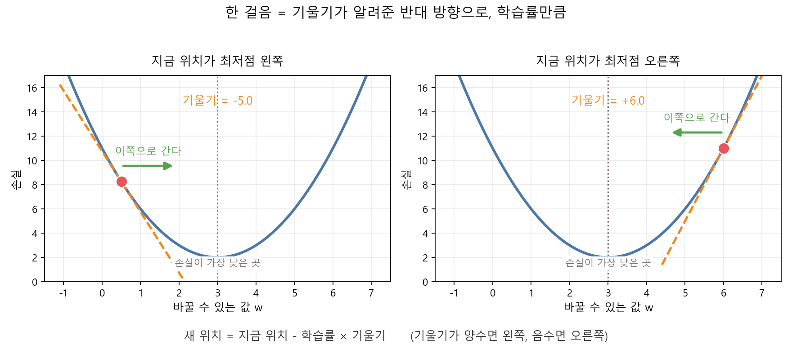
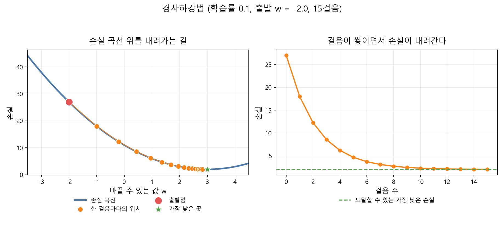
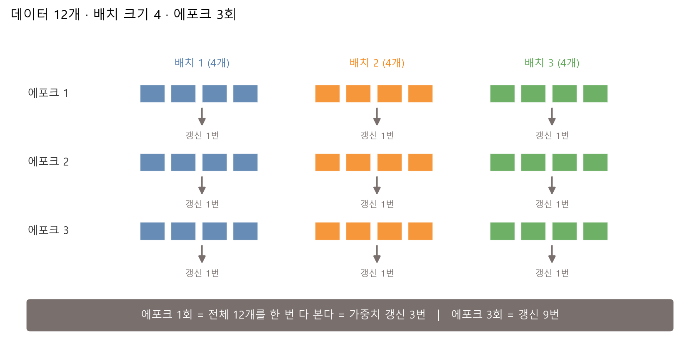
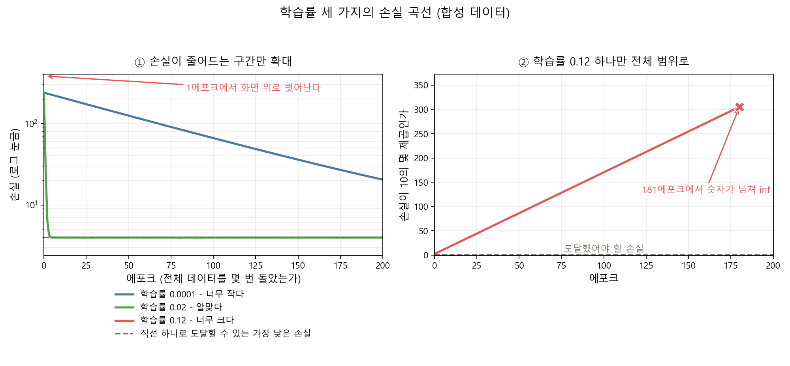

# 제6장 학습이란 무엇인가 — 손실함수와 경사하강법

---

### 학습 목표

- 모델이 "틀렸다"는 것을 어떻게 아는지 손실함수로 설명한다
- 분류 문제에서 교차 엔트로피가 정답 쪽 확률이 낮을수록 손실을 키운다는 것을 설명하고, 확률 하나로 손실을 계산한다
- 회귀 문제에서는 평균제곱오차를 쓴다는 것을 안다
- 기울기가 알려주는 것이 무엇인지, 경사하강법의 갱신 규칙 한 줄을 읽는다
- 역전파가 출력 쪽에서 입력 쪽으로 곱셈을 이어 가며 가중치마다 기울기를 구하는 과정을 숫자로 따라간다
- 학습률이 너무 작을 때와 너무 클 때 손실 곡선이 어떻게 달라지는지 구분한다
- epoch와 batch를 가중치 갱신 횟수로 환산한다

4장 실습에서 로지스틱 회귀는 `수면시간 = -1.59 x 공부시간 + 13.96` 이라는 선을 내놓았다. -1.59와 13.96을 정한 것은 사람이 아니다. 모델이 훈련 데이터 112명을 보며 스스로 고른 값이다. 이번 장은 그 고르는 과정을 연다. 필요한 것은 두 가지다. 지금 얼마나 틀렸는지 재는 자(손실함수), 그리고 어느 쪽으로 값을 옮겨야 하는지 정하는 규칙(경사하강법)이다.

이 장은 개념 하나를 설명한 바로 뒤에 그 개념을 확인하는 실습을 둔다. 3절의 갱신 규칙은 실습 6.1에서, 5·6절의 학습률과 에포크는 실습 6.2에서 실행해 본다.

### 실행 환경

```bash
cd practice/chapter6
python -m pip install -r ../requirements.txt
```

필요한 패키지는 numpy, pandas, matplotlib이다. GPU는 필요 없다. 두 실습 모두 노트북에서 몇 초 안에 끝난다.

실습 6.2의 데이터는 **컴퓨터로 만든 합성 데이터**다. 실제 관측 자료가 아니다.

---

### 1. 모델은 어떻게 "틀렸다"는 것을 아는가

저 두 숫자를 사람이 손으로 맞춘다면 어떻게 할지 먼저 적어 본다. 4장 실습에서 `MY_TREE_DEPTH`를 바꿔 가며 정확도를 확인한 것과 같은 방식이다.

1. 값을 하나 정한다
2. 실행해서 정확도를 본다
3. 정확도가 낮으면 값을 조금 옮긴다
4. 다시 실행한다

기계가 이 일을 대신하려면 2번과 3번이 걸린다.

○ **2번이 걸리는 이유** — 기계는 "낮다"를 모른다
  - 사람은 0.938이라는 숫자를 보고 "아직 부족하다"고 판단한다
  - 기계에게는 판단할 기준이 없다. 낮을수록 좋은 숫자 하나를 정해 줘야 한다
  - 그 숫자를 **손실(loss)** 이라고 부른다

○ **3번이 걸리는 이유** — 기계는 "어느 쪽"을 모른다
  - 사람은 그림을 보고 선을 왼쪽으로 옮길지 오른쪽으로 옮길지 정한다
  - 기계에게는 그림이 없다. 방향을 알려주는 숫자가 필요하다
  - 그 숫자를 **기울기(gradient)** 라고 부른다

이 장의 나머지는 두 숫자를 만드는 방법이다. 손실을 2절에서, 기울기를 3절에서 다룬다.

○ **왜 정확도를 그대로 쓰지 않는가**
  - 정확도는 맞힌 개수를 세는 값이라 계단처럼 움직인다. 선을 아주 조금 옮겨도 맞힌 개수는 그대로다
  - 그러다 어느 지점에서 한 명이 넘어가면 한 칸 뛴다. 이런 값으로는 "조금 옮기면 조금 좋아진다"를 알 수 없다
  - 손실은 조금 옮기면 조금 변하도록 만든다. 그래야 기계가 방향을 잡는다

---

### 2. 손실함수 — 틀린 정도를 숫자 하나로 모은다

#### 2-1. 정답 쪽 확률에 −log를 씌운다

4장의 로지스틱 회귀는 학생마다 "시험을 통과할지"를 맞혔다. 답을 바로 내지 않고, 시그모이드(5장 3절)를 거쳐 0과 1 사이의 값을 먼저 계산한다. 이 값을 통과할 **확률**로 읽고, 0.5를 넘으면 통과로 판정한다.

손실함수(loss function)는 예측이 정답에서 얼마나 벗어났는지를 숫자 하나로 만드는 계산이다. 모델이 확률을 내놓는 분류 문제에서 가장 많이 쓰는 손실함수가 **교차 엔트로피(cross-entropy)** 다. 계산은 두 단계다.

```
1. 정답 쪽에 준 확률 p를 고른다   (정답이 통과면 통과 확률, 탈락이면 탈락 확률)
2. 손실 = −log(p)                 (log는 자연로그)
```

학생이 여러 명이면 학생마다 손실을 구해 평균 낸다. 4장의 scikit-learn 로지스틱 회귀도 이 평균을 줄이는 쪽으로 −1.59와 13.96을 골랐다. 기본 설정에서는 값이 지나치게 커지지 않게 막는 항이 하나 더 붙지만, 중심은 교차 엔트로피다.


**그림 6.1** 왼쪽은 정답 쪽에 준 확률 p와 손실 −log(p)의 관계다. 오른쪽은 같은 p에서 제곱 오차 (1 − p)²와 교차 엔트로피를 나란히 그렸다

p 값 네 개를 넣어 계산하면 이렇게 나온다.

```text
  정답 쪽 확률 p    교차 엔트로피 -log(p)    제곱 오차 (1-p)^2
           0.9                   0.105                0.010
           0.5                   0.693                0.250
           0.1                   2.303                0.810
          0.01                   4.605                0.980
```

_출처: `practice/chapter6/results/6-0-concept-figures.log`_

○ **정답에 높은 확률을 주면 손실이 0에 가깝다**
  - p = 0.9일 때 손실은 0.105다. p = 1이면 −log(1) = 0이다
  - 정답 쪽 확률을 0.9에서 0.5로 낮추면 손실은 0.693이 된다
  - 0.5는 "통과인지 탈락인지 모르겠다"는 확률이다. 실습 6.2는 w와 b를 0에서 출발시켜 모든 학생에게 0.5를 주므로, 처음 손실이 0.6931이다

○ **용어 정리**
  - **손실(loss)** — 지금 모델이 얼마나 틀렸는지를 나타내는 숫자 하나. 작을수록 좋다
  - **손실함수(loss function)** — 그 숫자를 만드는 계산 방법
  - 4장의 정확도는 클수록 좋았지만, 손실은 **작을수록** 좋다. 방향이 반대다

#### 2-2. 확신하고 틀리면 손실이 끝없이 커진다

○ **p가 0에 가까워질수록 손실이 커진다**
  - 통과한 학생에게 통과 확률 0.01을 주었다면, 탈락이라고 99% 확신하고 틀린 것이다
  - 이때 교차 엔트로피는 4.605다. p를 0에 더 가깝게 줄이면 손실은 끝없이 커진다
  - 같은 경우 제곱 오차는 0.980이다. p가 0이 되어도 (1 − 0)² = 1을 넘지 못한다

○ **그래서 분류에서는 제곱 오차 대신 교차 엔트로피를 쓴다**
  - 그림 6.1 오른쪽에서 p가 0 쪽으로 갈 때 빨간 곡선은 가파르게 올라가고, 파란 곡선은 1 아래에서 완만하다
  - 3절에서 볼 경사하강법은 곡선이 가파를수록 가중치를 크게 옮긴다
  - 교차 엔트로피를 쓰면 크게 틀린 예측이 있을 때 가중치가 크게 고쳐진다. 제곱 오차를 쓰면 같은 경우에도 조금만 고쳐진다

○ **1절의 정확도 문제도 풀린다**
  - 정확도는 맞힌 개수를 세서 계단처럼 움직였다
  - 교차 엔트로피는 확률이 0.50에서 0.51로 바뀌면 손실도 그만큼 조금 바뀐다. 판정이 바뀌지 않아도 손실은 변하므로, 기계가 방향을 잡을 수 있다

#### 2-3. 범주가 많아도 계산은 같다 — 숫자 분류와 언어모델

○ **범주가 열 개일 때**
  - 9장의 숫자 0~9 분류처럼 범주가 열 개여도 계산 방법은 같다. 정답 범주에 준 확률 하나를 골라 −log를 씌운다
  - 범주마다 확률을 나눠 주는 계산(소프트맥스)이 따로 있지만, 이 수업에서는 이름만 알아 둔다

○ **텍스트 언어모델도 같은 손실을 쓴다**
  - 언어모델은 문장 다음에 올 토큰(단어 조각) 하나를 고른다. 후보는 모델이 아는 토큰 목록 전체로, 수만 개가 넘는다
  - 즉 범주가 수만 개인 분류다. 실제로 다음에 나온 토큰에 준 확률에 −log를 씌우고, 문장의 토큰마다 구해 평균 낸다
  - 4장의 통과 예측, 9장의 숫자 분류, 언어모델의 다음 토큰 예측이 모두 이 장의 교차 엔트로피로 학습한다

#### 2-4. 회귀에서는 평균제곱오차를 쓴다

키나 가격처럼 숫자 하나를 맞히는 회귀 문제에는 "정답 쪽 확률"이 없다. 이때는 예측과 정답의 차이를 직접 잰다. 가장 많이 쓰는 것이 **평균제곱오차(MSE, mean squared error)** 다.

```
1. 차이  = 정답 − 예측            (점마다 하나씩)
2. 제곱  = 차이 × 차이            (점마다 하나씩)
3. 평균  = 제곱한 값을 다 더하고 개수로 나눈다
```

점 다섯 개의 차이가 −0.5, +0.8, −0.5, +1.0, −0.1이면 제곱은 0.25, 0.64, 0.25, 1.00, 0.01이고, 평균은 0.43이다.

_출처: `practice/chapter6/results/6-0-concept-figures.log`_

○ 제곱하는 이유는 두 가지다. 위로 빗나간 차이와 아래로 빗나간 차이가 서로 상쇄하지 않게 부호를 없애고, 크게 틀린 점에 더 무거운 벌을 준다

○ 7장 실습 7.1은 곡선의 차수를 바꿔 가며 점에 맞추고, 평균제곱오차의 제곱근(RMSE)으로 오차를 잰다

---

### 3. 기울기를 보고 내려간다

#### 3-1. 기울기는 방향을 알려주는 화살표

이제 손실이라는 숫자가 생겼다. 남은 문제는 이것이다. **값을 어느 쪽으로 옮겨야 손실이 줄어드는가.**

바꿀 수 있는 값을 w 하나라고 두자. w를 가로축, 손실을 세로축에 놓으면 곡선이 하나 그려진다. 우리가 하려는 일은 이 곡선에서 가장 낮은 지점을 찾는 것이다.



**그림 6.2** 지금 서 있는 자리에서 곡선이 어느 쪽으로 기울었는지 보면(주황 점선), 내려갈 방향이 정해진다

**기울기**는 지금 서 있는 자리에서 곡선이 얼마나, 어느 쪽으로 기울었는지를 나타내는 숫자다. 수학에서는 미분으로 구하지만, 지금은 화살표 하나로 이해하면 된다.

○ **기울기가 양수** — 오른쪽으로 갈수록 손실이 커진다
  - 그림 6.2 오른쪽 그림이 그렇다. 기울기가 +6.0이다
  - 손실을 줄이려면 **왼쪽**으로 가야 한다

○ **기울기가 음수** — 오른쪽으로 갈수록 손실이 작아진다
  - 그림 6.2 왼쪽 그림이 그렇다. 기울기가 −5.0이다
  - 손실을 줄이려면 **오른쪽**으로 가야 한다

○ **기울기가 0** — 어느 쪽으로 가도 손실이 그대로다
  - 곡선의 바닥에 도착했다는 뜻이다. 더 갈 곳이 없다

정리하면 이렇다. **기울기의 반대 방향으로 가면 손실이 줄어든다.** 이것이 경사하강법(gradient descent)의 전부다.

#### 3-2. 갱신 규칙 한 줄

방향이 정해졌으니 얼마나 갈지만 정하면 된다. 그 값이 **학습률(learning rate)** 이다.

```
새 w = 지금 w − 학습률 × 기울기
```

이 한 줄이 딥러닝 학습의 심장이다. 층이 백 개인 신경망도 가중치 하나하나에 이 규칙을 그대로 적용한다.

○ **부호가 저절로 맞는다**
  - 기울기가 양수면 학습률 × 기울기도 양수이고, 빼면 w가 작아진다. 즉 왼쪽으로 간다
  - 기울기가 음수면 빼는 값이 음수라 w가 커진다. 즉 오른쪽으로 간다
  - 방향을 따로 판단할 필요가 없다. 빼기 한 번으로 해결된다

○ **바닥에 가까워지면 걸음이 저절로 줄어든다**
  - 곡선의 바닥 근처는 평평하다. 평평하면 기울기가 0에 가깝다
  - 기울기가 작으면 학습률 × 기울기도 작아져서 조금만 움직인다
  - 멀리 있을 때는 성큼성큼, 가까워지면 살금살금 움직인다. 이 성질을 바로 다음 실습 6.1의 표에서 숫자로 확인한다

---

### 실습 6.1: 손실 곡선 위를 한 걸음씩 내려간다

#### 실습 목표

- 갱신 규칙 한 줄이 실제로 어떤 숫자를 만들어 내는지 걸음마다 확인한다
- 바닥에 가까워질수록 걸음이 짧아지는 것을 숫자로 본다
- 학습률과 출발점을 바꾸면 궤적이 어떻게 달라지는지 눈으로 비교한다

#### 데이터

이 실습에는 데이터가 없다. 손실 곡선을 식으로 직접 준다.

```
손실(w) = (w − 3)² + 2
```

이 곡선은 w = 3에서 가장 낮고, 그때 손실은 2다. 답을 우리가 이미 알고 시작한다. 알고 시작하는 이유는, 기계가 그 답을 **어떻게** 찾아가는지 걸음마다 대조하기 위해서다.

교차 엔트로피로 만든 손실 곡선도 바닥 근처에서는 이런 그릇 모양이다. 이 실습은 갱신 규칙만 떼어 보려고 가장 단순한 그릇 모양 식을 쓴다. scikit-learn을 쓰지 않고 numpy로 직접 계산해 식이 코드에 그대로 보이게 했다.

#### 실행 명령

```bash
cd practice/chapter6/code
python 6-1-gradient-descent.py
```

#### 핵심 코드

파일 맨 위에 학생이 바꿀 세 줄이 있다.

```python
LEARNING_RATE = 0.1    # 한 걸음의 보폭을 정하는 값
START_W = -2.0         # 어디에서 출발할 것인가
N_STEPS = 15           # 몇 걸음 걸을 것인가
```

기울기를 구하는 부분과 한 걸음 걷는 부분은 다음과 같다.

```python
def gradient(w: float) -> float:
    # 손실(w) = (w - 3)^2 + 2 를 w로 미분하면 2 * (w - 3) 이 된다.
    return 2.0 * (w - TRUE_BEST_W)

current_grad = gradient(w)
stride = learning_rate * current_grad     # 이번 걸음에서 움직이는 거리
next_w = w - stride
```

_전체 코드는 `practice/chapter6/code/6-1-gradient-descent.py` 참고_

#### 실행 결과

아래는 기본값(`LEARNING_RATE = 0.1`, `START_W = -2.0`, `N_STEPS = 15`)으로 실행한 로그다.

```text
손실 곡선: 손실(w) = (w - 3)^2 + 2
갱신 규칙: 다음 w = 지금 w - 학습률 x 기울기
학습률 0.1, 출발 w = -2.0, 15걸음

=== 걸음마다의 기록 ===
  걸음         w          손실         기울기        이동거리       다음w
   0    -2.000      27.000     -10.000       1.000    -1.000
   1    -1.000      18.000      -8.000       0.800    -0.200
   2    -0.200      12.240      -6.400       0.640     0.440
   3     0.440       8.554      -5.120       0.512     0.952
   4     0.952       6.194      -4.096       0.410     1.362
   5     1.362       4.684      -3.277       0.328     1.689
  ...
  13     2.725       2.076      -0.550       0.055     2.780
  14     2.780       2.048      -0.440       0.044     2.824
  15     2.824       2.031      -0.352       0.035     2.859

=== 처음과 끝 비교 ===
출발: w = -2.000, 손실 = 27.000
도착: w = 2.824, 손실 = 2.031
가장 낮은 곳: w = 3.000, 손실 = 2.000
아직 남은 거리: 0.176
```

_출처: `practice/chapter6/results/6-1-gradient-descent.log`_



**그림 6.3** 왼쪽은 손실 곡선 위를 내려가는 궤적, 오른쪽은 걸음이 쌓이면서 손실이 내려가는 모습이다. 초록 별이 가장 낮은 곳이다

#### 결과 읽기

○ **첫 걸음이 가장 크다**
  - 0걸음에서 기울기가 −10.000이고 이동거리가 1.000이다
  - 15걸음에서는 기울기가 −0.352, 이동거리가 0.035다. 첫 걸음의 29분의 1 수준이다
  - 학습률은 0.1로 처음부터 끝까지 그대로였다. 걸음이 짧아진 것은 기울기가 작아졌기 때문이다

○ **기울기가 전부 음수다**
  - 출발점 −2.0이 최저점 3.0의 왼쪽에 있어서 오른쪽으로 가야 한다
  - 갱신 규칙에서 음수를 빼니 w가 커진다. −2.000 → −1.000 → −0.200 → 0.440으로 오른쪽으로 이동한다
  - 방향을 사람이 알려주지 않았다. 기울기의 부호가 정했다

○ **손실이 27.000에서 2.031로 내려갔다**
  - 도달할 수 있는 가장 낮은 손실은 2.000이다. 차이가 0.031 남았다
  - w는 2.824까지 왔고 목표 3.000까지 0.176이 남았다
  - 15걸음으로는 정확히 도착하지 못한다. 대신 매 걸음 조금씩 가까워진다

○ **그림 6.3 왼쪽에서 점 간격을 본다**
  - 왼쪽 위 출발점 근처에서는 점이 듬성듬성하다
  - 바닥 근처에서는 점이 촘촘히 뭉쳐 있다
  - 같은 규칙, 같은 학습률인데 걸음의 길이만 저절로 달라졌다

#### 해 보기

`LEARNING_RATE`를 바꿔 다시 실행하고, 그림 6.3과 표를 비교한다.

1. `LEARNING_RATE = 0.01`로 줄인다. 15걸음 뒤 w가 어디까지 갔는지, 손실이 얼마나 남았는지 확인한다
2. `LEARNING_RATE = 0.9`로 올린다. 표의 w 열이 최저점 3.000의 왼쪽과 오른쪽 중 어느 쪽에 찍히는지 걸음마다 확인한다
3. `LEARNING_RATE = 1.1`로 더 올린다. 손실 열의 숫자가 커지는지 작아지는지 본다
4. `START_W = 8.0`으로 바꾼다. 기울기의 부호가 바뀌는지, w가 어느 쪽으로 움직이는지 확인한다

○ 확인할 것은 도착 여부가 아니다. **학습률 하나를 바꿨을 때 궤적이 어떻게 달라지는지**다

○ 4번에서 기울기 부호가 바뀌는데도 코드는 한 줄도 고치지 않았다. 갱신 규칙이 방향을 스스로 처리한다는 뜻이다

---

### 4. 층이 여러 개면 — 역전파

갱신 규칙을 쓰려면 가중치마다 기울기가 하나씩 있어야 한다. 실습 6.1은 가중치가 w 하나라 기울기 식을 손으로 적을 수 있었다. 5장의 다층 퍼셉트론은 층마다 가중치가 있고, 앞 층 가중치가 바뀌면 뒤 층 계산이 줄줄이 바뀐다. 가중치마다 식을 따로 세우기 어렵다.

**역전파(backpropagation)** 는 이 기울기를 한 번에 구하는 계산 순서다. 가장 작은 예로 따라간다. 입력 x에 가중치 두 개를 차례로 곱하고, 시그모이드로 통과 확률을 낸 뒤, 2절의 교차 엔트로피로 손실을 잰다.

```
h    = x × w1          (첫 번째 층)
z    = h × w2          (두 번째 층)
p    = 시그모이드(z)    (통과 확률)
손실 = −log(p)          (정답이 통과일 때)
```

x = 2, w1 = 0.5, w2 = −1로 두고, 정답은 통과로 둔다.


**그림 6.4** 윗줄 파란 화살표는 값을 왼쪽에서 오른쪽으로 계산하는 순전파다. 빨간 화살표는 오른쪽에서 왼쪽으로 기울기를 넘기는 역전파이고, 주황 상자가 각 가중치의 기울기다

○ **1단계 순전파 — 앞에서부터 값을 계산한다**
  - h = 2 × 0.5 = 1, z = 1 × (−1) = −1, p = 시그모이드(−1) = 0.269, 손실 = −log(0.269) = 1.313
  - 정답이 통과인데 통과 확률을 0.269만 줬다. 틀린 쪽으로 기운 예측이다
  - 계산한 값 h, z, p를 지우지 않고 둔다. 2단계에서 쓴다

○ **2단계 역전파 — 뒤에서부터 "손실이 이 값에 얼마나 민감한가"를 넘긴다**
  - 맨 끝: 손실이 z에 얼마나 민감한가는 **p − 정답**이다. 정답 통과를 1로 두면 0.269 − 1 = −0.731이다
  - 시그모이드와 교차 엔트로피를 이어 붙이면 맨 끝 값이 이렇게 뺄셈 하나로 줄어든다. 유도에는 미분이 필요해 생략하고, 아래 수치 확인으로 맞는지 본다
  - 음수라는 것은 z를 키우면 손실이 줄어든다는 뜻이다. z를 키우면 통과 확률이 올라가므로 맞는 방향이다
  - 한 칸 앞으로: z = h × w2이므로 h가 조금 바뀌면 z는 그 w2배만큼 바뀐다. 그래서 손실이 h에 민감한 정도는 −0.731 × w2 = −0.731 × (−1) = 0.731이다
  - 규칙은 하나다. **뒤에서 받은 값 × 이 칸에서 곱한 수**

○ **가중치의 기울기 — 그 가중치에 곱해진 입력을 곱한다**
  - w2는 h와 곱해졌다. w2의 기울기 = (z에서 받은 값 −0.731) × h(1) = −0.731
  - w1은 x와 곱해졌다. w1의 기울기 = (h에서 받은 값 0.731) × x(2) = 1.462
  - 3-2절의 갱신 규칙을 적용하면 기울기가 음수인 w2는 커지고, 양수인 w1은 작아진다. 두 변화 모두 z를 키워 통과 확률을 올린다

○ **계산이 맞는지 직접 확인한다**
  - 역전파로 구한 w1의 기울기 1.462는 "w1을 아주 조금 키우면 손실이 그 1.462배만큼 커진다"는 뜻이다
  - 코드에서 w1과 w2를 각각 0.001만큼 키우고 손실을 다시 계산해, 손실 변화를 0.001로 나눠 보았다

```text
  수치 확인: 가중치를 0.001 키웠을 때 (손실 변화 ÷ 0.001)
          w1: 1.463  (역전파 값 1.462)
          w2: -0.731  (역전파 값 -0.731)
```

_출처: `practice/chapter6/results/6-0-concept-figures.log`_

  - 직접 바꿔 본 값이 역전파 값과 소수점 둘째 자리까지 같다. 남은 차이는 0.001이 0이 아니라서 생긴다

○ **층이 많아도 같은 일을 반복한다**
  - 층이 열 개면 순전파로 열 칸을 계산하고, 역전파로 열 칸을 거꾸로 지나며 곱셈을 이어 간다
  - 중간에 활성화 함수가 있으면 그 함수의 기울기를 한 번 더 곱한다. ReLU라면 켜졌을 때(입력이 양수일 때) 1, 꺼졌을 때 0을 곱한다
  - 순전파 한 번, 역전파 한 번이면 모든 가중치의 기울기가 나온다. 가중치마다 계산을 따로 다시 돌리지 않는다
  - 범주가 여러 개인 소프트맥스와 교차 엔트로피를 이어 붙여도 맨 끝 값은 "확률 − 정답" 꼴이다. 2-3절의 언어모델도 이 값에서 역전파를 시작한다
  - 9장에서 쓰는 scikit-learn의 `MLPClassifier`는 이 역전파로 기울기를 구하고, 분류 손실로 2절의 교차 엔트로피를 쓴다. 학습 코드 한 줄 안에서 이 장의 계산이 반복된다

---

### 5. 학습률이 정하는 보폭

학습률은 사람이 정해 주는 값이다. 데이터에서 배우는 값이 아니다. 이렇게 사람이 미리 정하는 값을 **하이퍼파라미터(hyperparameter)** 라고 부른다.

학습률 하나만 바꿔도 학습 결과가 완전히 달라진다.

**표 6.1** 학습률에 따라 달라지는 것

| 학습률 | 한 걸음의 크기 | 나타나는 현상 |
|---|---|---|
| 너무 작다 | 아주 짧다 | 방향은 맞지만 진도가 안 나간다. 정해진 횟수를 다 돌아도 바닥에 못 닿는다 |
| 알맞다 | 적당하다 | 손실이 빠르게 내려가다 바닥 근처에서 평평해진다 |
| 너무 크다 | 지나치게 길다 | 바닥을 뛰어넘어 반대편 더 높은 곳에 착지한다. 손실이 처음보다 커지거나 오르내린다 |

○ **너무 클 때 손실이 커지는 이유**
  - 바닥 근처에서 오른쪽으로 가야 한다는 신호를 받았다고 하자
  - 보폭이 너무 길면 바닥을 지나쳐 반대편 비탈에 도착한다. 원래보다 높은 자리다
  - 거기서 다시 왼쪽으로 가라는 신호를 받고, 또 지나친다. 손실이 바닥 근처에 머물지 못하고 오르내린다
  - 실습 6.2에서 학습률을 크게 주면 1에포크 만에 손실이 처음보다 커지는 것을 직접 본다

○ **알맞은 값을 찾는 방법**
  - 정답 공식이 없다. 몇 개를 넣어 보고 손실 곡선을 비교하는 것이 표준 방법이다
  - 10배, 100배씩 띄워 가며 넣어 본다. 알맞은 범위는 데이터와 모델에 따라 다르다. 실습 6.2에서는 0.3이 알맞고 30이 너무 크다
  - 손실이 처음보다 커지면 확실히 크다는 뜻이므로, 그때는 10분의 1로 줄여 다시 본다

---

### 6. epoch와 batch

지금까지는 한 걸음 걷는 방법만 봤다. 실제 학습에서는 데이터가 여러 개이고, 그 데이터를 여러 번 반복해서 본다. 여기에 이름이 두 개 붙는다.

○ **에포크(epoch)** — 전체 데이터를 처음부터 끝까지 한 번 다 본 것
  - 데이터가 1000개면, 1000개를 모두 한 번씩 쓴 시점이 1에포크다
  - 에포크 10회는 같은 데이터를 열 번 반복해서 봤다는 뜻이다

○ **배치(batch)** — 가중치를 한 번 갱신하기 전에 묶어서 보는 데이터의 개수
  - 배치 크기가 32면, 32개를 본 뒤 갱신 한 번, 다음 32개를 본 뒤 갱신 한 번 하는 식이다
  - 배치 크기를 전체 데이터 개수와 같게 두면 에포크마다 갱신이 한 번뿐이다



**그림 6.5** 데이터 12개를 배치 크기 4로 나누면 에포크 1회에 갱신이 3번 일어난다. 에포크 3회면 갱신 9번이다

갱신 횟수는 곱셈으로 나온다.

```
에포크당 갱신 횟수 = 전체 데이터 개수 ÷ 배치 크기
전체 갱신 횟수     = 에포크당 갱신 횟수 × 에포크 수
```

**표 6.2** 데이터 1000개일 때 설정에 따른 갱신 횟수

| 배치 크기 | 에포크 | 에포크당 갱신 | 전체 갱신 |
|---:|---:|---:|---:|
| 1000 | 10 | 1 | 10 |
| 100 | 10 | 10 | 100 |
| 10 | 10 | 100 | 1000 |

○ **배치 크기를 작게 하면**
  - 갱신이 자주 일어나서 같은 에포크 수로도 더 많이 움직인다
  - 대신 한 번에 보는 데이터가 적어 방향이 들쭉날쭉해진다. 손실 곡선이 지그재그로 흔들린다

○ **배치 크기를 크게 하면**
  - 방향이 안정된다. 손실 곡선이 매끄럽다
  - 대신 갱신이 드물고, 한 번에 계산할 양이 많아 메모리를 더 쓴다

○ **바로 다음 실습 6.2의 설정**
  - 실습 6.2는 배치를 나누지 않는다. 학생 200명을 한 번에 보고 갱신 한 번을 한다
  - 그래서 에포크 200회 = 갱신 200번이다. 표 6.2의 첫 줄과 같은 구조다

---

### 실습 6.2: 학습률 셋으로 학습을 일부러 망가뜨린다

#### 실습 목표

- 학습률 하나만 바꿨을 때 교차 엔트로피 손실 곡선이 얼마나 달라지는지 한 그림에서 비교한다
- 학습률이 너무 크면 손실이 처음보다 커지고 바닥 근처에 머물지 못하는 것을 확인한다
- 학습 곡선을 보고 학습률을 어느 쪽으로 고쳐야 하는지 판단한다

#### 데이터

학생 200명을 만든다. 공부시간은 0~10시간 사이에서 고르고, 통과 확률 = 시그모이드(1.2 × 공부시간 − 6)에 따라 통과·탈락을 뽑았다. 통과한 학생은 98명이다. **컴퓨터로 만든 합성 데이터**이며 실제 관측 자료가 아니다.

모델은 통과 확률 = 시그모이드(w × 입력 + b)이고, w와 b 두 값을 경사하강법으로 찾는다. 손실은 2절의 교차 엔트로피다. 입력은 공부시간에서 5를 뺀 값이다. 5를 빼지 않으면 어떻게 되는지는 해 보기 3번에서 확인한다.

#### 실행 명령

```bash
cd practice/chapter6/code
python 6-2-learning-rate.py
```

#### 핵심 코드

파일 맨 위에서 학습률 세 개를 정한다.

```python
LEARNING_RATES = [0.003, 0.3, 30.0]   # 너무 작다 / 알맞다 / 너무 크다
N_EPOCHS = 200                        # 전체 데이터를 몇 번 도는가
SHIFT_INPUT = True                    # True면 입력 = 공부시간 - 5, False면 공부시간 그대로
```

한 에포크에서 하는 일은 다섯 줄이다. 실습 6.1의 갱신 규칙을 w와 b 두 개에 각각 적용한 것이다.

```python
p = sigmoid(w * x + b)                   # 학생마다 통과 확률
grad_w = float(np.mean((p - y) * x))     # w를 키우면 손실이 얼마나 커지는가
grad_b = float(np.mean(p - y))           # b를 키우면 손실이 얼마나 커지는가

w = w - learning_rate * grad_w
b = b - learning_rate * grad_b
```

`p - y`는 4절 역전파의 맨 끝 값 "p − 정답"이다. 학생마다 이 값을 구하고, w의 기울기는 여기에 입력 x를 곱해 평균 낸다.

_전체 코드는 `practice/chapter6/code/6-2-learning-rate.py` 참고_

#### 실행 결과

```text
=== 목적지 ===
w와 b로 도달할 수 있는 가장 낮은 손실: 0.2542
그때의 w = 1.3007, b = -0.0534, 정확도 = 0.905

=== 학습률별 결과 ===
   학습률    평가  처음 손실  마지막 손실  가장 높았던 손실  손실이 오른 에포크 수    찾은 w    찾은 b   정확도
 0.003 너무 작다 0.6931  0.3814     0.6931             0  0.4166 -0.0038 0.910
 0.300   알맞다 0.6931  0.2542     0.6931             0  1.3006 -0.0529 0.905
30.000 너무 크다 0.6931  1.0473     3.3057            73 10.6357  1.1509 0.900

=== 에포크별 손실 (일부만 뽑아 봄) ===
   에포크    lr=0.003      lr=0.3       lr=30
     0      0.6931      0.6931      0.6931
     1      0.6894      0.4192      3.3057
     2      0.6856      0.3502      3.0161
     3      0.6819      0.3194      2.7273
     5      0.6746      0.2909      2.1532
    10      0.6572      0.2678      0.7665
    20      0.6253      0.2576      0.8598
    50      0.5490      0.2543      0.2595
   100      0.4663      0.2542      0.4798
   200      0.3814      0.2542      1.0473
```

_출처: `practice/chapter6/results/6-2-learning-rate.log`_



**그림 6.6** 왼쪽은 에포크별 손실이고, 회색 점선이 도달할 수 있는 가장 낮은 손실이다. 오른쪽은 200에포크 뒤 학습률마다 찾은 통과 확률 곡선과 학생 200명이다

#### 결과 읽기

세 곡선은 모두 같은 자리(손실 0.6931)에서 출발했다. 2-1절에서 본 대로, 모든 학생에게 통과 확률 0.5를 준 상태의 손실이다. 200에포크 뒤 도착 지점만 다르다.

○ **학습률 0.3 — 50에포크 무렵 바닥에 닿았다**
  - 1에포크에서 0.6931 → 0.4192로 떨어졌다
  - 50에포크에서 0.2543이다. 도달할 수 있는 가장 낮은 손실 0.2542와 0.0001 차이다
  - 100에포크부터는 0.2542에서 움직이지 않는다. 찾은 w는 1.3006으로 목표 1.3007과 소수점 셋째 자리까지 같다
  - 그림 6.6 왼쪽에서 초록 곡선이 회색 점선에 붙어 있는 구간이 이 상태다

○ **학습률 0.003 — 방향은 맞는데 진도가 안 나간다**
  - 손실이 0.6931에서 0.3814까지 내려갔다. 손실이 오른 에포크 수가 0이다. 한 번도 방향을 틀리지 않았다
  - 그런데 목표는 0.2542다. 200에포크를 다 쓰고도 도착하지 못했다
  - 찾은 w는 0.4166으로 목표 1.3007의 3분의 1 정도다. 그림 6.6 오른쪽에서 파란 곡선이 완만하게 누운 것이 이 때문이다

○ **학습률 30 — 첫 에포크부터 손실이 올라갔다**
  - 0에포크 0.6931에서 1에포크 3.3057로 커졌다. 한 걸음 만에 약 4.8배다
  - 50에포크에 0.2595로 바닥 근처까지 왔다가 100에포크에 0.4798, 200에포크에 1.0473으로 다시 올라갔다
  - 200에포크 중 73에포크에서 손실이 직전보다 커졌다. 그림 6.6 왼쪽의 빨간 톱니 모양이 이것이다
  - 찾은 w는 10.6357로 목표 1.3007의 8배가 넘는다. 오른쪽 빨간 곡선이 계단처럼 꺾인 것은 w가 지나치게 커서다. 모델이 공부시간 5시간 근처를 경계로 확률을 0과 1로 단정한다

○ **손실이 inf로 넘치지는 않았다**
  - 200에포크 동안 가장 높았던 손실은 3.3057이다
  - 교차 엔트로피 분류에서는 기울기의 재료인 p − 정답이 −1과 1 사이에 머문다. 그래서 한 걸음에 움직이는 거리에 상한이 있다
  - 학습률이 커도 손실이 걸음마다 몇 배씩 불어나지 않고, 이 실습에서는 바닥 근처를 오르내렸다

○ **정확도는 세 학습률이 거의 같다**
  - 정확도는 0.910, 0.905, 0.900이다. 손실은 0.3814와 0.2542로 크게 다른데 정확도는 오히려 학습률 0.003이 가장 높다
  - 정확도는 확률이 0.5를 넘었는지만 센다. 0.51로 맞힌 것과 0.99로 맞힌 것을 구분하지 않는다
  - 1절에서 학습에 정확도 대신 손실을 쓴다고 한 이유가 이것이다. 정확도만 보면 세 학습률의 차이가 보이지 않는다

○ **여기서 얻는 판단 기준**
  - 손실이 첫 몇 에포크에 올라가면 학습률이 크다. 10분의 1로 줄인다
  - 손실이 계속 내려가는데 끝까지 평평해지지 않으면 학습률이 작거나 에포크가 모자라다
  - 손실이 어느 값에 붙어 더 안 내려가면 그 값이 이 모델이 도달할 수 있는 바닥이다. 학습률을 더 만져도 소용없다

#### 해 보기

`LEARNING_RATES`, `N_EPOCHS`, `SHIFT_INPUT`을 바꿔 다시 실행한다.

1. `[0.003, 0.3, 30.0]`의 첫 값을 `0.03`으로 올린다. 200에포크 안에 바닥 0.2542에 닿는지 확인한다
2. 마지막 값을 `3.0`으로 낮춘다. "손실이 오른 에포크 수" 열이 73에서 어떻게 바뀌는지 본다
3. `SHIFT_INPUT = False`로 바꾼다. 학습률 0.3의 마지막 손실이 0.2542에 닿는지, 손실 곡선 모양이 어떻게 달라지는지 확인한다
4. 학습률 0.003을 그대로 두고 `N_EPOCHS`만 2000으로 늘린다. 보폭이 짧아도 걸음 수로 메울 수 있는지 확인한다

○ 4번이 이 실습의 핵심 질문이다. 학습률과 에포크는 서로 맞바꿀 수 있는 값인지, 아니면 각자 다른 일을 하는지 판단해 본다

---

### 7. 학습 곡선 읽는 법

**학습 곡선(learning curve)** 은 가로축에 에포크, 세로축에 손실을 놓고 그린 그림이다. 학습이 잘 되고 있는지 이 그림 하나로 판단한다. 실습 6.2의 그림 6.6 왼쪽이 학습 곡선이다.


**그림 6.7** 윗줄 다섯 칸은 아래 표 6.3의 다섯 줄과 같은 순서다. 모양만 비교하려고 축에 숫자를 넣지 않았다. 아랫줄 두 칸은 모양이 같은 곡선 두 개인데, 왼쪽은 손실이 237에서 4까지 233만큼 내려갔고 오른쪽은 4.1에서 4.0까지 0.1만큼 내려갔다. 세로축 눈금을 읽지 않으면 두 곡선을 같은 성과로 본다.

**표 6.3** 곡선 모양별 진단

| 곡선 모양 | 무슨 일이 일어났는가 | 다음에 할 일 |
|---|---|---|
| 빠르게 내려가다 평평해진다 | 정상이다. 바닥에 닿았다 | 그대로 둔다. 더 돌려도 크게 안 변한다 |
| 아주 천천히 내려간다 | 학습률이 작거나 에포크가 모자라다 | 학습률을 키우거나 에포크를 늘린다 |
| 위로 솟거나 튄다 | 학습률이 크다 | 학습률을 10분의 1로 줄인다 |
| 처음부터 평평하다 | 갱신이 일어나지 않는다 | 학습률이 0에 가깝지 않은지, 데이터가 제대로 들어갔는지 본다 |
| 지그재그로 흔들리며 내려간다 | 배치 크기가 작을 때 흔히 나타난다 | 전체 방향이 아래로 향하면 문제로 보지 않는다 |

○ **실습 6.2의 곡선을 표에 대 본다**
  - 학습률 0.3의 초록 곡선은 첫 줄, 0.003의 파란 곡선은 둘째 줄, 30의 빨간 곡선은 셋째 줄에 해당한다

○ **세로축 눈금을 확인한다**
  - 손실이 237에서 4까지 내려간 곡선과 4.1에서 4.0으로 내려간 곡선은 모양이 비슷하게 보일 수 있다
  - 눈금을 보지 않고 모양만 보면 잘못 읽는다
  - 값의 규모 차이가 크면 세로축을 로그 눈금으로 바꾼다

○ **도달할 수 있는 바닥이 어디인지 안다면 같이 그린다**
  - 잡음이 섞인 데이터에서는 손실이 0까지 내려가지 않는다. 실습 6.2의 바닥도 0이 아니라 0.2542다
  - 실습 6.2는 도달할 수 있는 가장 낮은 손실을 미리 계산해 가로 점선으로 그렸다
  - 곡선이 그 선에 붙으면 더 내려갈 곳이 없다는 뜻이다

---

### 8. 직접 움직여 보는 웹 자료

아래 설명은 각 페이지를 열어 확인한 내용이다. 모두 무료다.

| 자료 | 무엇을 볼 수 있는가 | 주소 |
|---|---|---|
| Google 머신러닝 단기집중과정(한국어), 로지스틱 회귀: 손실 및 정규화 | 로지스틱 회귀의 손실로 제곱 손실 대신 로그 손실(교차 엔트로피)을 쓴다고 설명하고, 로그 손실 수식을 싣는다. 시그모이드 출력이 1에 가까워질수록 필요한 자릿수가 늘어나는 표가 있다 | https://developers.google.com/machine-learning/crash-course/logistic-regression/loss-regularization?hl=ko |
| Google 머신러닝 단기집중과정(한국어), 손실 | 회귀의 손실을 다룬다. L1·L2와 MAE·MSE를 표로 구분하고, 이상치 하나가 MSE와 MAE에 다르게 작용하는 그림 두 장이 있다 | https://developers.google.com/machine-learning/crash-course/linear-regression/loss?hl=ko |
| Google 머신러닝 단기집중과정(한국어), 경사하강법 | 반복 과정을 나타낸 도식, 1000번째 반복 근처에서 수렴하는 손실 곡선, 학습 시작·중간·끝의 모델 스냅샷 세 장, 3차원 손실 표면 그림이 있다 | https://developers.google.com/machine-learning/crash-course/linear-regression/gradient-descent?hl=ko |
| Google 머신러닝 단기집중과정(한국어), 초매개변수 | 학습률·배치 크기·에포크를 각각 정의하고, 학습률이 알맞을 때·너무 작을 때·너무 클 때의 손실 곡선 네 장을 나란히 보여준다. 객관식 점검 문제 두 개가 붙어 있다 | https://developers.google.com/machine-learning/crash-course/linear-regression/hyperparameters?hl=ko |
| TensorFlow Playground | 학습률을 0.00001부터 10까지 목록에서 고르고, 배치 크기를 조절하고, 에포크를 재생·정지하며 Training loss와 Test loss가 변하는 것을 본다 | https://playground.tensorflow.org/ |

○ 네 번째 자료의 그림 네 장은 실습 6.2와 짝이 된다. 우리가 만든 곡선과 나란히 놓고 모양을 비교한다

○ TensorFlow Playground에서는 학습률만 바꾸고 나머지를 그대로 둔 채 두 번 돌려 본다. 같은 데이터·같은 구조인데 손실이 다르게 움직이는 것을 확인한다 <- 해보세요...

---

### 과제 (LMS 제출)

수업 시간에 실습을 실행했는지만 확인한다. 따로 보고서를 쓰지 않는다.

#### 제출물

두 실습을 실행하면 만들어지는 그림 파일 두 장을 LMS에 올린다.

1. `practice/chapter6/results/gradient_descent_path.png`
2. `practice/chapter6/results/learning_rate_curves.png`

#### 평가 기준

- 두 파일을 올리면 완료로 인정한다. 손실이 얼마나 내려갔는지는 채점하지 않는다
- 실습 6.1에서 `LEARNING_RATE`를 바꿨다면 바뀐 그림이 올라온다. 기본값 그대로여도 인정한다

#### 마감

- 실습 수업일 포함 7일 이내

---

### 핵심 정리

| 개념 | 한 줄 정리 |
|---|---|
| 손실 | 지금 모델이 얼마나 틀렸는지를 나타내는 숫자 하나. 작을수록 좋다 |
| 손실함수 | 그 숫자를 만드는 계산. 분류에서는 교차 엔트로피, 회귀에서는 평균제곱오차를 많이 쓴다 |
| 교차 엔트로피 | 정답 쪽에 준 확률 p에 −log를 씌운다. 확신하고 틀릴수록 끝없이 커진다. 숫자 분류와 언어모델도 이 손실로 학습한다 |
| 평균제곱오차 | 회귀의 손실. 정답과 예측의 차이를 제곱해 평균 낸다 |
| 기울기 | 어느 쪽으로 가야 손실이 줄어드는지 알려주는 화살표. 반대 방향으로 간다 |
| 경사하강법 | 새 w = 지금 w − 학습률 × 기울기. 이 한 줄을 반복한다 |
| 역전파 | 순전파로 값을 계산한 뒤, 출력에서 입력 쪽으로 "뒤에서 받은 값 × 이 칸에서 곱한 수"를 이어 가며 가중치마다 기울기를 구한다. 시그모이드와 교차 엔트로피의 맨 끝 값은 p − 정답이다 |
| 학습률 | 한 걸음의 보폭. 사람이 정한다. 작으면 진도가 안 나가고, 크면 손실이 처음보다 커지거나 오르내린다 |
| epoch | 전체 데이터를 한 번 다 본 것 |
| batch | 갱신 한 번 전에 묶어서 보는 데이터 개수. 갱신 횟수 = 데이터 수 ÷ 배치 크기 × 에포크 |
| 학습 곡선 | 에포크별 손실 그림. 모양을 보고 학습률을 어느 쪽으로 고칠지 정한다 |

다음 장에서는 손실을 끝까지 낮춘 모델이 오히려 새 데이터에서 틀리는 현상을 다룬다. 훈련 손실만 보면 안 되는 이유가 거기서 드러난다.
