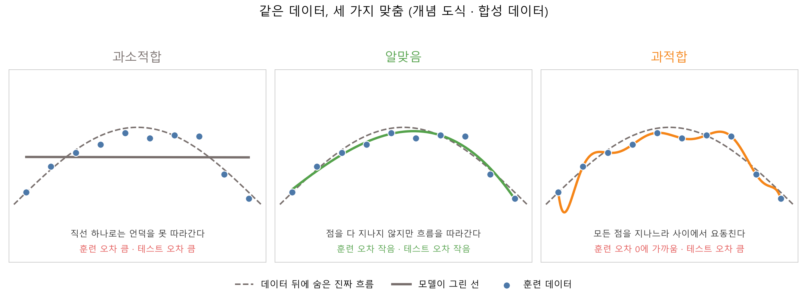
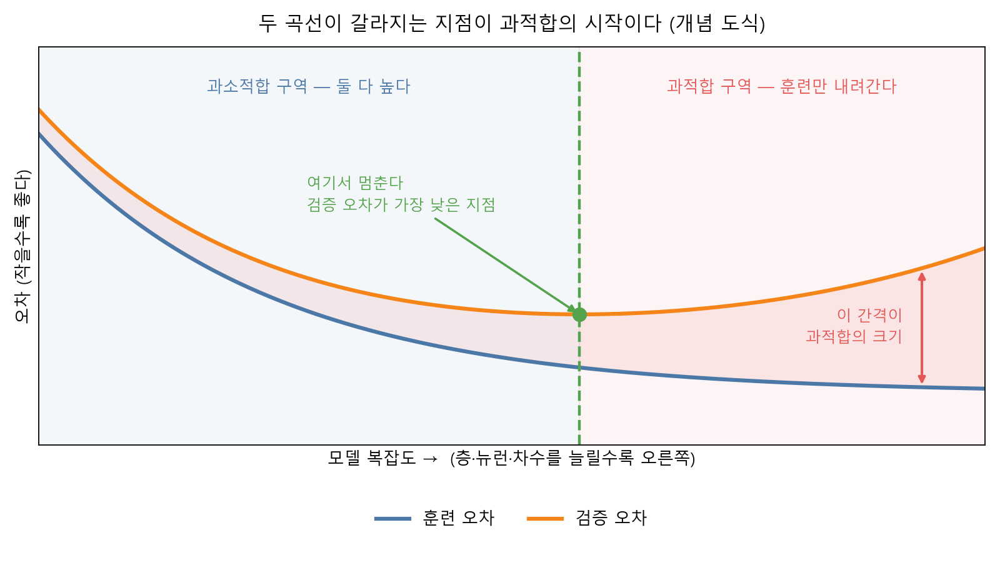
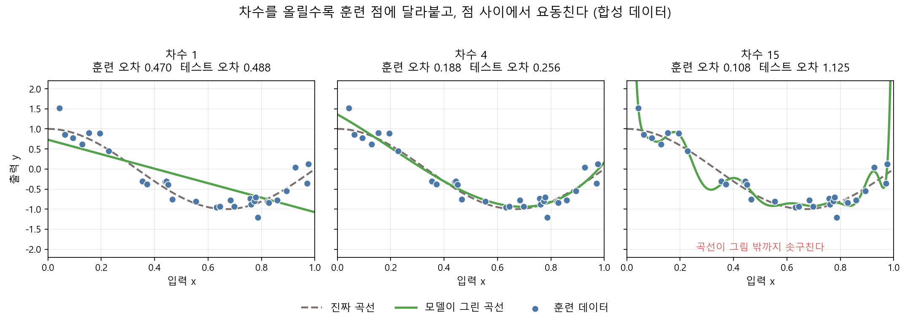
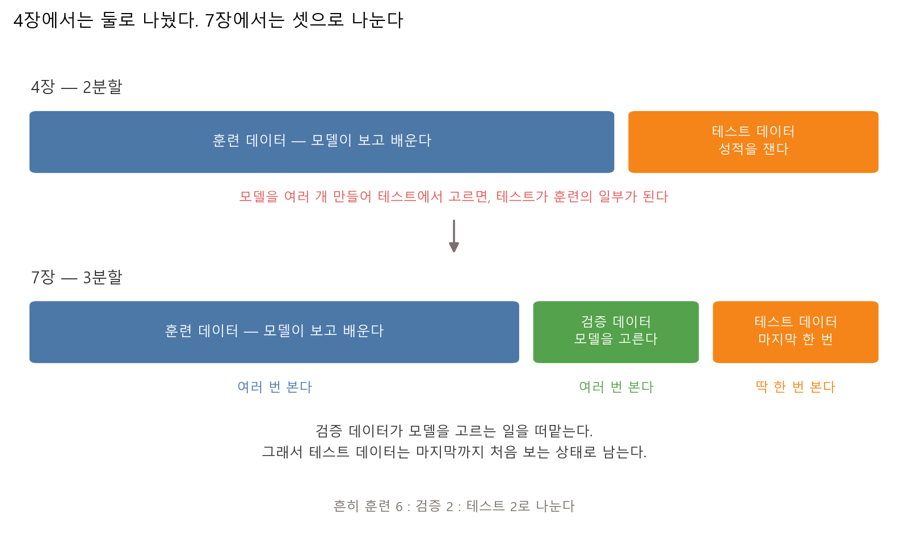
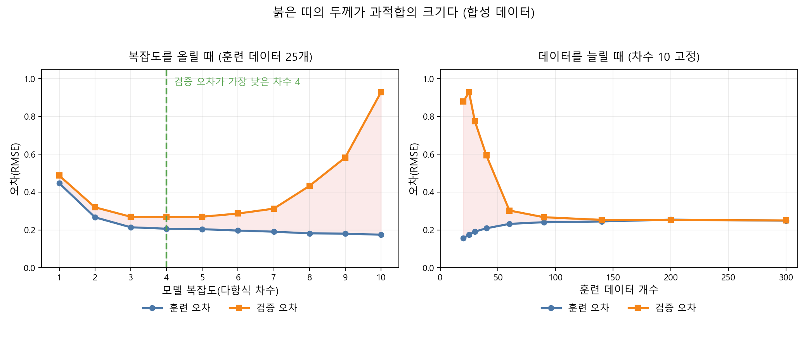

# 제7장 과적합과 일반화 — 외운 모델과 이해한 모델

---

### 학습 목표

- 과적합이 무엇인지 외운 모델과 이해한 모델의 차이로 설명한다
- 훈련 성능과 검증 성능의 간격을 보고 과적합을 알아챈다
- 검증 데이터가 왜 따로 필요한지, 테스트 데이터와 무엇이 다른지 설명한다
- 모델 복잡도를 올릴 때 훈련 오차와 검증 오차가 각각 어디로 움직이는지 말한다
- 과적합을 고치는 네 가지 방법을 구분하고, 각각이 어느 그림에 대응하는지 안다

4장 실습 4.1에 이상한 결과가 하나 남아 있다. 결정 트리의 깊이 제한을 풀었더니 훈련 데이터 112명을 한 명도 틀리지 않았는데(정확도 1.000), 테스트 정확도는 오히려 0.938에서 0.917로 내려갔다. 훈련에서 완벽해진 모델이 처음 보는 학생에게는 더 못 맞힌 것이다. 그때는 "훈련 성적과 테스트 성적은 다를 수 있다"만 확인하고 넘어갔다. 이번 장에서 이 현상에 이름을 붙이고, 왜 그런 일이 벌어지는지 손으로 확인한다.

이 장은 개념을 설명한 바로 뒤에 그 개념을 확인하는 실습을 둔다. 1~2절의 세 가지 상태와 훈련·테스트 오차의 간격은 실습 7.1에서, 3~5절의 검증 데이터·모델 복잡도·데이터 늘리기·모델 줄이기는 실습 7.2에서 실행해 본다. 정규화와 dropout은 개념만 다룬다.

### 실행 환경

```bash
cd practice/chapter7
python -m pip install -r ../requirements.txt
```

필요한 패키지는 numpy, pandas, matplotlib, scikit-learn이다. GPU는 필요 없다. 두 실습 모두 노트북에서 몇 초 안에 끝난다.

실습 7.1은 미리 만들어 둔 파일을 불러오고, 실습 7.2는 데이터를 코드로 만든다.

---

### 1. 외운 모델과 이해한 모델

#### 1-1. 시험 범위를 통째로 외운 학생

시험 공부를 두 가지 방식으로 한 학생을 생각해 본다.

○ **A 학생** — 기출문제 100개의 답을 통째로 외웠다
  - 기출문제를 다시 풀면 100점이다
  - 숫자만 바꾼 새 문제를 주면 손도 못 댄다

○ **B 학생** — 기출문제를 풀며 원리를 익혔다
  - 기출문제에서 92점이다. 계산 실수로 몇 개 틀렸다
  - 새 문제에서도 90점 근처가 나온다

모델도 똑같이 나뉜다. 훈련 데이터에 답을 맞추는 데만 매달린 모델은 A 학생이 된다. 이것을 **과적합(overfitting)** 이라고 부른다. 훈련 데이터에 지나치게(over) 맞춰졌다(fit)는 뜻이다.

반대쪽 실패도 있다. 아예 아무것도 못 배운 상태다. 이것이 **과소적합(underfitting)** 이다. 훈련 데이터에서도 못 맞추고 새 데이터에서도 못 맞춘다.

#### 1-2. 세 가지 상태를 한 그림에



**그림 7.1** 같은 점 10개에 서로 다른 선을 맞춘 결과 — 왼쪽은 못 따라가고, 오른쪽은 점 하나하나를 외운다

세 그림 모두 같은 데이터를 쓴다. 달라진 것은 모델에게 허락한 자유도뿐이다.

○ **과소적합(왼쪽)** — 직선 하나만 그릴 수 있게 했다
  - 데이터가 언덕 모양인데 직선으로는 언덕을 표현할 방법이 없다
  - 훈련 데이터도 못 맞추고, 새 데이터도 못 맞춘다

○ **알맞음(가운데)** — 완만한 곡선까지 그릴 수 있게 했다
  - 점을 전부 지나지는 않는다. 점 몇 개는 곡선에서 벗어나 있다
  - 그런데 데이터 뒤에 숨은 흐름(회색 점선)은 잘 따라간다

○ **과적합(오른쪽)** — 마음껏 구부릴 수 있게 했다
  - 점을 하나도 빠짐없이 지나간다. 훈련 오차가 0에 가깝다
  - 대신 점과 점 사이에서 위아래로 요동친다. 그 요동은 데이터에 섞인 **잡음을 외운 흔적**이다

여기서 핵심을 하나 정리한다. 가운데 그림의 곡선은 점을 다 지나지 않는다. 점을 다 지나는 것은 오른쪽 그림이다. 그런데 새 데이터에서 잘하는 쪽은 가운데다. **훈련 데이터를 완벽하게 맞추는 것이 목표가 아니다.**

#### 1-3. 일반화

모델이 처음 보는 데이터에서도 제 성능을 내는 것을 **일반화(generalization)** 라고 부른다. 이 과목에서 만드는 모든 모델의 진짜 목표가 일반화다.

훈련 데이터의 성적은 목표가 아니라 중간 점검이다. 시험을 잘 보려고 공부하는 것이지, 연습 문제를 잘 풀려고 공부하는 것이 아니다.

○ **체크 질문**
  - 훈련 정확도 100%인 모델을 보고 좋아해야 하는가
  - 훈련 정확도가 낮은데 테스트 정확도가 높은 모델이 나올 수 있는가

---

### 2. 과적합은 어떻게 알아채는가

#### 2-1. 숫자 하나로는 못 알아챈다

훈련 성능 하나만 보면 과적합인지 아닌지 알 방법이 전혀 없다. 훈련 오차 0.10이 좋은 값인지 나쁜 값인지, 비교 상대 없이는 판정이 성립하지 않는다.

○ **판정 규칙**
  - 훈련 성능은 좋은데 검증 성능이 나쁘다 → 과적합
  - 훈련 성능도 나쁘고 검증 성능도 나쁘다 → 과소적합
  - 둘 다 좋고 간격도 작다 → 지금은 이대로 둔다

#### 2-2. 복잡도를 올릴 때 두 곡선이 갈라진다

모델을 조금씩 복잡하게 만들면서 두 성능을 계속 재면 다음 모양이 나온다.



**그림 7.2** 훈련 오차는 계속 내려가지만 검증 오차는 어느 지점부터 다시 올라간다

○ **훈련 오차(파란 선)** — 복잡하게 만들수록 계속 내려간다
  - 자유도를 더 주면 훈련 데이터에 더 맞출 수 있으니 당연하다
  - 그래서 훈련 오차는 언제 멈춰야 할지 알려주지 못한다

○ **검증 오차(주황 선)** — 내려가다가 어느 지점부터 다시 올라간다
  - 올라가기 시작하는 지점 앞은 아직 덜 배운 상태다(과소적합 구역)
  - 올라가기 시작한 뒤는 잡음을 외우기 시작한 상태다(과적합 구역)
  - 검증 오차가 가장 낮은 지점이 멈출 곳이다

○ **두 곡선 사이의 간격** — 이 간격이 과적합의 크기다
  - 간격이 벌어진다는 말은 "훈련 데이터에만 통하는 것을 배우고 있다"는 뜻이다
  - 바로 다음 실습 7.1의 표에서 이 간격을 숫자로 확인한다

이 그림은 개념 도식이다. 실제로 측정하면 곡선이 더 울퉁불퉁하다. 실습 7.2에서 측정한 곡선을 본다.

○ **바로 다음 실습 7.1의 설정**
  - 파일을 불러온다. 훈련 데이터 30개, 테스트 데이터 200개, 그리고 다항식 차수 1·4·15로 학습해 저장한 모델 3개다
  - 진짜 곡선은 `cos(1.5πx)`이고, 여기에 잡음을 섞어 데이터를 만들었다. 그림 7.1과 같은 세 상태(과소적합·알맞음·과적합)의 모델을 불러와 숫자로 분석한다
  - 이 실습은 아직 검증 데이터를 쓰지 않는다. 검증 데이터가 필요한 이유는 3절에서 배우므로, 여기서는 훈련 오차와 테스트 오차를 비교용으로만 본다. 차수를 고르는 일은 실습 7.2에서 검증 데이터로 한다

---

### 실습 7.1: 과적합된 모델 분석하기

#### 실습 목표

- 저장된 데이터 파일과 모델 파일을 불러와 오차를 계산한다
- 훈련 오차와 테스트 오차가 반대 방향으로 움직이는 것을 표로 확인한다
- 과적합된 곡선이 훈련 점 사이에서 어디까지 솟구치는지 숫자로 측정한다

#### 데이터

점 하나가 관측 하나다. 가로축은 입력 x, 세로축은 출력 y다. 뒤에 숨은 진짜 곡선은 `cos(1.5πx)`이고, 여기에 잡음을 섞었다. `practice/chapter7/data/` 폴더에 미리 저장해 두었고, 실습에서는 불러오기만 한다.

| 파일 | 내용 |
|---|---|
| `train.csv` | 훈련 데이터 30개. 열은 x, y |
| `test.csv` | 테스트 데이터 200개. 열은 x, y |
| `model_degree01.joblib` | 훈련 데이터 30개로 학습한 차수 1 다항식 모델 |
| `model_degree04.joblib` | 같은 훈련 데이터로 학습한 차수 4 다항식 모델 |
| `model_degree15.joblib` | 같은 훈련 데이터로 학습한 차수 15 다항식 모델 |

차수 1·4·15라는 조합은 scikit-learn 공식 예제 Underfitting vs. Overfitting에서 쓰는 조합과 같다.[^sklearn-uo] 같은 구성을 우리 데이터로 만들어 두었다.

○ **불러오기 전에 알아 둘 것**
  - joblib 파일은 불러올 때 파일 안의 코드가 실행될 수 있다. 저장소에서 받은 파일만 불러온다
  - scikit-learn 버전이 달라 모델을 불러오지 못하면, `code` 폴더에서 `python 7-1-make-overfit-files.py`를 한 번 실행한다. 파일이 새로 만들어진다. 같은 난수 씨앗을 쓰므로 데이터는 같다

#### 실행 명령

```bash
cd practice/chapter7/code
python 7-1-analyze-overfit.py
```

#### 핵심 코드

파일 맨 위에 학생이 바꿀 두 줄이 있다.

```python
DEGREES = [1, 4, 15]      # 불러올 모델의 차수. 1, 4, 15 중에서 고른다
X_RANGE = (0.0, 1.0)      # 곡선의 최솟값·최댓값을 확인할 x 구간. 훈련 점은 0과 1 사이에 있다
```

파일을 불러오는 부분은 다음과 같다. `pd.read_csv`가 표를 읽고, `joblib.load`가 저장된 모델을 되살린다. 되살린 모델은 학습이 끝난 상태라 `predict`만 부르면 예측값이 나온다.

```python
train = pd.read_csv(DATA_DIR / "train.csv")
test = pd.read_csv(DATA_DIR / "test.csv")
models = [joblib.load(DATA_DIR / f"model_degree{d:02d}.joblib") for d in degrees]
```

불러온 모델로 오차를 계산하는 부분은 다음과 같다. 예측이 정답에서 평균 몇만큼 떨어져 있는지(RMSE)를 구한다.

```python
pred = model.predict(x.reshape(-1, 1))
return float(np.sqrt(mean_squared_error(y, pred)))
```

_전체 코드는 `practice/chapter7/code/7-1-analyze-overfit.py` 참고_

#### 실행 결과

```text
불러온 파일: data/train.csv, data/test.csv, 모델 3개 (data/model_degree*.joblib)
훈련 데이터 30개, 테스트 데이터 200개
불러온 모델의 차수: [1, 4, 15]

=== 차수별 오차 (RMSE, 작을수록 잘 맞춘 것) ===
  차수        훈련오차        테스트오차         차이
   1      0.4703       0.4877     0.0173
   4      0.1882       0.2562     0.0680
  15      0.1077       1.1247     1.0171

오차가 작은 차수부터 나열한 순위
  훈련 오차 순위: 15 > 4 > 1
  테스트 오차 순위: 4 > 1 > 15

테스트 오차가 가장 작은 차수: 4 (테스트 오차 0.2562)
```

_출처: `practice/chapter7/results/7-1-analyze-overfit.log`_



**그림 7.3** 회색 점선이 진짜 곡선, 초록 실선이 모델이 그린 곡선. 차수 15의 곡선은 그림 위쪽 밖으로 나간다

**표 7.1** 차수를 올릴 때 곡선이 어디까지 벌어지는가

| 차수 | 곡선 최솟값 | 곡선 최댓값 |
|---:|---:|---:|
| 1 | -1.08 | 0.73 |
| 4 | -0.94 | 1.36 |
| 15 | -0.92 | 24.76 |

_출처: `practice/chapter7/results/7-1-analyze-overfit.log`_

#### 결과 읽기

○ **차수 1 — 과소적합**
  - 훈련 오차 0.4703, 테스트 오차 0.4877이다. 둘 다 크고, 차이는 0.0173으로 작다
  - 두 오차가 나란히 크면 과적합이 아니라 과소적합이다. 모델이 아직 아무것도 못 배웠다
  - 곡선이 -1.08에서 0.73 사이만 움직인다. 언덕을 표현할 방법이 없어서 대각선 하나로 지나간다

○ **차수 4 — 알맞음**
  - 훈련 오차 0.1882, 테스트 오차 0.2562다. 테스트 오차가 셋 중 가장 작다
  - 두 오차의 차이 0.0680은 차수 1보다 크다. 간격이 조금 벌어졌지만 아직 감당할 수준이다

○ **차수 15 — 과적합**
  - 훈련 오차는 0.1077로 가장 작다. 세 모델 중 훈련 데이터를 가장 잘 맞췄다
  - 그런데 테스트 오차가 1.1247이다. 차수 1(0.4877)의 두 배가 넘는다
  - 두 오차의 차이가 1.0171이다. 차수 4의 0.0680과 비교하면 15배 차이다

○ **곡선이 24.76까지 솟구쳤다**
  - 진짜 곡선은 -1.00에서 1.00 사이만 움직인다. 그런데 차수 15의 곡선은 최댓값이 24.76이다
  - 그림 7.3의 오른쪽 판에서 초록 선이 위쪽으로 사라지는 부분이 그곳이다
  - 훈련 점이 드문 구간에서 곡선이 크게 튄 결과다. 훈련 점만 보고는 이 문제를 알 수 없다

○ **훈련 오차만 보고 모델을 고르면 차수 15를 고른다**
  - 훈련 오차 순위는 15 → 4 → 1이고, 테스트 오차 순위는 4 → 1 → 15다
  - 두 순위가 완전히 다르다. 이것이 과적합의 정의다

#### 해 보기

두 상수를 바꿔 다시 실행한다.

1. `DEGREES`를 `[1, 15]`로 바꾼다. 알맞은 차수 4가 빠지면 테스트 오차가 가장 작은 차수가 어디로 바뀌는가. 모델을 고르는 일이 후보에 달려 있음을 확인한다
2. `X_RANGE`를 `(-0.2, 1.2)`로 바꾼다. 훈련 점이 없는 구간까지 확인하면 세 곡선의 최솟값과 최댓값이 어떻게 달라지는가. 차수 15의 곡선은 어디까지 치솟는가
3. 2번과 같은 설정에서 차수 4의 곡선도 진짜 곡선의 범위(-1.00에서 1.00)를 벗어나는가. 알맞다고 한 모델이 훈련 점 밖에서도 믿을 만한가
4. `DEGREES`를 `[4]`로 바꾼다. 모델이 하나뿐이면 훈련 오차 순위와 테스트 오차 순위로 과적합을 판단할 수 있는가

○ 확인할 것은 훈련 오차 순위와 테스트 오차 순위가 서로 다른 모델이 무엇인지, 그리고 훈련 점이 없는 구간에서 곡선이 진짜 곡선에서 얼마나 벗어나는지다

---

### 3. 검증 데이터가 필요한 이유

#### 3-1. 4장에서는 둘로 나눴다

4장에서 데이터를 훈련과 테스트 둘로 나눴다. 그때는 모델이 하나뿐이었다. 로지스틱 회귀 하나를 학습시키고 테스트에서 성적을 쟀다. 이 방식은 문제가 없다.

문제는 모델을 **여러 개 만들어 그중 하나를 고를 때** 생긴다.

차수 1부터 10까지 열 개 모델을 만들었다고 하자. 테스트 데이터에서 열 개를 다 재보고 가장 좋은 것을 골랐다. 이렇게 고른 모델의 테스트 성적은 실력인가.

아니다. 열 번 시험을 쳐서 가장 잘 나온 점수만 골라 적은 것과 같다. 테스트 데이터를 보고 모델을 골랐으므로, **테스트 데이터가 학습 과정의 일부가 되어 버렸다.** 그 점수는 실제 성능보다 높게 나온다.

#### 3-2. 그래서 셋으로 나눈다



**그림 7.4** 4장의 2분할과 7장의 3분할 — 검증 데이터가 모델을 고르는 일을 떠맡는다

**표 7.2** 세 갈래 데이터가 각각 맡는 일

| 데이터 | 하는 일 | 모델이 보는 횟수 |
|---|---|---|
| 훈련(train) | 모델의 가중치를 정한다 | 학습 내내 계속 본다 |
| 검증(validation) | 여러 모델 중 하나를 고른다. 언제 멈출지 정한다 | 모델을 고를 때마다 본다 |
| 테스트(test) | 고른 모델의 최종 성적을 잰다 | 맨 마지막에 딱 한 번 |

○ **나누는 비율**
  - 흔히 훈련 6 : 검증 2 : 테스트 2로 나눈다
  - 데이터가 아주 많으면 검증과 테스트 비율을 더 낮춰도 된다

○ **테스트 데이터를 대하는 태도**
  - 테스트 성적을 보고 모델을 고치면, 그 순간 테스트는 검증이 되어 버린다
  - 고칠 것이 생기면 검증 데이터로 돌아가서 고친다
  - 테스트 데이터는 "실제 세상에 내놓기 직전 한 번 재는 자"로 남겨 둔다

○ **데이터가 적을 때**
  - 100개짜리 데이터를 셋으로 나누면 검증에 20개밖에 안 돌아간다. 20개로 잰 성적은 못 믿는다
  - 이럴 때 교차검증(cross-validation)을 쓴다. 데이터를 여러 조각으로 나눠 돌아가며 검증에 쓰는 방법이다
  - 방법은 아래 3-3에서 설명한다. 이 과목에서는 직접 구현하지 않는다

#### 3-3. 데이터가 적을 때 — 교차검증

교차검증은 검증 20개를 한 번만 쓰지 않고, **검증으로 쓰는 조각을 바꿔 가며 5번 쓰는 방법**이다. 데이터가 100개인 경우를 예로 든다.

1. 데이터 100개를 20개씩 5조각으로 나눈다
2. 조각 1을 검증으로 쓰고, 나머지 조각 2·3·4·5(80개)로 학습한다. 검증 점수를 적어 둔다
3. 검증으로 쓰는 조각을 2, 3, 4, 5로 바꿔 가며 2번을 되풀이한다
4. 5번의 검증 점수를 평균 낸다


**그림 7.5** 검증으로 쓰는 조각(주황)이 회차마다 한 칸씩 옮겨 간다. 5번의 검증 점수를 평균 낸다

5조각 교차검증에서 회차마다 조각이 맡는 일은 다음과 같다.

| 회차 | 검증으로 쓰는 조각 | 학습에 쓰는 조각 |
|---|---|---|
| 1 | 1 | 2·3·4·5 |
| 2 | 2 | 1·3·4·5 |
| 3 | 3 | 1·2·4·5 |
| 4 | 4 | 1·2·3·5 |
| 5 | 5 | 1·2·3·4 |

○ **모델이 여러 개일 때**
  - 그림 7.5의 5줄은 **같은 모델 하나**를 조각만 바꿔 5번 학습한 것이다. 서로 다른 모델 5개가 아니다
  - 후보 모델이 20개이면 모델마다 이 과정을 한 번씩 한다. 학습은 20 × 5 = 100번이고, 모델마다 평균 점수가 하나씩 나온다
  - 20개의 평균 점수 중 가장 높은 모델을 고른다

○ **얻는 것**
  - 100개가 모두 한 번씩 검증에 쓰인다. 검증 20개 하나로 낸 점수보다 어느 20개가 뽑혔는지에 따른 우연의 영향이 작다
  - 학습에도 조각마다 80개씩 쓰이므로 데이터를 검증에 통째로 빼앗기지 않는다

○ **치르는 값**
  - 모델을 5번 학습해야 하므로 시간이 5배 든다
  - 학습이 오래 걸리는 모델(큰 신경망 등)에는 쓰기 어렵다

○ **테스트 데이터는 여전히 따로 둔다**
  - 교차검증 점수로 모델을 골랐다면, 그 점수는 고르는 데 쓰인 점수라서 실제 성능보다 높게 나올 수 있다
  - 최종 성적은 교차검증에 쓰지 않은 테스트 데이터로 한 번만 잰다

---

### 4. 모델 복잡도 — 무엇을 돌리는 손잡이인가

모델 복잡도는 "모델이 표현할 수 있는 모양이 얼마나 다양한가"다. 자유도가 크면 복잡한 모델이다.

**표 7.3** 모델마다 복잡도를 조절하는 손잡이가 다르다

| 모델 | 복잡도 손잡이 | 올리면 벌어지는 일 |
|---|---|---|
| 다항식 회귀 | 차수 | 곡선이 더 많이 구부러진다 |
| 신경망 | 층 수, 층마다의 뉴런 수 | 표현할 수 있는 경계 모양이 늘어난다 |
| 결정트리 | 트리 깊이 | 조건문이 더 잘게 갈라진다 |

이 장의 실습에서는 다항식 차수를 손잡이로 쓴다. 차수 하나만 바꿔도 그림이 눈에 띄게 달라지기 때문이다. 신경망의 층 수를 늘리는 것과 원리는 같다.

○ **복잡한 모델이 나쁜 것은 아니다**
  - 데이터가 충분히 많으면 복잡한 모델이 더 잘한다. 실습 7.2에서 이것을 확인한다
  - 문제는 데이터에 비해 모델이 복잡할 때 생긴다
  - "복잡도가 데이터 양에 비해 적당한가"가 질문이지, "복잡도가 낮은가"가 질문이 아니다

○ **자주 하는 실수**
  - 성능이 안 나오면 일단 층을 더 쌓는다. 훈련 성능만 올라가고 검증 성능은 내려간다
  - 손잡이를 돌리기 전에 두 성능을 먼저 재야 어느 방향으로 돌릴지 알 수 있다

---

### 5. 데이터를 늘리고 모델을 줄인다

과적합을 고치는 방법은 네 가지다. 이 절에서 앞의 두 가지를 다루고, 바로 뒤 실습 7.2에서 확인한다. 정규화와 dropout은 6절에서 다룬다.

#### 5-1. 데이터를 늘린다

원인을 직접 없애는 방법이다. 잡음을 외우려면 외울 잡음이 적어야 한다. 데이터가 많아지면 잡음이 서로 상쇄되어 모델이 외울 것이 없어진다.

실습 7.2에서 같은 복잡도를 유지한 채 데이터만 늘렸을 때 두 곡선의 간격이 어떻게 좁아지는지 숫자로 확인한다.

○ **한계**
  - 데이터를 새로 모으는 데 돈과 시간이 든다
  - 이미지 데이터라면 좌우 뒤집기·자르기·밝기 조절로 데이터를 늘리는 방법이 있다. 데이터 증강(augmentation)이라고 부른다. 9장에서 다시 나온다

#### 5-2. 모델을 줄인다

복잡도 손잡이를 반대 방향으로 돌린다. 차수를 낮추거나, 층을 빼거나, 뉴런 수를 줄인다.

검증 오차가 가장 낮은 지점까지 내려오면 된다. 그 지점을 찾는 방법이 실습 7.2의 복잡도 곡선이다.

○ **한계**
  - 너무 줄이면 과소적합으로 넘어간다
  - 검증 오차가 다시 올라가기 시작하면 너무 줄인 것이다

○ **바로 다음 실습 7.2의 설정**
  - 같은 합성 곡선 데이터 1000개를 훈련 후보 700개, 검증 200개, 테스트 100개로 나눈다(3절의 세 갈래 분할)
  - 훈련 데이터 25개를 고정하고 차수를 1부터 10까지 올리며 두 오차의 간격을 본다(4절의 복잡도, 5-2의 모델 줄이기)
  - 차수 10을 고정하고 훈련 데이터를 20개에서 300개까지 늘리며 간격을 본다(5-1의 데이터 늘리기)
  - 검증 오차로 차수를 고른 뒤, 테스트 데이터는 마지막에 한 번만 쓴다

---

### 실습 7.2: 과적합 진단하고 고치기

#### 실습 목표

- 복잡도를 x축에 놓고 훈련 곡선과 검증 곡선이 갈라지는 지점을 직접 찾는다
- 같은 모델에 데이터만 늘렸을 때 두 곡선이 어떻게 달라지는지 본다
- 검증 데이터로 모델을 고르고, 테스트 데이터를 마지막에 딱 한 번 쓰는 순서를 따라 해 본다

#### 데이터

같은 합성 곡선 데이터 1000개를 세 갈래로 나눈다.

| 갈래 | 개수 | 쓰는 곳 |
|---|---:|---|
| 훈련 후보 | 700 | 여기서 필요한 만큼 잘라 쓴다 |
| 검증 | 200 | 차수를 고른다 |
| 테스트 | 100 | 맨 마지막에 한 번 |

훈련 데이터를 한 번만 뽑으면 어느 점이 뽑혔는지에 따라 오차가 들쭉날쭉하다. 그래서 같은 크기의 훈련 데이터를 최대 9번 다르게 뽑아 재고, 그중 가운데 값(중앙값)을 쓴다.

#### 실행 명령

```bash
cd practice/chapter7/code
python 7-2-diagnose.py
```

#### 핵심 코드

파일 맨 위에 학생이 바꿀 다섯 줄이 있다.

```python
MAX_DEGREE = 10          # 왼쪽 그림에서 차수를 1부터 여기까지 올린다
FIT_SIZE = 25            # 왼쪽 그림에서 쓰는 훈련 데이터 개수
LEARNING_DEGREE = 10     # 가운데 그림에서 고정해 두는 차수(복잡한 모델)
NOISE_LEVEL = 0.25       # 데이터에 섞는 잡음의 크기
N_REPEATS = 9            # 같은 크기로 훈련 데이터를 몇 번 다르게 뽑아 볼 것인가
```

진단 3의 훈련 데이터 개수는 따로 입력하지 않는다. 진단 2의 `LEARNING_SIZES`에서 가장 큰 값인 300개를 코드가 자동으로 사용한다.

훈련 데이터를 여러 번 뽑아 중앙값을 내는 부분은 다음과 같다.

```python
repeats = max(1, min(N_REPEATS, len(x_pool) // size))
for r in range(repeats):
    start = r * size
    x_fit = x_pool[start:start + size]
    y_fit = y_pool[start:start + size]
    model = fit_polynomial(degree, x_fit, y_fit)
    train_scores.append(rmse(model, x_fit, y_fit))
    val_scores.append(rmse(model, x_val, y_val))

return float(np.median(train_scores)), float(np.median(val_scores)), repeats
```

_전체 코드는 `practice/chapter7/code/7-2-diagnose.py` 참고_

#### 실행 결과

```text
전체 1000개 = 훈련 후보 700개 + 검증 200개 + 테스트 100개
잡음 크기 NOISE_LEVEL = 0.25
같은 크기로 훈련 데이터를 최대 9번 다르게 뽑아 중앙값을 쓴다

=== 진단 1. 복잡도를 올릴 때 (훈련 데이터 25개 고정) ===
          차수        훈련오차        검증오차        간격      뽑은횟수
           1      0.4467      0.4872    0.0405         9
           2      0.2665      0.3194    0.0529         9
           3      0.2137      0.2694    0.0556         9
           4      0.2060      0.2687    0.0627         9
           5      0.2036      0.2696    0.0660         9
           6      0.1963      0.2864    0.0901         9
           7      0.1904      0.3123    0.1219         9
           8      0.1815      0.4327    0.2512         9
           9      0.1801      0.5829    0.4028         9
          10      0.1744      0.9285    0.7541         9

검증 오차가 가장 낮은 차수: 4 (검증 오차 0.2687)
```

_출처: `practice/chapter7/results/7-2-diagnose.log`_

```text
=== 진단 2. 데이터를 늘릴 때 (차수 10 고정) ===
      훈련데이터수        훈련오차        검증오차        간격      뽑은횟수
          20      0.1551      0.8788    0.7237         9
          25      0.1744      0.9285    0.7541         9
          30      0.1907      0.7758    0.5850         9
          40      0.2083      0.5945    0.3862         9
          60      0.2317      0.3025    0.0708         9
          90      0.2406      0.2668    0.0262         7
         140      0.2444      0.2530    0.0086         5
         200      0.2542      0.2520   -0.0021         3
         300      0.2486      0.2500    0.0014         2
```

_출처: `practice/chapter7/results/7-2-diagnose.log`_

```text
=== 진단 3. 두 처방을 함께 적용할 때 (훈련 데이터 300개 고정) ===
          차수        훈련오차        검증오차        간격      뽑은횟수
           1      0.4729      0.4728   -0.0001         2
           2      0.2999      0.3118    0.0119         2
           3      0.2555      0.2490   -0.0065         2
           4      0.2516      0.2437   -0.0079         2
           5      0.2508      0.2438   -0.0070         2
           6      0.2505      0.2452   -0.0052         2
           7      0.2503      0.2452   -0.0051         2
           8      0.2497      0.2457   -0.0039         2
           9      0.2490      0.2477   -0.0013         2
          10      0.2486      0.2500    0.0014         2

두 처방을 함께 적용했을 때 검증 오차가 가장 낮은 차수: 4 (검증 오차 0.2437)
```

_출처: `practice/chapter7/results/7-2-diagnose.log`_



**그림 7.6** 왼쪽은 복잡도를 올릴 때, 가운데는 데이터를 늘릴 때, 오른쪽은 데이터 300개에서 차수를 다시 비교할 때다. 붉은 띠의 두께가 두 곡선의 간격이다

**표 7.4** 두 처방을 따로, 함께 적용한 결과

| 처방 | 훈련 오차 | 검증 오차 | 간격 |
|---|---:|---:|---:|
| 없음 (차수 10, 데이터 25개) | 0.1744 | 0.9285 | 0.7541 |
| 모델을 단순하게 (차수 4, 데이터 25개) | 0.2060 | 0.2687 | 0.0627 |
| 데이터를 늘림 (차수 10, 300개) | 0.2486 | 0.2500 | 0.0014 |
| 둘 다 (차수 4, 데이터 300개) | 0.2516 | 0.2437 | -0.0079 |

_출처: `practice/chapter7/results/7-2-diagnose.log`_

훈련 데이터를 300개로 늘린 뒤 차수 1부터 10까지 다시 비교했다. 이번 실행에서는 차수 4의 검증 오차가 0.2437로 가장 낮았다. 차수 5는 0.2438이므로 두 값은 사실상 같다. 코드가 수치상 최솟값인 차수 4를 골랐지만, 이 결과만으로 차수 4가 언제나 유일한 최적이라고 말할 수는 없다. 검증 데이터로 차수를 고른 뒤 테스트 데이터로 마지막 성능을 확인한다.

_출처: `practice/chapter7/results/7-2-diagnose.log`_

```text
=== 마지막에 한 번만 쓰는 테스트 데이터 ===
고른 모델: 차수 4, 훈련 후보 700개 전부로 다시 학습
고른 방법: 진단 3에서 검증 오차가 가장 낮은 차수 4를 코드가 자동으로 골랐다
검증 오차: 0.2427
테스트 오차: 0.2675
```

_출처: `practice/chapter7/results/7-2-diagnose.log`_

#### 결과 읽기

○ **훈련 오차는 끝까지 내려간다**
  - 차수 1에서 0.4467, 차수 10에서 0.1744다. 한 번도 올라가지 않는다
  - 훈련 오차만 보면 차수 10이 최고다. 훈련 오차는 멈출 지점을 알려주지 못한다

○ **검증 오차는 차수 4에서 바닥을 친다**
  - 0.4872 → 0.2687(차수 4) → 0.9285(차수 10)로 내려갔다 올라간다
  - 다만 차수 3(0.2694), 4(0.2687), 5(0.2696)는 사실상 같은 값이다. 세 번째 자리에서 갈린다
  - 이 구간에서는 어느 차수를 골라도 성능 차이가 없다

○ **진단 1에서는 차수 3부터 5까지 비슷하다**
  - 진단 1의 검증 오차가 가장 낮은 값은 차수 4다
  - 차이가 0.0007밖에 안 나는 구간에서 이 규칙은 사실상 동전 던지기다. 훈련 데이터를 다시 뽑으면 순위가 바뀔 수 있다
  - 성능이 같다면 **더 단순한 쪽**을 고르는 편이 낫다. 차수가 낮을수록 데이터가 바뀌었을 때 덜 흔들린다
  - 최종 차수는 여기서 정하지 않는다. 데이터를 늘린 진단 3에서 검증 오차를 다시 비교해 자동으로 고른다

○ **간격이 벌어지는 속도가 빨라진다**
  - 차수 1→4 구간에서 간격은 0.0405 → 0.0627로 천천히 는다
  - 차수 7→10 구간에서는 0.1219 → 0.7541로 여섯 배가 된다
  - 간격은 천천히 벌어지다가 어느 지점부터 급히 커진다. 이 구간에 들어가기 전에 멈춘다

○ **데이터를 늘리면 같은 모델이 정상으로 돌아온다**
  - 차수 10은 데이터 25개일 때 검증 오차 0.9285였다. 쓸 수 없는 모델이다
  - 같은 차수 10에 데이터를 300개 준 결과, 검증 오차가 0.2500으로 내려갔다
  - 모델을 바꾸지 않았다. 데이터만 열두 배로 늘렸다

○ **두 처방을 함께 적용한 뒤 차수를 다시 고른다**
  - 데이터 300개에서 차수 1부터 10까지 비교하니 검증 오차가 차수 4에서 0.2437로 가장 낮았다
  - 차수 5의 0.2438과 차이는 0.0001이다. 이번 실행에서는 차수 4를 골랐지만 두 차수의 성능은 사실상 같다
  - 데이터가 늘어나자 차수 10도 0.2500까지 좋아졌다. 그래도 검증 오차가 가장 낮은 조합은 차수 4와 데이터 300개였다

○ **데이터 200개에서 간격이 음수(-0.0021)다**
  - 검증 오차가 훈련 오차보다 낮게 나왔다는 뜻이다. 이상해 보이지만 정상이다
  - 두 값은 서로 다른 데이터에서 잰 것이다. 간격이 0에 가까워지면 어느 쪽이 조금 더 낮은지는 표본에 따라 갈린다
  - 음수가 나왔다는 것은 과적합이 사라졌다는 신호이지, 계산이 틀렸다는 신호가 아니다

○ **훈련 오차가 올라가는 것이 나쁜 신호가 아니다**
  - 가운데 그림에서 훈련 오차는 0.1551에서 0.2486으로 **올라간다**
  - 데이터가 많아지면 전부 외우기가 어려워지니 당연하다
  - 봐야 할 것은 훈련 오차의 절대값이 아니라 검증 오차와의 간격이다. 그 간격은 0.7237에서 0.0014로 줄었다

○ **두 처방을 어떻게 고르는가**
  - 데이터를 더 구할 수 있으면 데이터를 늘린 뒤, 늘어난 데이터에서 복잡도를 다시 고른다
  - 데이터를 더 구할 수 없으면 가진 25개에서 차수를 줄인다. 이 실행에서는 차수 4가 수치상 가장 낮다

○ **마지막에 테스트를 한 번 쓴다**
  - 진단 3의 검증 데이터로 차수 4를 골랐다. 훈련 후보 700개로 다시 학습했을 때 검증 오차는 0.2427이다
  - 그래서 한 번도 안 쓴 테스트 데이터로 다시 잰다. 0.2675다
  - 검증 0.2427보다 테스트 0.2675가 0.0248 높다. 이 차이가 검증 데이터를 보고 고른 값이라 깎여 있던 몫이다

#### 해 보기

다섯 상수를 바꿔 다시 실행한다.

1. `FIT_SIZE`를 100으로 올린다. 검증 오차가 가장 낮은 차수가 4에서 어디로 옮겨가는가
2. `NOISE_LEVEL`을 0.05로 낮춘다. 잡음이 적으면 높은 차수도 견디는가
3. `MAX_DEGREE`를 15로 올린다. 차수 10 이후 간격이 어디까지 벌어지는가
4. `N_REPEATS`를 1로 낮춘다. 곡선이 얼마나 들쭉날쭉해지는가. 왜 여러 번 뽑아야 하는지 확인한다
5. `LEARNING_DEGREE`를 `6`으로 낮춘다. 차수 10일 때와 비교해 데이터가 늘어날수록 간격이 줄어드는 모양이 어떻게 달라지는가

○ 1번, 2번, 5번은 같은 결론으로 이어진다. **알맞은 복잡도는 모델 혼자 정하는 값이 아니라 데이터 양과 잡음이 함께 정하는 값이다**

---

### 6. 정규화와 dropout — 개념만 다룬다

이 절의 두 방법은 실습 없이 개념만 다룬다. 정규화는 8절의 TensorFlow Playground에서 직접 조작해 볼 수 있다.

#### 6-1. 정규화 — 큰 가중치에 벌점을 더한다

모델 크기는 그대로 두고, 학습 과정에 제약을 하나 건다.

원래 손실은 예측이 정답에서 얼마나 벗어났는지만 잰다. 이 값만 줄이면 모델이 잡음까지 맞추려고 가중치를 크게 키울 수 있다. 그림 7.1의 오른쪽 곡선처럼 점 사이에서 크게 요동하는 다항식에도 큰 계수가 필요하다.

L2 정규화는 원래 손실에 **가중치 벌점**을 더한다.

```
학습할 손실 = 예측 손실 + 가중치 벌점
가중치 벌점 = λ × (w₁² + w₂² + ⋯)
```

각 기호의 뜻은 다음과 같다.

- `예측 손실`: 예측이 정답에서 벗어난 정도
- `w₁, w₂, …`: 모델이 학습하는 가중치
- `λ`(람다): 가중치 벌점을 얼마나 강하게 적용할지 정하는 값

다음은 계산 구조를 보기 위한 가상 예다. `λ = 0.1`이라고 하자.

| 후보 | 예측 손실 | 가중치 | 가중치 벌점 | 학습할 손실 |
|---|---:|---|---:|---:|
| A | 0.20 | `[2, -1]` | `0.1 × (4 + 1) = 0.50` | 0.70 |
| B | 0.30 | `[0.5, -0.5]` | `0.1 × (0.25 + 0.25) = 0.05` | 0.35 |

A는 예측 손실만 보면 더 낫다. 하지만 큰 가중치에 붙은 벌점까지 더하면 B의 손실이 더 작다. 경사하강법은 0.70보다 0.35를 선택하므로, 잡음까지 따라가려고 가중치를 크게 만드는 모델을 피한다.

`λ = 0`이면 벌점이 사라져 원래 손실만 줄인다. λ를 키우면 작은 가중치를 더 강하게 선호한다. 너무 크게 잡으면 필요한 가중치까지 줄어 과소적합할 수 있다. 정규화는 큰 가중치를 금지하지 않는다. 예측에 꼭 필요한 가중치는 벌점을 감수하고 남는다. 위 식처럼 가중치를 제곱해서 더하는 방식을 L2 정규화라고 부른다.[^google-reg]

○ **6장과의 연결**
  - 6장에서 손실함수를 줄이는 방향으로 가중치를 움직였다
  - 정규화는 그 손실함수 자체에 항을 하나 더하는 일이다. 경사하강법은 그대로다

#### 6-2. dropout — 뉴런 일부를 무작위로 쉬게 한다

신경망에서 쓰는 방법이다. 학습할 때마다 뉴런 일부를 무작위로 골라 그 회차 동안 꺼 둔다. 예를 들어 뉴런의 20%를 끈다면, 매 회차마다 꺼지는 뉴런이 달라진다. 이렇게 하면 모델이 특정 뉴런 하나에 의존하지 못한다. 언제 꺼질지 모르는 뉴런에 답을 몽땅 맡길 수 없기 때문에, 여러 뉴런이 나눠서 정보를 담게 된다. 조별 과제에서 매번 다른 사람이 빠진다면 한 사람에게 일을 몰아줄 수 없는 것과 같은 구조다. 학습이 끝나고 실제로 예측할 때는 뉴런을 끄지 않고 전부 쓴다. 이 과목에서는 dropout을 코드로 구현하지 않는다. 직관만 알고 넘어간다.

**표 7.5** 네 방법 비교

| 방법 | 무엇을 바꾸는가 | 이 장에서 확인하는 방법 |
|---|---|---|
| 데이터 늘리기 | 데이터 양 | 실습 7.2 가운데 그림 |
| 모델 줄이기 | 모델 구조 | 실습 7.2 왼쪽 그림 |
| 정규화 | 손실함수 | 개념만. TensorFlow Playground에서 조작 |
| dropout | 학습 과정 | 개념만 |

---

### 7. 4장의 깊은 트리를 다시 읽는다

이제 도입에서 꺼낸 4장 결과를 해석할 수 있다. 실습 4.1은 결정 트리의 깊이를 바꿔 가며 두 성적을 쟀다. 깊이가 이 장에서 말한 모델 복잡도의 손잡이다.

**표 7.6** 실습 4.1의 트리 깊이별 성적

| 트리 깊이 | 훈련 정확도 | 테스트 정확도 |
|---|---:|---:|
| 1 | 0.866 | 0.854 |
| 2 | 0.866 | 0.854 |
| 3 | 0.938 | 0.938 |
| 제한 없음 | 1.000 | 0.917 |

_출처: `practice/chapter4/results/4-1-simple-classifier.log`_

○ **깊이 3까지 — 두 성적이 함께 오른다**
  - 0.866 / 0.854에서 0.938 / 0.938로 둘 다 올랐다
  - 조건문을 더 쓸수록 데이터의 구조를 더 담아내는 구간이다. 아직 과적합이 아니다
  - 깊이 1과 2의 성적이 같은 이유는 따로 있다. 깊이 2 트리는 잎을 넷으로 갈랐지만 왼쪽 둘이 모두 미통과, 오른쪽 둘이 모두 통과여서 예측이 깊이 1과 한 명도 다르지 않았다. 조건문을 더 써도 판정이 바뀌지 않으면 성적도 그대로다

○ **제한을 풀었을 때 — 두 성적이 갈라진다**
  - 훈련은 0.938에서 1.000으로 올라 112명을 한 명도 틀리지 않았다
  - 같은 트리의 테스트 성적은 0.938에서 0.917로 내려갔다
  - 트리가 조건문을 계속 쪼개 훈련 데이터의 학생 한 명씩을 따로 처리한 결과다. 1절에서 말한 외운 모델이 바로 이 모양이다

○ **여기서 배울 것**
  - 훈련 성적만 보면 제한 없는 트리를 가장 좋은 모델로 골랐을 것이다. 훈련 1.000은 어느 모델보다 높다
  - 4장에서는 데이터를 훈련 112명과 테스트 48명 둘로만 나눴다. 네 트리 중 하나를 테스트 성적으로 골랐다면, 그 성적은 실제 성능보다 높게 나온다
  - 제대로 하려면 검증 데이터를 따로 떼어 깊이를 고르고, 테스트는 마지막에 한 번만 써야 한다

○ **실습 7.1의 표와 같은 현상이다**
  - 트리 깊이와 다항식 차수는 서로 다른 손잡이지만, 둘 다 표 7.3에 있는 복잡도 손잡이다
  - 깊이 제한을 풀거나 차수를 15로 올리면 훈련 성적은 가장 좋아지고 테스트 성적은 직전 단계보다 나빠진다(트리 정확도 0.938 → 0.917, 다항식 테스트 오차 0.2562 → 1.1247)

---

### 8. 직접 움직여 보는 웹 자료

수업에서 다 보여줄 수 없는 그림은 아래 자료로 보충한다. 모두 무료이고, 아래 설명은 각 페이지를 열어 확인한 내용이다.

| 자료 | 무엇을 볼 수 있는가 | 주소 |
|---|---|---|
| MLU-Explain, Bias-Variance Tradeoff | K 값을 조절하면 결정 경계가 실시간으로 바뀐다. K가 작으면 경계가 잘게 구불거리고, 크면 지나치게 평평해진다 | https://mlu-explain.github.io/bias-variance/ |
| Google 머신러닝 단기집중과정(한국어), 과적합 | 적합하지 않음·적합·과적합 세 상태를 한 그래프로 비교하고, 훈련 손실과 검증 손실을 겹쳐 그린 일반화 곡선을 보여준다 | https://developers.google.com/machine-learning/crash-course/overfitting/overfitting?hl=ko |
| Google 머신러닝 단기집중과정(한국어), 정규화 | L2 정규화를 가중치 제곱합으로 정의하고, 정규화율을 높였을 때와 낮췄을 때 가중치 분포가 어떻게 달라지는지 히스토그램 두 장으로 비교한다 | https://developers.google.com/machine-learning/crash-course/overfitting/regularization?hl=ko |
| TensorFlow Playground | Regularization을 None·L1·L2 중에서 고르고, Noise와 훈련·테스트 데이터 비율을 조절하며 Training loss와 Test loss가 벌어지는 것을 본다 | https://playground.tensorflow.org/ |

○ TensorFlow Playground는 6장 웹 자료 표에서 소개했다. 이번에는 학습률이 아닌 다른 손잡이를 돌린다. **Ratio of training to test data**를 10%까지 내리고, **Noise**를 50까지 올린 뒤 층을 여러 개 쌓으면 Training loss만 내려가고 Test loss가 따라오지 않는 상태를 만들 수 있다. 그 상태에서 Regularization을 L2로 바꾸면 두 값이 어떻게 달라지는지 본다

○ MLU-Explain의 K 조절은 표 7.3의 마지막 줄과 짝이 된다. K를 줄이면 복잡해진다는 말이 눈으로 확인된다

---

### 과제 (LMS 제출)

수업 시간에 실습을 실행했는지만 확인한다. 따로 보고서를 쓰지 않는다.

#### 제출물

두 실습을 실행하면 만들어지는 그림 파일 두 장을 LMS에 올린다.

1. `practice/chapter7/results/overfit_curves.png`
2. `practice/chapter7/results/diagnose_curves.png`

#### 평가 기준

- 두 파일을 올리면 완료로 인정한다. 오차가 얼마인지는 채점하지 않는다
- 상수를 바꿨다면 바뀐 그림이 올라온다. 기본값 그대로여도 인정한다

#### 마감

- 실습 수업일 포함 7일 이내

---

### 핵심 정리

| 개념 | 한 줄 정리 |
|---|---|
| 과적합 | 훈련 데이터의 잡음까지 외운 상태. 훈련 성능은 좋고 새 데이터 성능은 나쁘다 |
| 과소적합 | 훈련 데이터에서도 못 맞추는 상태. 두 성능이 나란히 나쁘다 |
| 일반화 | 처음 보는 데이터에서 제 성능을 내는 것. 모든 모델의 진짜 목표다 |
| 진단 방법 | 훈련 성능과 검증 성능을 나란히 놓고 간격을 본다. 숫자 하나로는 판정이 안 된다 |
| 검증 데이터 | 모델을 고르는 데 쓴다. 테스트로 모델을 고르면 테스트 점수가 부풀려진다 |
| 모델 복잡도 | 낮을수록 좋은 것이 아니다. 데이터 양에 비해 적당한지가 질문이다 |
| 고치는 방법 | 데이터를 늘린다 / 모델을 줄인다 / 정규화 / dropout |
| dropout | 학습할 때 뉴런 일부를 무작위로 쉬게 해서 특정 뉴런에 의존하지 못하게 한다 |

다음 주는 중간 미니 프로젝트다. 직접 만든 모델의 훈련 성능과 검증 성능을 나란히 재고, 실패한 사례를 함께 제출한다.

---

[^google-reg]: Google, "과적합: L2 정규화", 머신러닝 단기집중과정. https://developers.google.com/machine-learning/crash-course/overfitting/regularization?hl=ko (2026년 8월 24일 확인)

[^sklearn-uo]: scikit-learn, "Underfitting vs. Overfitting". https://scikit-learn.org/stable/auto_examples/model_selection/plot_underfitting_overfitting.html (2026년 8월 24일 확인). BSD-3-Clause 라이선스로 공개돼 있다
