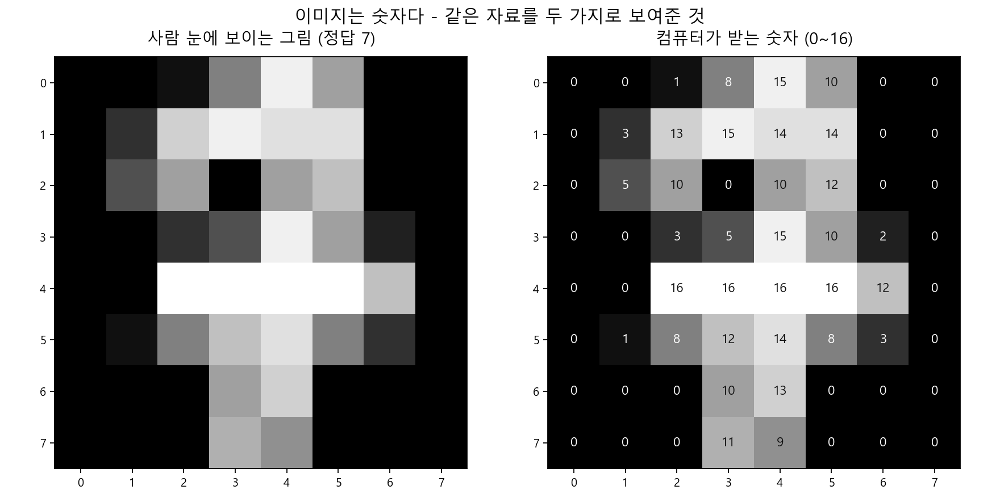
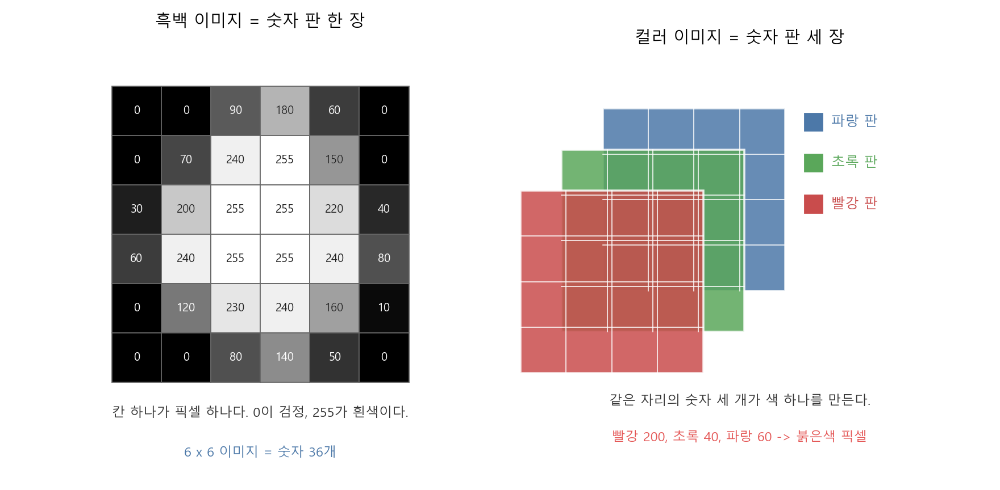
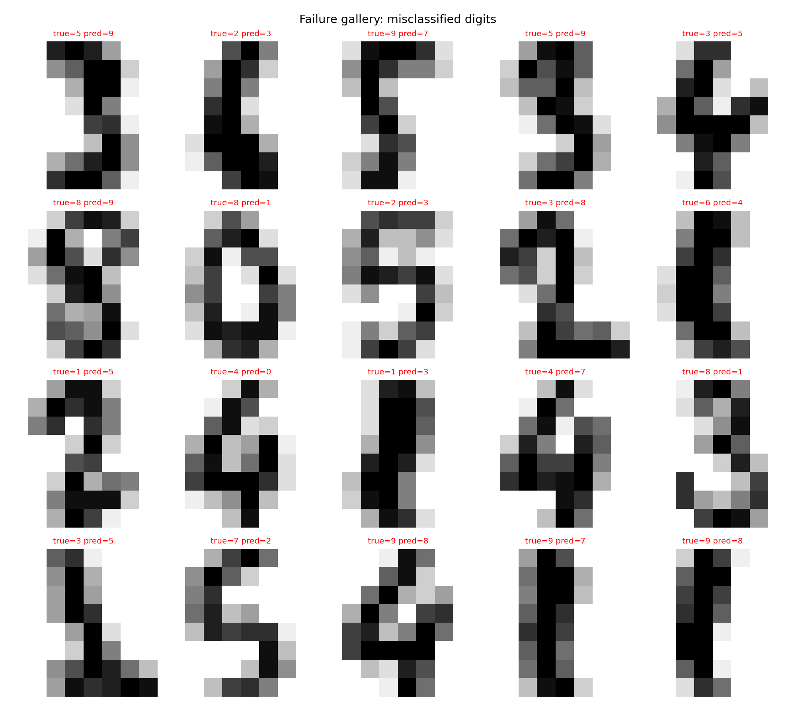
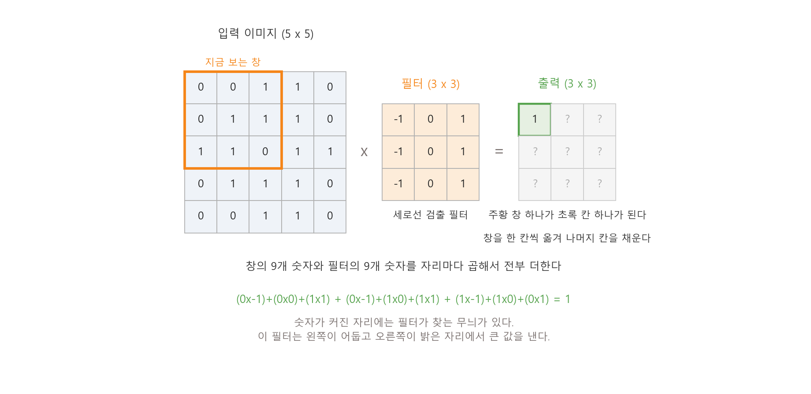
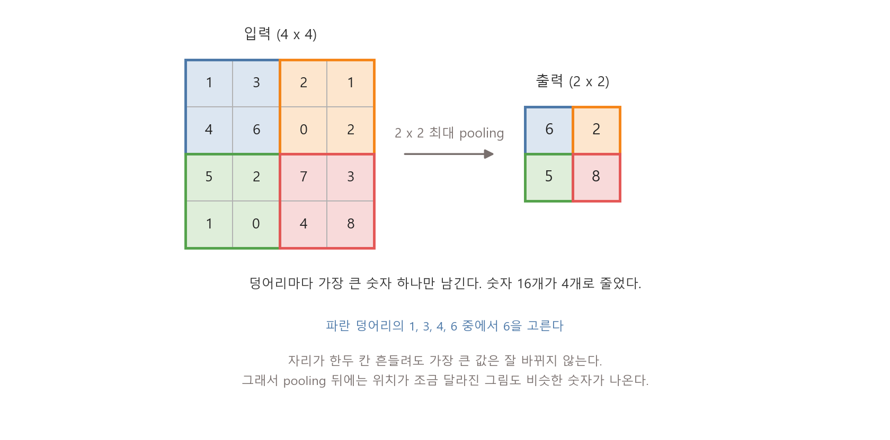

# 제9장 이미지 인식과 CNN — 컴퓨터가 이미지를 보는 방식

---

### 학습 목표

- 이미지 한 장이 컴퓨터에게 어떤 숫자 덩어리인지 설명한다
- 픽셀과 채널을 구분하고, 흑백 이미지와 컬러 이미지가 숫자 판 몇 장인지 말한다
- 이미지를 한 줄로 펴서 넣으면 무엇이 사라지는지 실험 결과로 설명한다
- 3x3 필터로 합성곱을 손으로 한 칸 계산한다
- 풀링(pooling)이 특징맵 크기를 어떻게 줄이는지 설명한다
- CNN의 층 순서를 그리고, 필터의 숫자를 학습으로 찾는다는 뜻을 설명한다
- 컴퓨터 비전의 대표 작업과 발전 과정을 설명한다

지금까지 다룬 데이터는 표였다. 가로줄 하나가 학생 한 명이었고, 세로줄 하나가 공부 시간이나 수면 시간 같은 특징이었다. 이번 장에서는 이미지를 다룬다. 이미지도 결국 숫자지만, 표와 달리 숫자가 **어느 칸에 놓였는지**에 뜻이 있다. 합성곱은 칸의 위치 관계를 살려서 계산하는 방법이고, 합성곱을 층으로 쌓은 신경망이 CNN이다.

이 장은 문제를 먼저 측정하고 해법을 뒤에 둔다. 1~3절에서 이미지를 숫자로 보고 한 줄로 펴서 넣는 방식을 설명한 뒤, 실습 9.1에서 그 방식으로 분류기를 만들어 어디까지 되고 어디서 무너지는지 측정한다. 4절에서 합성곱을 설명하고, 5절에서는 이 계산을 층으로 쌓은 CNN의 구조를 그림으로 보고, 6절에서는 CNN이 쓰이는 컴퓨터 비전 분야를 살펴본다.

○ **합성곱을 직접 계산하는 이유**
  - 딥러닝 라이브러리는 합성곱을 함수 하나로 계산해 주므로, 안에서 무슨 일이 일어나는지 보이지 않는다
  - 4절은 창 하나의 합성곱을 곱셈 아홉 개까지 풀어 보여 준다. 그래서 필터의 숫자가 결과를 어떻게 만드는지 칸 단위로 따라갈 수 있다

### 실행 환경

```bash
cd practice/chapter9
python -m pip install -r ../requirements.txt
```

필요한 패키지는 numpy, pandas, matplotlib, scikit-learn이다. GPU는 필요 없다. 실습은 노트북에서 몇 초 안에 끝난다.

실습 데이터는 `sklearn.datasets.load_digits()`다. 합성 데이터가 아니라 실제 손글씨를 스캔해 만든 공개 데이터이고, scikit-learn 안에 들어 있어서 따로 내려받지 않는다.

---

### 1. 이미지는 숫자다

이미지 파일을 열면 사람은 그림을 보고, 컴퓨터는 숫자를 받는다. 이 장에서 쓰는 데이터는 손글씨 숫자 이미지이고, 한 장의 크기는 8 x 8 픽셀이다.

```text
scikit-learn load_digits() - 실제 손글씨를 스캔해 만든 공개 데이터
이미지 장수: 1797장
이미지 한 장의 크기: 8 x 8 픽셀
채널 수: 1 (흑백이므로 숫자 판이 한 장이다)
픽셀값 범위: 0 ~ 16
이미지 한 장이 숫자 64개다
```

_출처: `practice/chapter9/results/9-1-flatten-classifier.log`_

17번 이미지의 픽셀값을 그대로 찍으면 다음과 같다.

```text
         0    1    2    3    4    5    6    7
     ----------------------------------------
  0 |    0    0    1    8   15   10    0    0
  1 |    0    3   13   15   14   14    0    0
  2 |    0    5   10    0   10   12    0    0
  3 |    0    0    3    5   15   10    2    0
  4 |    0    0   16   16   16   16   12    0
  5 |    0    1    8   12   14    8    3    0
  6 |    0    0    0   10   13    0    0    0
  7 |    0    0    0   11    9    0    0    0
```

_출처: `practice/chapter9/results/9-1-flatten-classifier.log`_

이 숫자 64개가 이미지의 전부다. 0이 검정이고 16이 흰색이다. 4번 줄에서 16이 네 번 이어지는 칸이 밝은 가로획이다. 이 이미지의 정답은 7이다.



**그림 9.1** 왼쪽과 오른쪽은 같은 자료다. 사람은 왼쪽을 보고, 컴퓨터는 오른쪽을 받는다

○ **여기서 확인할 것**
  - 사람이 "7처럼 생겼다"고 느끼는 그림과 컴퓨터가 받는 숫자 64개는 같은 자료다
  - 밝기 차이가 곧 숫자 차이다. 획이 지나간 칸은 값이 크고, 배경 칸은 0이다

---

### 2. 픽셀과 채널

○ **픽셀(pixel)** — 이미지를 이루는 가장 작은 칸 하나
  - 8 x 8 이미지에는 픽셀이 64개 있다
  - 흑백 이미지에서 픽셀 하나는 밝기를 뜻하는 숫자 하나다

○ **채널(channel)** — 같은 크기의 숫자 판이 몇 장 겹쳐 있는가
  - 흑백은 판이 한 장이므로 채널 수가 1이다
  - 컬러는 빨강·초록·파랑 판이 한 장씩 있어서 채널 수가 3이다



**그림 9.2** 같은 위치에 있는 세 판의 숫자 세 개가 색 하나를 만든다

컬러 이미지에서 픽셀 하나의 색을 알려면 숫자를 세 개 봐야 한다. 빨강 판에서 200, 초록 판에서 40, 파랑 판에서 60이면 그 픽셀은 붉은색이다.

이미지가 커지면 숫자 개수는 가로 × 세로 × 채널 수만큼 늘어난다.

**표 9.1** 이미지 크기와 숫자 개수

| 이미지 | 채널 | 숫자 개수 |
|---|---:|---:|
| 8 x 8 흑백 (실습 데이터) | 1 | 64 |
| 28 x 28 흑백 | 1 | 784 |
| 200 x 200 컬러 | 3 | 120,000 |
| 1000 x 1000 컬러 | 3 | 3,000,000 |

---

### 3. 한 줄로 펴서 넣으면 무엇이 사라지는가

5장에서 만든 신경망은 입력을 한 줄로 받았다. 이미지를 그 신경망에 넣으려면 8 x 8을 한 줄로 펴야 한다. 위 줄부터 차례로 이어 붙이면 숫자 64개짜리 한 줄이 된다. 이 작업을 **평탄화**(flatten)라고 부른다.

○ **영상으로 먼저 보기** — [딥러닝 프로젝트] 1강. 합성곱 신경망(CNN) (한빛미디어, 약 11분)
  - 주소: https://www.youtube.com/watch?v=hSUOpeUKqrM
  - 영상 설명란의 목차는 00:43 인공 신경망, 03:45 합성곱 신경망, 09:47 풀링층이다
  - 3절에서는 00:43의 인공 신경망 부분을, 4절을 읽은 뒤에는 03:45 이후를 이어서 본다

#### 3-1. 위아래 이웃이 8칸 떨어진다


**그림 9.3** 주황 칸(4행 2열, 값 16)과 파랑 칸(5행 2열, 값 8)은 그림에서 위아래로 붙어 있다. 한 줄로 펴면 34번과 42번 자리로 가서 8칸 떨어진다

```text
그림에서 위아래로 붙은 두 칸: (4행 2열, 값 16)과 (5행 2열, 값 8)
한 줄로 편 뒤의 자리: 34번과 42번 -> 8칸 떨어진다
```

_출처: `practice/chapter9/results/9-1-flatten-classifier.log`_

가로로 붙은 두 칸은 한 줄에서도 붙어 있다. 위아래로 붙은 두 칸은 한 줄이 8칸이라서 8칸 떨어진다. 그림에서는 같은 획에 속한 두 칸이 한 줄에서는 멀리 놓인다.

#### 3-2. 평탄화 모델은 칸 번호만 안다

평탄화 모델은 64칸을 0번부터 63번까지 번호로만 구별하고, 번호마다 가중치를 따로 둔다. "34번과 42번은 그림에서 위아래 이웃이다"라는 정보는 모델 어디에도 없다. 여기서 세 가지 결과를 예상할 수 있다.

○ **예측 1: 칸 순서를 섞어도 정확도가 거의 같다**
  - 모든 이미지의 칸 순서를 똑같이 섞으면 번호만 바뀌고 값은 그대로 남는다
  - 모델은 바뀐 번호에 맞춰 가중치를 배운다. 사람은 섞인 그림을 알아볼 수 없지만 모델에게는 차이가 없다

○ **예측 2: 그림을 한 칸 밀면 정확도가 무너진다**
  - 7을 오른쪽으로 한 칸 옮겨 써도 사람 눈에는 같은 7이다
  - 모델에게는 번호마다 들어오는 값이 바뀐다. 17번 이미지에서 34번 칸은 획의 밝기 16을 받았는데, 한 칸 밀면 배경의 0을 받는다

○ **문제 3: 이미지가 커지면 가중치가 너무 많아진다**
  - 첫 층 뉴런 하나가 모든 칸과 연결되므로, 가중치 수는 입력 숫자 수 × 뉴런 수다
  - 8 x 8 흑백에 뉴런 32개(실습 9.1의 모델)이면 64 × 32 = 2,048개다
  - 200 x 200 컬러에 뉴런 100개이면 120,000 × 100 = 12,000,000개다

○ **바로 다음 실습 9.1의 설정**
  - 1797장을 훈련 1257장과 테스트 540장으로 나누고, 8 x 8을 편 64개 숫자로 숫자 0~9를 분류한다
  - 정확도와 자주 헷갈린 짝을 본 뒤, 예측 1과 예측 2를 실험으로 확인한다
  - 실험 1은 64칸의 순서를 섞어 모델을 새로 학습한다. 실험 2는 학습이 끝난 모델에 한두 칸 민 테스트 이미지를 넣는다

---

### 실습 9.1: 64개 숫자로 분류하고 한계를 측정한다

#### 실습 목표

- 8 x 8을 한 줄로 편 64개 숫자로 숫자 0~9를 분류하고, 기준선과 비교한다
- 틀린 이미지를 모아 실패 갤러리를 만들고, 어떤 짝이 자주 헷갈리는지 찾는다
- 칸 순서를 섞었을 때와 그림을 밀었을 때 정확도가 어떻게 달라지는지 측정한다

#### 데이터와 모델

`load_digits()` 1797장이다. 모델은 scikit-learn의 `MLPClassifier`이고, 은닉층이 하나인 신경망이다. **CNN이 아니다.** 합성곱 층이 없다.

모델을 만드는 코드는 다음 한 줄이다.

```python
MLPClassifier(hidden_layer_sizes=(32,), max_iter=60, random_state=42)
```

○ **은닉층(hidden layer)이란**
  - 입력(숫자 64개)과 출력(숫자 0~9의 점수 10개) 사이에 있는 층이다. 입력과 출력은 우리가 정하는 값이고, 그 사이의 계산은 모델이 알아서 하므로 밖에서 보이지 않는다는 뜻에서 은닉(hidden, 숨겨진)이라고 부른다
  - 은닉층의 뉴런 하나는 앞 층의 숫자를 전부 받아 하나씩 가중치를 곱해 더한 값 하나를 내보낸다

○ **`hidden_layer_sizes=(32,)`를 읽는 법**
  - 괄호 안의 숫자 하나가 은닉층 하나이고, 숫자의 크기가 그 층의 뉴런 수다. `(32,)`는 "은닉층 1개, 뉴런 32개"다. 숫자가 하나뿐이어도 쉼표를 붙이는 것은 파이썬에서 원소가 하나인 묶음을 쓰는 규칙이다
  - `(64, 32)`라고 쓰면 은닉층이 2개이고 뉴런 수가 64개, 32개다. 숫자를 늘리면 층이 깊어지고, 숫자를 키우면 층이 넓어진다

○ **이 모델의 크기를 숫자로 보면**
  - 층별 뉴런 수는 입력 64 → 은닉 32 → 출력 10이다
  - 연결마다 가중치가 있다. 입력과 은닉층 사이는 64 × 32 = 2,048개, 은닉층과 출력 사이는 32 × 10 = 320개다. 뉴런마다 따로 더하는 값(편향)이 은닉층 32개, 출력층 10개 있어서 학습으로 정하는 숫자는 모두 2,410개다
  - 은닉층 뉴런 수를 바꾸면 이 개수가 바뀐다. 뉴런이 늘수록 모델이 만들 수 있는 모양이 다양해지고, 가중치도 그만큼 늘어난다. 7장 표 7.3에서 신경망의 복잡도 손잡이가 층 수와 뉴런 수라고 한 것이 이 값이다

그림 9.4는 이 모델을 층마다 몇 개만 골라 그린 것이다. 노드 106개를 모두 그리면 선이 겹쳐 읽을 수 없으므로 나머지는 점 세 개로 줄였다.


**그림 9.4** 실습 9.1 모델의 일부. 입력 64개 중 5개, 은닉층 뉴런 32개 중 4개, 출력 10개 중 4개만 그렸다. 주황 선은 은닉층 뉴런 1이 받는 연결이다

#### 실행 명령

```bash
cd practice/chapter9/code
python 9-1-flatten-classifier.py
```

#### 핵심 코드

파일 맨 위에 바꿀 값이 다섯 개 있다.

```python
SAMPLE_INDEX = 17      # 픽셀 표로 볼 손글씨 번호. 0부터 1796까지 넣을 수 있다.
HIDDEN_SIZE = 32       # 은닉층 뉴런 수. 크게 하면 정확도가 오르지만 느려진다.
MAX_ITER = 60          # 학습을 몇 바퀴 돌 것인가.
TEST_RATIO = 0.3       # 테스트로 떼어 둘 비율
GALLERY_SIZE = 12      # 실패 갤러리에 넣을 이미지 장수
```

`HIDDEN_SIZE`는 코드 안에서 `hidden_layer_sizes=(HIDDEN_SIZE,)`로 들어간다. 이 값을 32에서 128로 바꾸면 입력과 은닉층 사이의 가중치는 64 × 128 = 8,192개가 된다.

실험 1은 64칸의 순서를 한 번 정해 훈련과 테스트 모두에 똑같이 적용한 뒤 새로 학습한다.

```python
perm = np.random.default_rng(RANDOM_SEED).permutation(x.shape[1])
model_perm.fit(x_train[:, perm], y_train)
perm_acc = accuracy_score(y_test, model_perm.predict(x_test[:, perm]))
```

실험 2는 다시 학습하지 않는다. 테스트 이미지만 밀어서 원래 모델에 넣는다. 비는 칸은 0(검정)으로 채운다.

```python
shifted = shift_images(img_test, dx, dy)
acc = accuracy_score(y_test, model.predict(flatten(shifted)))
```

_전체 코드는 `practice/chapter9/code/9-1-flatten-classifier.py` 참고_

#### 실행 결과

```text
전체 1797장 = 훈련 1257장 + 테스트 540장
입력: 8x8 이미지를 한 줄로 펴서 숫자 64개

기준선(가장 많은 숫자로만 답하기)            0.102
훈련 데이터                         0.960
테스트 데이터                        0.933
학습 반복 실제 횟수: 60회

테스트 540장 중 틀린 것 36장
```

_출처: `practice/chapter9/results/9-1-flatten-classifier.log`_

```text
hidden_layer_sizes = (32,)
층별 뉴런 수: 64 -> 32 -> 10  (입력 -> 은닉층 -> 출력)
1번째 연결: 가중치 64 x 32 = 2048개, 편향 32개
2번째 연결: 가중치 32 x 10 = 320개, 편향 10개
가중치와 편향을 합한 전체 개수: 2410개
```

_출처: `practice/chapter9/results/9-1-flatten-classifier.log`_

```text
=== 실험 1. 64칸의 순서를 섞어 새로 학습 ===
원래 순서로 학습              0.933
섞은 순서로 학습              0.943
차이: +0.009

=== 실험 2. 테스트 이미지를 밀어서 넣기 (다시 학습하지 않는다) ===
조건                 테스트 정확도
원본                   0.933
오른쪽 1칸               0.439
왼쪽 1칸                0.376
아래 1칸                0.470
오른쪽 2칸               0.152
기준선: 0.102
```

_출처: `practice/chapter9/results/9-1-flatten-classifier.log`_


**그림 9.5** 왼쪽은 원본과 오른쪽으로 1칸 민 이미지다. 오른쪽 막대에서 파랑은 칸 순서만 바꾼 경우, 빨강은 그림을 민 경우의 테스트 정확도다. 점선은 기준선이다

**표 9.2** 자주 헷갈린 짝 (테스트 540장 기준)

| 정답 | 모델 예측 | 건수 |
|---:|---:|---:|
| 8 | 1 | 8 |
| 9 | 7 | 4 |
| 1 | 9 | 4 |
| 1 | 8 | 4 |
| 5 | 9 | 3 |
| 2 | 1 | 2 |

_출처: `practice/chapter9/results/9-1-flatten-classifier.log`_



**그림 9.6** 실패 갤러리. 각 그림 위에 정답과 모델의 예측을 적었다

#### 결과 읽기

○ **평탄화해도 0.933까지 맞힌다**
  - 기준선 0.102는 가장 많은 숫자 하나로만 답했을 때의 정확도다. 정답이 열 가지이고 개수가 고르므로 10분의 1 근처가 나온다
  - 테스트 0.933은 기준선의 아홉 배가 넘는다. 3절의 문제가 있어도 이 데이터에서 평탄화 모델이 쓸모없지는 않다
  - 훈련 0.960과 테스트 0.933의 차이는 0.027이다. 7장에서 본 과적합의 간격이 작은 경우다

○ **예측 1이 맞았다: 순서를 섞어도 정확도가 거의 같다**
  - 원래 순서 0.933, 섞은 순서 0.943이다. 섞은 쪽이 오히려 조금 높다
  - 두 값이 완전히 같지 않은 이유는 학습 시작 때 가중치를 무작위로 정하기 때문이다. 같은 seed라도 칸 번호가 바뀌면 각 칸에 배정되는 처음 가중치가 달라진다
  - 이 결과는 평탄화 모델이 "어느 칸이 어느 칸 옆인가"를 쓰지 않는다는 증거다. 쓰고 있었다면 순서를 섞은 뒤 성능이 떨어졌어야 한다

○ **예측 2도 맞았다: 한 칸만 밀어도 정확도가 반 아래로 떨어진다**
  - 오른쪽 1칸에서 0.439, 왼쪽 1칸에서 0.376, 아래 1칸에서 0.470이다. 원본 0.933의 절반에도 못 미친다
  - 오른쪽 2칸이면 0.152로 기준선 0.102에 가까워진다
  - 밀어서 잘려 나간 밝기는 원인이 아니다. 오른쪽 1칸 밀 때 잘려 나간 밝기 합은 이미지 한 장 평균 1.1이고, 전체 밝기 합 평균은 312.2다. 획은 거의 그대로 남았고 위치만 바뀌었다

○ **틀린 이미지에는 규칙이 있다**
  - 8을 1로 본 것이 8건으로 가장 많다. 그림 9.6의 두 번째 줄 두 번째 그림이 그 예다. 8 x 8까지 줄인 8은 가운데 세로 획만 굵게 남는 경우가 있다
  - 1·8·9·7이 서로 섞인다. 1을 9로 4건, 1을 8로 4건, 9를 7로 4건 틀렸다. 네 숫자 모두 가운데에 긴 세로 획이 있다
  - 표 9.2에서 보듯 틀린 건수는 특정 짝에 몰려 있다. 정확도 0.933이라는 숫자 하나로는 이 사실이 보이지 않는다. 4장에서 혼동행렬을 배운 이유가 여기서 다시 나온다

#### 학습 중 나온 경고

로그에 경고가 하나 찍힌다. 지우지 않고 그대로 뒀다.

```text
[ConvergenceWarning] Stochastic Optimizer: Maximum iterations (60) reached and the optimization hasn't converged yet.
```

_출처: `practice/chapter9/results/9-1-flatten-classifier.log`_

`MAX_ITER = 60`으로 작게 잡아서 나온 경고다. 학습이 아직 끝나지 않았는데 반복 횟수를 다 썼다는 뜻이다. 수업 시간 안에 끝나는 것을 우선해 이 값을 작게 뒀다.

#### 해 보기

1. `SAMPLE_INDEX`를 0, 1, 2로 바꿔 다른 숫자의 픽셀 표를 본다. 0과 1은 숫자 64개의 배치가 어떻게 다른가
2. `MAX_ITER`를 300으로 올린다. 경고가 사라지는가. 원본 정확도와 1칸 민 정확도는 각각 얼마가 되는가
3. `HIDDEN_SIZE`를 128로 올린다. 모델을 키우면 1칸 민 이미지의 정확도도 회복되는가
4. `GALLERY_SIZE`를 20으로 올려 실패 갤러리를 넓게 본다. 8을 1로 본 이미지가 몇 장 들어오는가

○ 2번과 3번은 같은 질문이다. **학습을 더 하거나 모델을 키우는 것으로 위치 문제가 풀리는가.** 결과를 확인한 뒤 4절로 넘어간다

---

### 4. 합성곱 신경망(CNN)의 계산

평탄화 모델은 칸 번호마다 따로 가중치를 배운다. 그래서 실습 9.1에서 그림을 한 칸 밀자 정확도가 0.933에서 0.439로 떨어졌다. **합성곱 신경망**(Convolutional Neural Network, CNN)은 작은 필터 하나를 이미지의 모든 위치에 같은 방식으로 적용한다. CNN의 핵심은 **어떤 필터를 쓸지를 사람이 정하지 않고 학습으로 찾는다**는 데 있다.

#### 4-1. 합성곱 연산

**필터**(filter, 커널이라고도 부른다)는 3 x 3이나 5 x 5 크기의 작은 숫자 판이다. **합성곱**(convolution)은 필터를 이미지 위에 겹쳐 놓고, 겹친 숫자끼리 곱해서 전부 더하는 계산이다.



**그림 9.7** 주황 창 안의 숫자 아홉 개와 필터의 숫자 아홉 개를 위치마다 곱해 더하면, 출력 칸 하나가 채워진다. 그림의 5 x 5 입력은 설명용으로 손으로 고른 값이다

1. 이미지 왼쪽 위에서 필터 크기만 한 창을 하나 떼어 낸다
2. 창의 숫자와 필터의 숫자를 **위치마다** 곱한 뒤 전부 더한다
3. 그 합을 출력 칸 하나에 적고, 창을 옆으로 옮겨 반복한다

아래는 1절의 17번 이미지에서 2행 2열부터 시작하는 창에 세로선 필터를 씌운 결과다.

```text
  이미지 창          필터            곱한 값
    10    0   10   x    -1.0   0.0   1.0   =    -10.0    0.0   10.0
     3    5   15   x    -1.0   0.0   1.0   =     -3.0    0.0   15.0
    16   16   16   x    -1.0   0.0   1.0   =    -16.0    0.0   16.0

  더하기: (10x-1) + (0x0) + (10x1) + (3x-1) + (5x0) + (15x1) + (16x-1) + (16x0) + (16x1)
        = 12.0
```

_출처: `practice/chapter9/results/9-2-filter-and-pooling.log`_

#### 4-2. 특징맵

창을 왼쪽 위에서 오른쪽으로 한 칸씩 옮기고, 줄 끝에 닿으면 한 줄 내려가 다시 옮긴다. 창 하나가 출력 칸 하나를 채우며, 이렇게 채운 출력 판을 **특징맵**(feature map)이라 부른다. 필터가 찾는 무늬가 있는 곳에서 특징맵의 값이 커진다.


**그림 9.8** 윗줄의 주황 창 하나가 아랫줄의 초록 칸 하나가 된다. 1번째·2번째·6번째·36번째 창을 골라 그렸다

○ 창이 이미지 밖으로 나가지 않으면 `출력 크기 = 입력 크기 - 필터 크기 + 1`이다. 8 x 8에 3 x 3 필터를 쓰면 8 - 3 + 1 = 6이므로 특징맵은 6 x 6이다

○ 36개 위치 모두에 같은 필터를 쓴다. 무늬가 옮겨 가면 특징맵에서 큰 값이 나오는 칸도 함께 옮겨 간다. 이미지가 커져도 필터의 숫자는 아홉 개 그대로다

#### 4-3. 합성곱 뒤의 ReLU

합성곱 결과에는 음수도 나온다. CNN은 특징맵에 5장에서 본 ReLU를 적용해 음수를 0으로 바꾸고 양수는 그대로 둔다. 그러면 필터가 찾는 무늬가 있는 칸의 값만 남는다.

#### 4-4. 보폭과 패딩

○ **보폭**(stride) — 창을 한 번에 옮기는 칸 수다. 보폭이 1이면 한 칸씩, 2이면 한 칸씩 건너뛰며 옮긴다. 보폭을 키우면 특징맵이 작아진다

○ **패딩**(padding) — 이미지 가장자리를 처리하는 방법이다. 두 가지를 쓴다
  - **valid**: 창을 이미지 안에서만 움직인다. 특징맵이 입력보다 작아진다(8 x 8 → 6 x 6)
  - **same**: 이미지 둘레를 0 같은 값으로 채운 뒤 계산해서, 특징맵을 입력과 같은 크기로 맞춘다

이 장의 계산은 보폭 1, valid다.

#### 4-5. 필터가 여러 개일 때

필터 하나는 특징맵 한 장을 만든다. 필터를 4개 쓰면 같은 이미지에서 특징맵 4장이 나온다. 필터마다 숫자가 다르므로 세로선, 가로선처럼 서로 다른 무늬를 찾는다.

#### 4-6. 풀링

**풀링**(pooling)은 특징맵의 크기를 줄이는 계산이다. 가장 많이 쓰는 **최대 풀링**(max pooling)은 겹치지 않는 2 x 2 덩어리마다 가장 큰 값 하나만 남긴다.



**그림 9.9** 2 x 2 덩어리마다 최댓값 하나만 남긴다. 숫자 16개가 4개로 줄었다. 그림의 숫자는 설명용으로 손으로 고른 값이다

○ 6 x 6 특징맵에 2 x 2 풀링을 하면 3 x 3이 된다. 칸 수가 36에서 9로 줄어 뒤 층의 계산이 빨라진다

○ 강한 반응이 덩어리 안에서 한 칸 옮겨 가도 최댓값은 같다. 그래서 그림이 조금 움직여도 결과가 덜 바뀐다

---

### 5. CNN의 전체 구조

CNN은 합성곱층과 풀링층을 번갈아 쌓고, 마지막에 완전연결층을 둔다. 앞부분은 이미지에서 특징을 뽑고, 뒷부분은 뽑은 특징으로 분류한다.


**그림 9.10** 8 x 8 입력에 필터 4개를 쓰는 작은 CNN의 개념 도식이다. 판의 크기는 8 → 6 → 3으로 줄고, 판의 장수는 1 → 4로 는다

```
8 x 8 입력 → 합성곱(필터 4개) → 6 x 6 특징맵 4장 → ReLU → 2 x 2 풀링 → 3 x 3 판 4장
           → 펴기 → 숫자 36개 → 완전연결층 → 숫자 0~9의 점수 10개
```

○ **합성곱층** — 필터 여러 개로 특징맵을 만들고 ReLU를 적용한다(4-1~4-5)

○ **풀링층** — 특징맵의 크기를 줄인다(4-6)

○ **펴기**(flatten) — 풀링층에서 나온 판 여러 장을 숫자 한 줄로 편다. 3 x 3 판 4장은 숫자 36개가 된다

○ **완전연결층** — 펴 놓은 숫자 전부를 받아 숫자 0~9의 점수를 낸다. 실습 9.1의 은닉층처럼 앞 층의 숫자를 전부 받아 가중치를 곱해 더하는 층이다

○ **학습** — 6장의 역전파로 손실을 줄이는 방향으로 가중치를 고친다. CNN에서 고치는 가중치는 합성곱층의 필터 숫자와 완전연결층의 가중치다. 4-1의 세로선 필터는 사람이 정했지만, CNN은 이 숫자를 데이터에서 찾는다

**표 9.3** 3절의 문제와 CNN이 쓰는 방법

| 평탄화 방식의 문제 | 실습에서 확인한 것 | 합성곱·풀링이 하는 일 |
|---|---|---|
| 칸 사이의 이웃 관계를 쓰지 않는다 | 순서를 섞어도 0.933 → 0.943 | 3 x 3 창으로 붙어 있는 칸끼리만 묶어 계산한다 |
| 위치가 밀리면 배운 것을 쓰지 못한다 | 1칸 밀면 0.933 → 0.439 | 같은 필터를 모든 위치에 쓰므로 결과가 그림과 함께 옮겨 가고, 풀링이 작은 이동을 지운다 |
| 이미지가 커지면 가중치가 폭증한다 | 8 x 8에서도 첫 층 가중치 2,048개 | 필터 하나의 숫자는 9개이고, 이미지가 커져도 그대로다 |

_출처: `practice/chapter9/results/9-1-flatten-classifier.log`_

표 9.3의 오른쪽 열은 합성곱과 풀링의 계산 구조에서 나오는 성질이며, 학습을 마친 CNN의 정확도로 확인한 값이 아니다. 실제 CNN 학습에는 PyTorch나 TensorFlow 같은 딥러닝 라이브러리를 쓴다.

---

### 6. 컴퓨터 비전

**컴퓨터 비전**(computer vision)은 컴퓨터가 이미지와 영상에서 정보를 얻게 하는 분야다. 이 장에서 다룬 손글씨 숫자 분류도 컴퓨터 비전 문제이고, CNN은 이 분야에서 가장 널리 쓰인 모델이다.

#### 6-1. 컴퓨터 비전이 하는 일

같은 사진을 넣어도 무엇을 출력하게 하느냐에 따라 작업이 달라진다.


**그림 9.11** 같은 장면을 넣었을 때 네 작업이 내놓는 출력이다. 분류는 사진 전체에 이름표 하나, 검출은 물체마다 상자 하나, 분할은 픽셀마다 이름표 하나, 설명 생성은 문장 하나를 낸다. 장면은 설명용으로 손으로 그린 도형이다

**표 9.4** 컴퓨터 비전의 대표 작업

| 작업 | 컴퓨터가 내놓는 것 | 예 |
|---|---|---|
| 이미지 분류 | 이미지 한 장에 이름표 하나 | 손글씨 숫자 0~9 맞히기(실습 9.1) |
| 객체 검출(object detection) | 물체마다 위치를 표시한 상자와 이름표 | 도로 사진에서 자동차와 사람 찾기 |
| 영상 분할(segmentation) | 픽셀마다 이름표 | 의료 영상에서 병변 영역 칠하기 |
| 이미지 설명 생성(captioning) | 이미지를 설명하는 문장 | 사진을 보고 "공원에서 개가 뛰고 있다"라고 쓰기 |

이미지 설명 생성처럼 다른 신경망과 함께 쓰는 경우도 많다. 이미지를 읽는 일은 CNN이 맡고, 문장을 만드는 일은 순환 신경망 같은 문장용 모델이 맡는다. 바둑 프로그램 알파고도 바둑판을 19 x 19 이미지처럼 읽는 데 CNN을 썼다.

